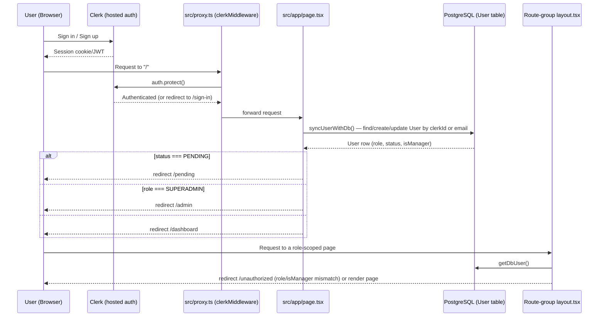
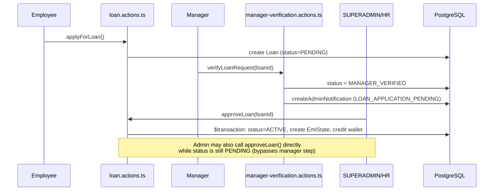
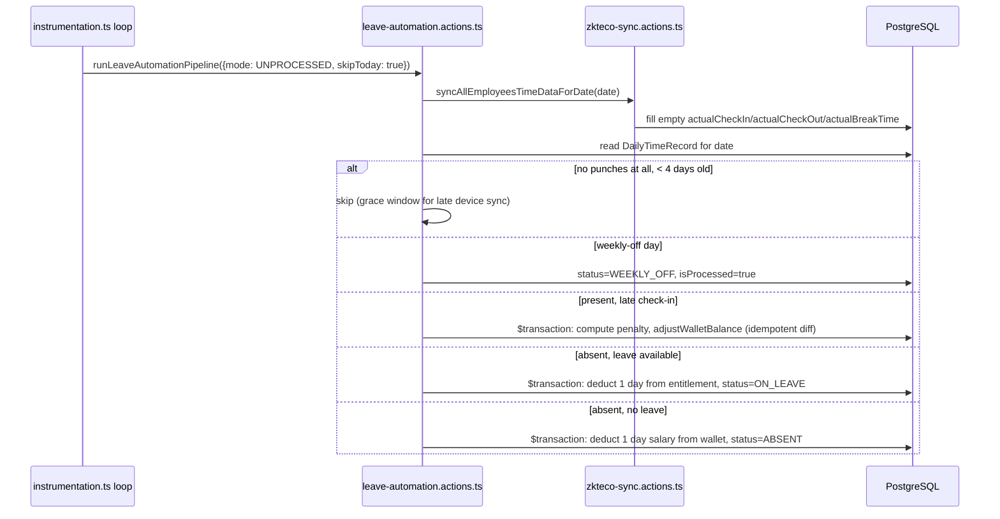
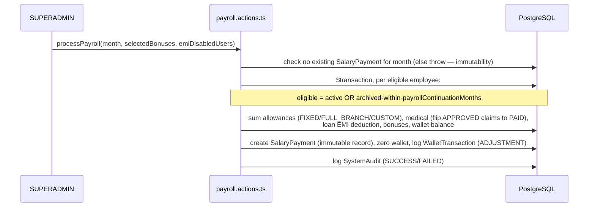

# ARCHITECTURE.md

System architecture of Bit HR, reverse-engineered from `src/`, `prisma/`, `docker-compose.yml`, and `.github/workflows/deploy.yml`.

See also: [CLAUDE.md](CLAUDE.md) (conventions), [DATABASE.md](DATABASE.md) (schema), [API.md](API.md) (routes), [DECISIONS.md](DECISIONS.md) (why).

## Table of Contents

- [Application Layers](#application-layers)
- [Request Flow](#request-flow)
- [Authentication Flow (Sequence)](#authentication-flow-sequence)
- [Authorization / Route Gating](#authorization--route-gating)
- [Database Flow](#database-flow)
- [Business Logic Organization](#business-logic-organization)
- [Background Jobs / Cron Architecture](#background-jobs--cron-architecture)
- [Configuration Loading](#configuration-loading)
- [Dependency Flow](#dependency-flow)
- [File Organization](#file-organization)
- [Design Patterns Observed](#design-patterns-observed)
- [Key Sequence Diagrams](#key-sequence-diagrams)

## Application Layers

```
┌─────────────────────────────────────────────────────────────────┐
│  Browser (React 19 client components + Server Components)        │
├─────────────────────────────────────────────────────────────────┤
│  Next.js 16 App Router                                            │
│   ├─ src/proxy.ts            (Clerk middleware / route protection)│
│   ├─ src/app/**/layout.tsx    (role-based redirect gate)          │
│   ├─ src/app/**/page.tsx      (Server Components, data fetch)     │
│   └─ src/app/api/**/route.ts  (Route Handlers — webhooks/cron/REST)│
├─────────────────────────────────────────────────────────────────┤
│  Server Actions layer — src/actions/*.ts ("use server")           │
│   34 files, one per business domain, called from both server      │
│   and client components                                           │
├─────────────────────────────────────────────────────────────────┤
│  Thin service layer — src/lib/services/*.service.ts                │
│   email.service.ts / loan.service.ts / medical.service.ts /        │
│   zkteco.service.ts — calculation + external HTTP concerns only    │
├─────────────────────────────────────────────────────────────────┤
│  Prisma Client (singleton, src/lib/prisma.ts)                      │
├─────────────────────────────────────────────────────────────────┤
│  PostgreSQL 17                                                      │
└─────────────────────────────────────────────────────────────────┘
```

There is no separate backend process. "Controllers" are the `page.tsx`/`route.ts` files; "services/repositories" in the classic sense do not exist — see [CLAUDE.md](CLAUDE.md)'s Backend Patterns section for what actually replaces them.

## Request Flow

1. Every request first passes through `src/proxy.ts` (Next.js 16's middleware file — the framework renamed `middleware.ts` to `proxy.ts` in v16; functionally identical to Next.js Middleware). It runs `clerkMiddleware` and calls `auth.protect()` for any route that isn't `/sign-in(.*)` or `/sign-up(.*)`, redirecting unauthenticated users to Clerk's sign-in.
2. For page requests, the matching route-group `layout.tsx` (`(admin)`, `(manager)`, or `(employee)`) runs as a Server Component: calls `getDbUser()`, then redirects to `/sign-in`, `/pending`, or `/unauthorized` based on `status`/`role`/`isManager` (see [Authorization / Route Gating](#authorization--route-gating)).
3. The `page.tsx` itself (also a Server Component in nearly every route observed) calls one or more `src/actions/*.ts` functions directly (no `fetch`, no internal HTTP hop) and passes the result as props into client components.
4. Client components (`"use client"`) that need to mutate data import the same Server Action functions and invoke them directly from event handlers (e.g. button `onClick`) — Next.js serializes the call over its RPC-like Server Actions transport automatically.
5. Server Actions call `prisma` (directly or via a `src/lib/services/*` helper), optionally wrap multi-step writes in `prisma.$transaction`, call `revalidatePath()` for affected routes, and return a plain result object.
6. For non-page traffic (webhooks, cron triggers, small JSON endpoints), `src/app/api/**/route.ts` Route Handlers are used instead of Server Actions, because they need standard HTTP verbs/headers/status codes that Server Actions don't expose (e.g. svix header verification, bearer-token cron auth). Full list in [API.md](API.md).

## Authentication Flow (Sequence)



Clerk webhooks (`POST /api/webhooks/clerk`) provide a second, asynchronous path that keeps the `User` row in sync with Clerk on `user.created`/`user.updated`/`user.deleted`, independent of the user actually visiting the app. See [API.md](API.md).

## Authorization / Route Gating

| Route group | Layout file | Required to enter |
|---|---|---|
| `(admin)` | `src/app/(admin)/layout.tsx` | `status === "APPROVED"` and `role === "SUPERADMIN"` |
| `(manager)` | `src/app/(manager)/layout.tsx` | `status === "APPROVED"` and `role === "EMPLOYEE"` and `isManager === true` |
| `(employee)` | `src/app/(employee)/layout.tsx` | `status === "APPROVED"` (any role/manager combination) |

Layout gating is a UX convenience only — the real authorization boundary is inside every `src/actions/*.ts` function, each of which re-derives the caller and checks role/`isManager` itself (see [CLAUDE.md](CLAUDE.md)). This matters architecturally because Server Actions are independently invocable network endpoints; a page-level redirect does not stop a direct action call.

## Database Flow

- All access goes through the Prisma singleton (`src/lib/prisma.ts`). No connection pool tuning beyond Prisma's default; no read replicas; no caching layer (no Redis/memcached found in the repo).
- Multi-write mutations (money, leave balances, EMI state, status transitions with side effects) are wrapped in `prisma.$transaction(async (tx) => { ... })`. This is the closest thing to a "unit of work" pattern in the codebase.
- Two raw-SQL aggregate queries exist (`dashboard.actions.ts`, via `prisma.$queryRaw`/`Prisma.sql`) for medical-claims-vs-entitlements and leave-utilization reporting; everything else uses Prisma's query builder.
- No migrations run automatically in dev; in Docker/production the container's start command runs `npx prisma migrate deploy` before `npm start` (see `Dockerfile`).

## Business Logic Organization

Grouped by domain file in `src/actions/`. Full function-by-function detail is out of scope for this file (see the domain-specific pages linked below); the important architectural facts:

- **Loans** (`loan.actions.ts`, `manual-loan.actions.ts`, `manager-verification.actions.ts`, `src/lib/services/loan.service.ts`): loan → EMI schedule → monthly-batch deduction, with a manager-verification pre-approval step. EMI recalculation formula: `EMI = round((remainingPrincipal + carryForward) / remainingMonths)`. Payment waterfall: carryForward → currentEmi → principal (see `processLoanPayment` in `loan.service.ts`).
- **Overtime** (`overtime-request.actions.ts`, `overtime.actions.ts`): per-request approval (also manager-verified) feeds `DailyTimeRecord.requestedOvertime`; a separate **year-end payout** action (`applyOvertimePayout`) converts a whole year's accumulated overtime/undertime plus unused renewable leave into a one-time wallet credit, using `perMinuteSalary = baseSalary / workingDaysInMonth / dailyWorkingMinutes`.
- **Leave** (`leave.actions.ts`, `leave-automation.actions.ts`, `leave-board.actions.ts`): leave types/entitlements/applications are user-driven; `leave-automation.actions.ts` is the nightly batch job that finalizes each day's attendance outcome (present/absent/auto-leave/weekly-off) and reconciles late-checkin wallet penalties — see [Background Jobs](#background-jobs--cron-architecture).
- **Timeline/Attendance** (`timeline.actions.ts` — the largest action file at ~2,700 lines — plus `zkteco-sync.actions.ts`, `timeline-modification-request.actions.ts`, `late-checkin.actions.ts`, `availability.actions.ts`): generates/backfills daily attendance records, computes required vs. actual active time and overtime/undertime, syncs punches from the ZKTeco biometric device, and lets employees request corrections (reviewed by admin or manager).
- **Payroll & Wallet** (`payroll.actions.ts`, `salary.actions.ts`, `wallet.actions.ts`): monthly payroll run computes `netPay = baseSalary + allowances + medicalReimbursement − loanDeduction`, then adds selected bonuses and the employee's wallet balance; payroll for a given month is immutable once run (a second run for the same month throws). `wallet.actions.ts`'s `adjustWalletBalance` is the shared ledger primitive used by many other domains (late penalties, absence penalties, OT/UT payouts) to move money.
- **Medical** (`medical.actions.ts`, `src/lib/services/medical.service.ts`): annual entitlement auto-created per user/year from the global `SystemSettings.medicalClaimLimit`; claims exceeding the remaining balance are auto-rejected at submission time.
- **Organization** (`branch.actions.ts`, `department.actions.ts`, `designation.actions.ts`, `bonus.actions.ts`, `settings.actions.ts`): CRUD for the org hierarchy and pay-component configuration (allowances, bonuses), all gated by the shared `canManageOrganization` check (SUPERADMIN or manager) and audited via `manager-organization.actions.ts` when a manager performs the change.
- **Role management** (`role-management.actions.ts`, `role-management-client.actions.ts`): SUPERADMIN-only; the underlying model is "manager is just `EMPLOYEE` + `isManager: true`," not a separate role.
- **Notifications & Breaking Notices** (`notification.actions.ts`, `breaking-notice.actions.ts`): `AdminNotification` is the central admin-facing inbox (also has a generic `handleNotificationAction` dispatcher that dynamically imports the relevant domain action to approve/reject from the notification UI); `EmployeeNotification` is the employee-facing equivalent; `BreakingNotice`/`BreakingNoticeRecipient` implement versioned org/branch/individual announcements with per-recipient seen-tracking.
- **System Control & Email Config** (`system-control.actions.ts`, `email-config.actions.ts`): DB-backed runtime configuration for cron schedules and ZKTeco/SMTP credentials, with a full change-history log (`SystemControlChangeLog`) and sensitive-field redaction for non-privileged viewers.

## Background Jobs / Cron Architecture

There is no external job queue (no BullMQ/Redis/etc.) and the `node-cron` dependency in `package.json` is unused (no import found). Instead, `src/instrumentation.ts` exports a Next.js `register()` instrumentation hook that — only when `process.env.NEXT_RUNTIME === "nodejs"` — starts three self-scheduling `setInterval(..., 60_000)` loops directly inside the Next.js server process:

```mermaid
flowchart TD
    A[Server boot: instrumentation.register()] --> B[startDailyTimelineCron]
    A --> C[startZKTecoSyncCron]
    A --> D[startLeaveAutomationCron]
    B -->|every 60s, checks SystemControlSettings.timelineCronHour/Minute + appTimezone| E[checkAndGenerateToday]
    C -->|every 60s, DAILY or INTERVAL mode from SystemControlSettings| F{ZKTeco base URL reachable?}
    F -->|yes| G[syncAllEmployeesTimeData]
    F -->|no| H[skip this tick, log warning]
    D -->|every 60s, checks SystemControlSettings.leaveAutomationCronHour/Minute| I[runLeaveAutomationPipeline]
```

- Each loop reads its enabled flag and target hour/minute from the singleton `SystemControlSettings` row (`getRuntimeSystemControlConfig()`), **not** from environment variables directly — env vars (`CRON_TIMELINE_HOUR`, etc.) only seed the row's defaults on first creation.
- Each loop uses a `lastRunDate` closure variable to guarantee at-most-once-per-day execution in DAILY mode; the ZKTeco loop additionally supports an INTERVAL mode (run every N minutes, gap measured from the previous run's finish time) and a single-flight `isSyncRunning` lock so overlapping runs are impossible.
- A global flag on `globalThis` (`__dailyTimelineCronStarted`, etc.) prevents the loops from being started more than once if `register()` is invoked multiple times (e.g. by Next.js's dev-mode module reloading).
- `src/app/api/cron/*` Route Handlers exist as an **alternative** external trigger for the same underlying actions (e.g. for an external cron service to call over HTTP with a bearer token), independent of the in-process loops — both mechanisms can run the same logic; see [API.md](API.md) and [DECISIONS.md](DECISIONS.md).

## Configuration Loading

Three tiers, in order of precedence for cron/ZKTeco/email settings:
1. **Database** (`SystemControlSettings`, `EmailConfig` — both singleton rows with `id: "global"`) — the authoritative runtime source, editable via the admin System Control UI.
2. **Environment variables** (`.env`) — used only as the seed values when the DB row is first created (`getOrCreateSystemControlSettings`/`getOrCreateEmailConfig` `upsert` with `create: { ...envDefaults }`, `update: {}`).
3. **Hard-coded fallbacks** in `getEnvDefaults()`/`getDefaults()` if an environment variable is absent.

Clerk and database connection configuration (`DATABASE_URL`, `CLERK_*`) remain purely environment-variable-driven (no DB-backed override, for obvious bootstrapping reasons).

## Dependency Flow

```
src/app/**/page.tsx  ─┐
src/components/**    ─┼──> src/actions/*.ts ──> src/lib/services/*.ts ──> src/lib/prisma.ts ──> PostgreSQL
src/app/api/**       ─┘                     └──> src/lib/*.ts (helpers, no prisma dependency except email-config.ts/system-control.ts)

src/proxy.ts ──> @clerk/nextjs/server (independent of the above; runs before everything)
src/instrumentation.ts ──> src/actions/{timeline,zkteco-sync,leave-automation}.actions.ts + src/lib/system-control.ts
```

No circular dependency between `src/actions/*` files was specifically audited, but cross-imports between action files are common and expected (e.g. `employee.actions.ts` imports `notification.actions.ts` and `manager-employee-edit.actions.ts`; `notification.actions.ts` dynamically imports `profile.actions.ts`/`leave.actions.ts` inside `handleNotificationAction`).

## File Organization

See [README.md](README.md#folder-structure) for the annotated tree. Architecturally significant points not obvious from the tree alone:
- Route groups `(admin)`, `(manager)`, `(employee)` share no layout code but do share the same `AppSidebar`/`Header` components (parameterized by `role`/`isManager` props) for admin and employee; manager has its own dedicated `ManagerSidebar`/`ManagerHeader`.
- `src/app/(admin)/employees/[id]/...` (outside `/admin/`) and `src/app/(admin)/admin/employees/[id]/...` both exist — two employee-detail route trees under the same `(admin)` group. "Not found in current project": the specific reason both exist (likely a legacy path superseded by `/admin/employees`, but this is not confirmed in code comments or commit messages).
- `src/components/admin/timeline-types.ts` is a lone `.ts` (non-component) file living in a components folder — a shared type-definitions file for the admin timeline feature.

## Design Patterns Observed

| Pattern | Where | Notes |
|---|---|---|
| Singleton | `src/lib/prisma.ts` (`globalThis` cache), `src/lib/services/*.service.ts` (module-level exported instances) | Standard Next.js dev-reload-safe Prisma singleton; services are plain singletons with no DI container. |
| Unit of Work (via `$transaction`) | Any money/leave/status mutation | See Database Flow above. |
| Strategy-ish via enum + scope field | `AllowanceType.scope` (`FIXED`/`FULL_BRANCH`/`CUSTOM`), `BreakingNotice.targetType` (`ALL_EMPLOYEES`/`SINGLE_EMPLOYEE`/`SINGLE_BRANCH`) | Behavior branches on a stored enum value rather than polymorphic classes. |
| Audit log / event sourcing (partial) | `AuditLog`, `LeaveAuditLog`, `SystemControlChangeLog`, `TimelineModificationActionLog` | Four distinct, non-unified audit-log tables, each scoped to one domain rather than a single generic audit table — see [DECISIONS.md](DECISIONS.md). |
| Idempotent reconciliation | `leave-automation.actions.ts` (late-penalty wallet reconciliation), `timeline.actions.ts` (reversing/re-applying wallet+leave effects on status edit) | Effects are computed as diffs against previously-applied amounts (looked up via tagged `WalletTransaction.description` strings) so re-running the same day/edit doesn't double-charge. |
| Feature-flag-like runtime config | `SystemControlSettings` | Enables/disables and retimes each cron loop without a redeploy. |

## Key Sequence Diagrams

### Loan approval (two-step manager verification)



### Daily attendance automation (nightly cron)



### Monthly payroll run


