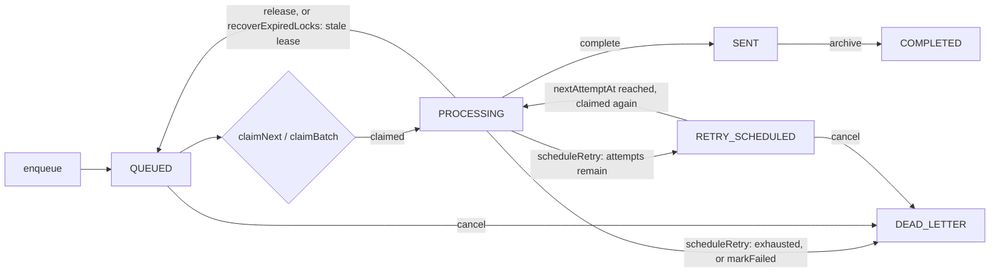
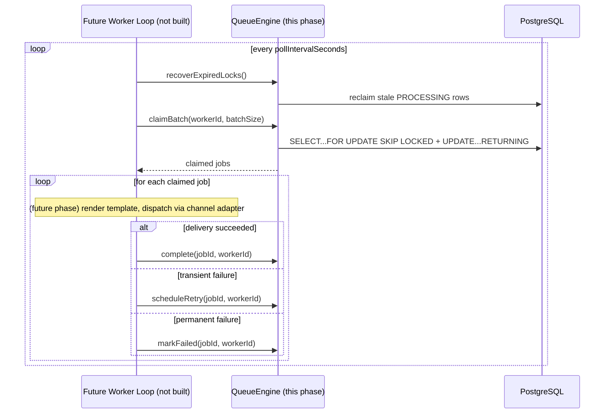

# Notification Queue Engine Report (Phase 3)

**Scope:** Queue persistence, job lifecycle, atomic locking, idempotency, retry-eligibility calculation, crash-recovery primitives, and queue state transitions — **only**. No SMTP, no worker loop, no `instrumentation.ts` integration, no cron, no email sending, no Google Drive, no PDF generation, no template rendering, no business-module integration. Verified by `tsc --noEmit` (strict, whole project, zero errors), `eslint` (zero issues), and 54 passing unit tests (zero touching the live database).

**Inputs (frozen, unchanged in behavior by this phase):** [NotificationEngineDesign.md](NotificationEngineDesign.md), [DatabaseImplementationReport.md](DatabaseImplementationReport.md), [MigrationRecoveryReport.md](MigrationRecoveryReport.md), [NotificationEngineDatabaseAudit.md](NotificationEngineDatabaseAudit.md), [CoreInfrastructureReport.md](CoreInfrastructureReport.md).

---

## Architecture Compliance

Everything in this phase lives under the same isolated bounded-context folder Phase 2 established (`src/lib/services/notification-engine/`), in a new `queue/` subfolder — no new top-level location, consistent with Design §21's frozen folder plan and CoreInfrastructureReport.md's own reasoning for keeping this divergence contained.

**Two deliberate, disclosed departures from a literal reading of the frozen documents, neither of which is a redesign:**

1. **Enum naming.** This phase's own prompt describes the lifecycle using the label `RETRY_PENDING`. The frozen schema (Phase 1, [DatabaseImplementationReport.md](DatabaseImplementationReport.md)) and design doc (§5/§23) use `RETRY_SCHEDULED`. **This implementation uses the real, already-frozen enum value `RETRY_SCHEDULED`** — inventing or renaming an enum member would itself be a schema change (forbidden: "Do NOT redesign anything"). `RETRY_PENDING` is treated as this phase's informal label for the same state, not a new value.
2. **Two administrative/consolidation choices not spelled out as their own enum-level states in the frozen design, both using existing enum values rather than adding new ones:**
   - **`cancel()`** — the frozen design has no `CANCELLED` state. `cancel()` transitions `QUEUED`/`RETRY_SCHEDULED` → `DEAD_LETTER` (the existing "will not be delivered" terminal bucket). Documented in `queue-state-machine.ts`'s own comment; flagged here so it isn't mistaken for a hidden assumption.
   - **`markFailed()`'s cascade** — Design §16 states "recipient-level permanent failures... skip straight to dead letter" and §23's own state diagram shows `FAILED --> DEAD_LETTER: always`. Nothing in the frozen design describes any behavior while a job independently rests in `FAILED`. This implementation therefore persists `markFailed()`'s result as `DEAD_LETTER` directly (the unconditional, immediate end-state), rather than requiring a second call to move `FAILED` onward. `FAILED` remains a valid, real enum value (used by `QueueStateMachine.canTransition("FAILED", "DEAD_LETTER")` and included in `countFailures()`), it's just not written as an intermediate row by this engine.

**One additive, backward-compatible fix to Phase 2 code** (`repositories/base.repository.ts`): `BaseRepository.wrap()` originally special-cased only `RepositoryError` (`if (error instanceof RepositoryError) throw error;`), because no other repository threw any other `NotificationError` subclass yet. This phase's `QueueRepository` deliberately throws `DuplicateJobError`/`InvalidQueueTransitionError` (both `QueueError` subclasses, per the exact error hierarchy Phase 2 already established) from inside a `wrap()` callback — without broadening the check, `wrap()` would have incorrectly re-wrapped those into a generic `RepositoryError`, destroying the specific type every caller needs to `instanceof`-check. The check was widened to `instanceof NotificationError` (the common abstract base). This is strictly more permissive than before and changes no existing behavior for any Phase 2 caller — `RepositoryError` still passes through exactly as it did.

No other Phase 1 or Phase 2 file was modified. `NOTIFICATION_ENGINE_DEFAULTS` gained one new, purely additive namespace (`queue: { defaultLeaseDurationMs, maxBatchSize }`) — no existing field changed.

---

## State Machine

```mermaid
stateDiagram-v2
    [*] --> QUEUED : enqueue()
    QUEUED --> PROCESSING : claimNext()/claimBatch()
    QUEUED --> DEAD_LETTER : cancel()
    PROCESSING --> SENT : complete()
    PROCESSING --> RETRY_SCHEDULED : scheduleRetry() (attempts remain)
    PROCESSING --> DEAD_LETTER : scheduleRetry() (exhausted) or markFailed()
    PROCESSING --> QUEUED : release() or recoverExpiredLocks()
    RETRY_SCHEDULED --> PROCESSING : claimNext()/claimBatch() (promote+claim, one atomic step)
    RETRY_SCHEDULED --> DEAD_LETTER : cancel()
    SENT --> COMPLETED : archive()
    FAILED --> DEAD_LETTER : (modeled; not persisted independently — see markFailed())
    DEAD_LETTER --> QUEUED : manual resend (modeled for completeness; no method exposes it this phase)
    COMPLETED --> [*]
```



`QueueStateMachine` (`queue-state-machine.ts`) is the single authoritative transition table every guarded repository call is checked against (both explicitly, via `QueueStateMachine.canTransition`, in unit tests, and implicitly, via each repository method's own hard-coded expected-status guard — see Locking Strategy). `COMPLETED` is the only fully terminal status (`isTerminal("COMPLETED") === true`); every other status has at least one outgoing edge.

**Why `RETRY_SCHEDULED -> QUEUED` is not a persisted, separate transition:** the frozen design's diagram shows it as its own step ("nextAttemptAt reached"), but implementing it as a literal, separately-persisted intermediate write would require *something* to run on a timer to promote due jobs — which is worker/cron behavior, explicitly forbidden this phase. Instead, `claimBatch`'s eligibility query treats `QUEUED` and `(RETRY_SCHEDULED AND nextAttemptAt <= now)` as equally claimable in one atomic step (see Locking Strategy) — the *effect* described in the design (a due retry becomes claimable) is preserved exactly; only the mechanism (one atomic promote-and-claim instead of a separate promotion sweep plus a claim) differs, and only because the alternative would require the worker loop this phase must not build. `findRetryCandidates()` (item in this phase's own requested method list) exists precisely to make this eligibility observable/testable without needing an actual claim.

---

## Queue Lifecycle



Every arrow above corresponds to exactly one `QueueEngine`/`QueueRepository` method — there is no lifecycle transition in this diagram without a corresponding, tested method, and no method that performs a transition not shown here.

---

## Locking Strategy

**PostgreSQL row locking only — no in-memory locks, no Redis, no BullMQ**, per this phase's explicit instruction.

`QueueRepository.claimBatch` (and `claimNext`, which is `claimBatch(workerId, 1)`) is the **only** place raw SQL is used in this phase, because `SELECT ... FOR UPDATE SKIP LOCKED` has no equivalent in Prisma's query builder:

```sql
WITH candidates AS (
  SELECT id FROM "NotificationJob"
  WHERE (status = 'QUEUED'::"NotificationJobStatus")
     OR (status = 'RETRY_SCHEDULED'::"NotificationJobStatus" AND "nextAttemptAt" <= $now)
  ORDER BY "nextAttemptAt" ASC
  LIMIT $batchSize
  FOR UPDATE SKIP LOCKED
)
UPDATE "NotificationJob" AS job
SET status = 'PROCESSING'::"NotificationJobStatus", "lockedAt" = $now, "lockedBy" = $workerId, "updatedAt" = $now
FROM candidates
WHERE job.id = candidates.id
RETURNING job.*;
```

`FOR UPDATE SKIP LOCKED` is the textbook PostgreSQL mechanism for a multi-consumer job queue: a second concurrent caller (a second worker, in the future) never blocks waiting for rows the first caller is already claiming — it simply skips them and claims whatever else is eligible. This is what makes "Future Multi Worker support without redesign" (an explicit requirement of this phase) actually true rather than aspirational: nothing about this query changes if a second worker process starts calling it tomorrow.

**Every other mutating operation** (`release`, `markSent`/`complete`, `markCompleted`/`archive`, `markDeadLetter`/`markFailed`, `scheduleRetry`, `cancel`, `recoverExpiredLocks`) uses Prisma's standard query builder with a **compare-and-swap guard**: an `updateMany` whose `WHERE` clause requires the row to still be in the exact expected status (and, where relevant, still locked by the exact calling `workerId`), followed by a check that `count === 1`. This is a single atomic statement per row — Postgres guarantees no other transaction can observe or act on a half-updated row, so no explicit `$transaction` wrapper is needed for correctness (see Transaction Design). Raw SQL was deliberately *not* used for these — the query builder already expresses everything they need, and this project's own convention (per [DECISIONS.md](DECISIONS.md)) is to prefer it wherever it suffices.

`QueueRepository` is a **new, separate class** from Phase 2's `NotificationJobRepository`, not an extension of it. Phase 2 documented `INotificationJobRepository` as deliberately *not* exposing claim/lease semantics ("belongs to the queue worker, a later phase" — this phase). Rather than retrofitting atomic-locking methods into a repository whose stated purpose was plain CRUD for any future caller (e.g. an eventual admin dashboard reading job details), a dedicated repository keeps Single Responsibility intact. Both classes operate on the same `NotificationJob` table; that's fine — they serve different callers with different guarantees, and neither depends on the other.

---

## Recovery Strategy

`recoverExpiredLocks(leaseDurationMs)` implements the crash-recovery **primitive** only — per this phase's explicit instruction, **the worker that would call it on a schedule is not built.** No cron, no interval, no `instrumentation.ts` change.

Mechanism: find every `PROCESSING` row whose `lockedAt` is older than `now - leaseDurationMs` (default 5 minutes, `NOTIFICATION_ENGINE_DEFAULTS.queue.defaultLeaseDurationMs`, per Design §19). For each, **increment `attemptCount`** (per Design §19: "a reclaimed job... already used up an attempt if it actually reached the provider before crashing; the conservative choice is to count the reclaimed run as a used attempt") and transition to `QUEUED` — or straight to `DEAD_LETTER` if that increment now meets `maxAttempts`. Each row's update is individually guarded on the *exact* `lockedAt` timestamp originally read, so a job a live worker legitimately finished (or re-claimed) between the recovery sweep's read and its write is never clobbered — the same compare-and-swap discipline as every other transition, applied even here.

This is exposed as a plain method any future caller can invoke — manually, from a test, or (in a later phase) from an actual worker's periodic tick. Building that periodic tick is explicitly out of scope.

---

## Retry Strategy

Per this phase's explicit instruction — **"Only calculate retry eligibility. Do NOT execute retries"** — `RetryScheduler.calculate` (`retry-scheduler.ts`) is a **pure function**: given an `attemptCount` and options, it returns a decision (`shouldRetry`, `nextAttemptAt`, `isExhausted`). It has no side effects, does not know what a `NotificationJob` is, does not read or write anything, and is not itself called on a timer.

Implements Design §16's exact formula:

```
nextAttemptAt = now + min(maxDelaySeconds, baseDelaySeconds * 2^attemptCount) ± (jitterRatio * that delay)
isExhausted   = (attemptCount + 1) >= maxAttempts
```

`QueueEngine.scheduleRetry(jobId, workerId)` is the only caller: it reads the job's current `attemptCount`/`maxAttempts`, asks `RetryScheduler` for a decision, and persists exactly that decision via `QueueRepository.scheduleRetry` (`RETRY_SCHEDULED` with the computed `nextAttemptAt`, or `DEAD_LETTER` if exhausted). **No channel adapter is ever called, no email is ever sent, no actual "retry" happens** — the method's entire job is deciding and recording whether/when a future attempt should be considered, which is precisely "eligibility," not "execution."

`RetryScheduler` accepts an injectable `IClock` and random-number source (defaulting to the real clock and `Math.random`), making its behavior fully deterministic in tests without needing to fake global time.

---

## Idempotency & Duplicate Detection (items 9, 10)

Follows Design §17/§18 exactly, reusing Phase 2's `IdempotencyKey` value object (already implementing the frozen `${dedupeKey}:${channel}:${recipientUserId}` format) via `NotificationJobFactory` — unchanged.

**The database's own unique index on `idempotencyKey`** (Phase 1) is the actual enforcement mechanism — "duplicate jobs must never be inserted" is guaranteed at the schema level, not by application-level check-then-insert logic (which would have a race window). `QueueRepository.enqueue` attempts the insert directly; `IdempotencyGuard.isIdempotencyKeyConflict` inspects a caught error for Prisma's `P2002` code targeting specifically the `idempotencyKey` column (not just any unique violation), and translates it into a `DuplicateJobError` carrying the existing row's id. `QueueEngine.enqueue` catches that specific error and returns the pre-existing job instead of propagating a failure — so from a caller's point of view, enqueuing the same logical job twice is a safe no-op that returns the same row both times, exactly matching Design §17's stated behavior.

---

## Optimistic Concurrency Protection (item 18)

There is no `version` column anywhere in this schema (a decision already made and documented in Phase 1's [DatabaseImplementationReport.md](DatabaseImplementationReport.md): "sufficient... through a conditional status-guarded update"). This phase's compare-and-swap guard (see Locking Strategy) **is** the optimistic concurrency control: every mutating method's `WHERE` clause encodes "only if the row is still in the state I last observed it in." A concurrent conflicting write (another process transitioning the same job, or a lease-expiry sweep reclaiming it mid-operation) simply causes the guard to affect zero rows, which `QueueRepository` detects and turns into a specific `InvalidQueueTransitionError` (`NOT_FOUND`, `INVALID_CURRENT_STATE`, or `LOCK_NOT_HELD` — diagnosed precisely with one follow-up read on the failure path only, never on the success path).

---

## Performance Considerations

**Designed for 1000+ emails/day, single worker today, multi-worker later, without redesign:**

- The claim query's `WHERE` clause (`status = 'QUEUED' OR (status = 'RETRY_SCHEDULED' AND "nextAttemptAt" <= now)`) is backed by the composite indexes Phase 1 already created specifically for this access pattern: `@@index([status, nextAttemptAt])` on `NotificationJob` (documented in [DatabaseImplementationReport.md](DatabaseImplementationReport.md) as "the hottest query in the whole engine"). No new index was needed for this phase.
- `recoverExpiredLocks`'s stale-row scan is backed by the same table's `@@index([status, lockedAt])`, also already present.
- `claimBatch` defaults to returning up to `NOTIFICATION_ENGINE_DEFAULTS.queue.maxBatchSize` (100) rows per call regardless of the caller's requested size, preventing an accidental unbounded claim from starving other workers of visibility into the queue.
- `FOR UPDATE SKIP LOCKED` is precisely the mechanism that lets **multiple concurrent claimers** (a future second/third worker) never block on each other — a design that would need to change under naive polling (`SELECT ... FOR UPDATE` without `SKIP LOCKED`, or an in-memory mutex) is exactly what's avoided here.
- 1000+ emails/day is roughly 1 every ~86 seconds on average — even the default `NOTIFICATION_ENGINE_DEFAULTS.worker.pollIntervalSeconds` (10s, Phase 2) and `batchSize` (20) leave enormous headroom; nothing in this phase's design assumes or requires tuning for that volume specifically, since the indexed compare-and-swap approach scales with table size (via the index), not with poll frequency.
- No N+1 queries: `claimBatch` is one round trip regardless of batch size; every guarded transition is exactly two round trips (`updateMany` then `findUnique`) on the success path, one extra only on the (expected-to-be-rare) conflict path.

---

## Transaction Design

**`prisma.$transaction` is used nowhere in this phase.** Every mutating operation was evaluated individually against the instruction "use Prisma transactions only where necessary; avoid unnecessary transaction scopes," and in every case a single atomic SQL statement (either the raw `claimBatch` query, or one `updateMany` guarded by the expected current state) was sufficient — Postgres guarantees a single statement's atomicity on its own, so wrapping it in an explicit multi-statement transaction would add overhead for zero additional correctness. This is a deliberate design outcome enabled directly by the compare-and-swap approach adopted throughout (see Locking Strategy / Optimistic Concurrency): the guard condition in each `WHERE` clause is what provides safety, not transaction isolation around multiple statements.

The one place a multi-step read-then-write happens (`scheduleRetry` reading the job's current `attemptCount` before computing and persisting the decision; `recoverExpiredLocks` reading stale rows before updating each) is safe **without** a `$transaction` because the final write is itself guarded (on `status`+`lockedBy`, or on the exact `lockedAt` read) — if the row changed between the read and the write, the guard fails and the caller gets `InvalidQueueTransitionError` rather than silently acting on stale data. Wrapping the read in the same transaction as the write would not have made this any safer; it would only have held a transaction open longer for no benefit.

---

## Public API

`QueueEngine` (`queue-engine.ts`) — every method requested by this phase, and its exact frozen-state-machine mapping:

| Method | Transition(s) | Notes |
|---|---|---|
| `enqueue(params)` | → `QUEUED` | Idempotent (see above); reuses Phase 2's `NotificationJobFactory`/`NotificationJobValidator` unmodified |
| `claimNext(workerId)` | `QUEUED`/due `RETRY_SCHEDULED` → `PROCESSING` | `claimBatch(workerId, 1)` under the hood |
| `claimBatch(workerId, batchSize)` | same, up to `batchSize` | Clamped to `[1, maxBatchSize]` |
| `release(jobId, workerId)` | `PROCESSING` → `QUEUED` | No attempt penalty |
| `complete(jobId, workerId)` | `PROCESSING` → `SENT` | Delivery succeeded |
| `archive(jobId)` | `SENT` → `COMPLETED` | The one edge into the terminal state |
| `markFailed(jobId, workerId)` | `PROCESSING` → `DEAD_LETTER` | Unconditional cascade, see Architecture Compliance |
| `scheduleRetry(jobId, workerId)` | `PROCESSING` → `RETRY_SCHEDULED` or `DEAD_LETTER` | Calculates only, never dispatches |
| `cancel(jobId)` | `QUEUED`/`RETRY_SCHEDULED` → `DEAD_LETTER` | Administrative; documented interpretation |
| `findQueued(pagination?)` | read-only | |
| `findProcessing(pagination?)` | read-only | |
| `findRetryCandidates(pagination?)` | read-only | Does NOT promote/claim — see State Machine |
| `search(criteria)` | read-only | Filters: status(es), channel, eventId, recipientUserId, recipientAddress substring, date range; paginated (`take`/`skip`, reusing Phase 2's `normalizePagination`), returns `total` alongside the page |
| `recoverExpiredLocks(leaseDurationMs?)` | `PROCESSING` (stale) → `QUEUED`/`DEAD_LETTER` | Primitive only — no scheduler |
| `countQueue()` | — | `QUEUED + PROCESSING + RETRY_SCHEDULED` |
| `countQueued()` | — | `QUEUED` only |
| `countProcessing()` | — | `PROCESSING` only |
| `countFailures()` | — | `FAILED + DEAD_LETTER` |
| `getStatistics()` | — | Full breakdown, every status present even at zero |

`workerId` is an opaque, caller-supplied string throughout — this phase does not generate or manage worker identity (that's the future worker loop's job).

Constructed via `new QueueEngine(queueRepository, logger?, retryOptions?)` — depends only on the `IQueueRepository` interface (Dependency Inversion, consistent with Phase 2), defaults its logger to `NoopLogger`. Exported as a ready-to-use singleton: `queueEngine` from both `@/lib/services/notification-engine` (barrel) and the frozen `@/lib/services/notification.service` entry point, alongside `notificationService` — wired into the same DI container Phase 2 built, with zero changes to how `notificationService` itself is constructed.

---

## Future Worker Integration

Nothing in this phase assumes there is or ever will be exactly one worker. The intended shape of the (not-yet-built) worker loop, using only what this phase already exposes:



Every arrow from "Worker" to "Engine" above is a method that already exists and is already tested. The only things a future phase needs to add are: the loop itself (an `instrumentation.ts`-style interval, matching this project's existing cron-loop convention per [DECISIONS.md](DECISIONS.md)), a `workerId` generation strategy (e.g. a process-unique string), and the actual dispatch step (template rendering + channel adapter call) in between claiming and reporting the outcome. None of that requires touching `QueueEngine`'s existing method signatures.

---

## Anything Intentionally Postponed

| Item | Why |
|---|---|
| The worker loop itself | Explicitly forbidden this phase ("NOT Worker Loop"). |
| `instrumentation.ts` integration | Explicitly forbidden ("NOT instrumentation.ts integration"). Untouched. |
| Cron registration | Explicitly forbidden ("NOT Cron Jobs"). |
| SMTP / actual email sending | Explicitly forbidden. No channel adapter exists; `ChannelAdapterFactory` (Phase 2) remains empty. |
| Template rendering | Explicitly forbidden. `NotificationTemplateRepository` (Phase 2) still only does CRUD. |
| Google Drive / PDF generation | Explicitly forbidden. `DocumentRepository` (Phase 2) is untouched by this phase. |
| Business-module integration (`loan.actions.ts` calling `queueEngine.enqueue`, etc.) | Explicitly forbidden ("NOT Business Modules"). No existing action file was touched. |
| A literal, separately-persisted `RETRY_SCHEDULED -> QUEUED` promotion step | Would require a timer/sweep, i.e. worker behavior — folded into `claimBatch`'s atomic eligibility query instead; see State Machine. |
| A `DEAD_LETTER -> QUEUED` manual-resend method | Modeled in `QueueStateMachine`'s transition table (matching Design §23) for completeness, but no `QueueEngine` method exposes it — this phase's requested method list didn't include a "resend" operation, and adding one wasn't necessary to satisfy any of the 18 numbered implementation items. |
| Integration tests against a real PostgreSQL instance | This project's only configured `DATABASE_URL` is the shared, multi-branch Neon instance documented in [MigrationRecoveryReport.md](MigrationRecoveryReport.md) — a genuine unit/integration test must never write to it. `QueueRepository`'s raw-SQL claim query and guarded updates are therefore verified by strict type-checking against Prisma's generated types plus manual review, not by executing them; `QueueEngine`'s orchestration logic (state transitions, retry math, idempotency handling) is exercised by 54 tests against a faithful in-memory fake of `IQueueRepository`. A real integration-test suite needs a disposable local/CI Postgres instance this project doesn't have today — recommended future work, not a gap introduced by this phase. |
| A concrete structured-logging backend | Explicitly scoped to "interfaces only." `IQueueLogger`/`NoopLogger` exist; nothing writes to a console, file, or external service. |

---

## Testing

54 tests, 0 failures, across 4 files — run via `pnpm test` (`tsc -p tsconfig.test.json && node --test .../queue/*.test.js`), a **zero-new-dependency** setup (Node's built-in `node:test`/`node:assert`, compiled to CommonJS by the TypeScript compiler already in this project's `devDependencies` — no `jest`/`vitest`/`mocha` added):

| File | What it covers |
|---|---|
| `retry-scheduler.test.ts` | Exponential backoff math, `maxDelaySeconds` cap, jitter bounds (both directions, never negative), exhaustion boundary (`attemptCount + 1 >= maxAttempts`), default-options behavior |
| `queue-state-machine.test.ts` | Every allowed and disallowed transition for all 7 statuses, `isTerminal`, `allowedTransitionsFrom` |
| `idempotency-guard.test.ts` | P2002-on-`idempotencyKey` detection, rejection of other columns/codes/shapes, non-object/null inputs |
| `queue-engine.test.ts` | Idempotent enqueue, atomic claim (single + batch, including clamping), every lifecycle transition (success and guard-violation paths — wrong lock owner, wrong current state), retry scheduling (both branches), crash recovery (including the exhausted-on-recovery branch and the "lease not yet expired" no-op), and every metrics/statistics method |

A discovery quirk worth recording for future test-suite maintenance: `node --test <directory>` must be pointed at an explicit `*.test.js` glob, not a bare directory — pointed at the bare compiled `queue/` directory, Node's loader also attempted to load `index.js` (which re-exports the real, Prisma-backed `QueueRepository`, unresolvable outside Next.js's bundler-aware `@/` alias) and crashed before running anything. `package.json`'s `test` script uses the explicit glob form. A second, unrelated discovery: the base `tsconfig.json`'s `incremental: true` is inherited by `tsconfig.test.json` by default and will cause `tsc` to silently skip re-emitting files if `.test-build` is deleted without also deleting the accompanying `tsconfig.test.tsbuildinfo` — `tsconfig.test.json` explicitly sets `"incremental": false` to prevent this.
