# Notification Engine — Master Design Blueprint

**Status:** DESIGN ONLY — nothing in this document has been implemented. No Prisma schema, no Server Action, no component has been written or modified as part of producing this file.

**Scope of Phase 0:** Design a multi-channel-ready Notification Engine for Bit HR. Only **Email** ships in the first implementation phase; SMS, WhatsApp, Push, Slack, and Teams are designed as pluggable channel adapters that slot into the same event/queue/worker skeleton without a rewrite.

**Grounding:** Every design decision below was made by reading the current [README.md](../../../README.md), [CLAUDE.md](../../../CLAUDE.md), [ARCHITECTURE.md](../../../ARCHITECTURE.md), [DATABASE.md](../../../DATABASE.md), [API.md](../../../API.md), [SETUP.md](../../../SETUP.md), [CONTRIBUTING.md](../../../CONTRIBUTING.md), [DECISIONS.md](../../../DECISIONS.md), [TROUBLESHOOTING.md](../../../TROUBLESHOOTING.md), [CHANGELOG.md](../../../CHANGELOG.md), plus the live source of `src/lib/services/email.service.ts` and `src/instrumentation.ts`. This engine is designed to **extend** existing patterns (DB-backed config, in-process interval-loop workers, the `{ success, error }` action contract, `AdminNotification`/`EmployeeNotification` as the in-app channel) rather than introduce a parallel architecture.

---

## Table of Contents

1. [Guiding Constraints & Non-Goals](#1-guiding-constraints--non-goals)
2. [Overall Architecture](#2-overall-architecture)
3. [Notification Lifecycle](#3-notification-lifecycle)
4. [Database ER Diagram](#4-database-er-diagram)
5. [Queue Lifecycle](#5-queue-lifecycle)
6. [Notification Event Architecture](#6-notification-event-architecture)
7. [Notification Service Architecture](#7-notification-service-architecture)
8. [Worker Architecture](#8-worker-architecture)
9. [SMTP Provider Architecture](#9-smtp-provider-architecture)
10. [SMTP Failover Architecture](#10-smtp-failover-architecture)
11. [Document Engine Architecture](#11-document-engine-architecture)
12. [PDF Generation Flow](#12-pdf-generation-flow)
13. [Google Drive Flow](#13-google-drive-flow)
14. [Temporary Local Storage Flow](#14-temporary-local-storage-flow)
15. [Drive Retry Flow](#15-drive-retry-flow)
16. [Retry Algorithm](#16-retry-algorithm)
17. [Duplicate Prevention Algorithm](#17-duplicate-prevention-algorithm)
18. [Idempotency Strategy](#18-idempotency-strategy)
19. [Crash Recovery Strategy](#19-crash-recovery-strategy)
20. [Database Transaction Strategy](#20-database-transaction-strategy)
21. [Folder Structure](#21-folder-structure)
22. [Service Interfaces](#22-service-interfaces)
23. [State Machine Diagrams](#23-state-machine-diagrams)
24. [Sequence Diagrams](#24-sequence-diagrams)
25. [Scalability Strategy](#25-scalability-strategy)
26. [Future Channel Support: SMS](#26-future-channel-support-sms)
27. [Future Channel Support: Push Notification](#27-future-channel-support-push-notification)
28. [Future Channel Support: WhatsApp](#28-future-channel-support-whatsapp)
29. [Future Channel Support: Slack & Teams](#29-future-channel-support-slack--teams)
30. [Future API Contracts](#30-future-api-contracts)
31. [Suggested Prisma Models](#31-suggested-prisma-models)
32. [Suggested Server Actions](#32-suggested-server-actions)
33. [Suggested Services](#33-suggested-services)
34. [Suggested Components](#34-suggested-components)
35. [Suggested Background Workers](#35-suggested-background-workers)
36. [Suggested Cron Jobs](#36-suggested-cron-jobs)
37. [Suggested Admin UI](#37-suggested-admin-ui)
38. [Suggested Manager UI](#38-suggested-manager-ui)
39. [Notification Center Layout](#39-notification-center-layout)
40. [Suggested Settings Layout](#40-suggested-settings-layout)
41. [Suggested Storage Strategy](#41-suggested-storage-strategy)
42. [Rollout Phasing](#42-rollout-phasing)
43. [Tradeoffs & Alternatives Considered](#43-tradeoffs--alternatives-considered)
44. [Open Questions Requiring Product Sign-Off](#44-open-questions-requiring-product-sign-off)
45. [Requirement Coverage Map](#45-requirement-coverage-map)

---

## 1. Guiding Constraints & Non-Goals

| Constraint | Source | Consequence for this design |
|---|---|---|
| No Redis, RabbitMQ, Kafka, BullMQ | Stated requirement | Queue lives in PostgreSQL as a Prisma-modeled table, not an external broker. |
| Single worker | Stated requirement | One in-process poller, following the exact `setInterval` + single-flight-lock pattern already used by the ZKTeco sync loop in `src/instrumentation.ts` — not a separate worker process/container. |
| Next.js 16 Server Actions architecture | [CLAUDE.md](../../../CLAUDE.md) | The engine is invoked from `src/actions/*.ts` like every other domain; it is not a separate service reachable over its own HTTP API. |
| No repository/service layer proliferation | [DECISIONS.md](../../../DECISIONS.md#no-repositoryservice-layer-for-most-domains) | Only two services are justified here (external HTTP/calculation-heavy, multi-caller): `notification.service.ts` (queueing/dispatch) and `document.service.ts` (PDF+Drive). Everything else stays inline in actions, matching existing precedent. |
| Existing `AdminNotification` / `EmployeeNotification` are not to be replaced | [CLAUDE.md](../../../CLAUDE.md#what-should-always-be-reused) | They remain the **in-app channel**. The new engine treats "in-app" as one more channel target and writes into these existing tables rather than duplicating them. |
| `createAdminNotification()` remains the reuse point for admin alerts | [CLAUDE.md](../../../CLAUDE.md) | Unchanged; the engine optionally triggers a multi-channel fan-out *from* the same call sites, additively. |
| Money/duration/soft-delete conventions | [DATABASE.md](../../../DATABASE.md) | New models follow existing conventions: `cuid()` ids (except one singleton config row), `createdAt`/`updatedAt` on mutable models only, hard delete unless a specific reason for soft delete exists. |
| No new dependency without discussion | [CONTRIBUTING.md](../../../CONTRIBUTING.md#logging) | PDF library, Google Drive SDK, and any SMS/WhatsApp/Slack SDKs are flagged explicitly as **new dependencies requiring sign-off** in [§44](#44-open-questions-requiring-product-sign-off), not silently assumed. |
| `.gitignore` excludes `*.md` | [CLAUDE.md](../../../CLAUDE.md) | This file will not be tracked by git unless an explicit negation is added — same caveat as every other doc in this repo. |

**Non-goals for this phase:** no implementation of any kind; no SMS/WhatsApp/Push/Slack/Teams sending (design only); no change to `AdminNotification`/`EmployeeNotification` schemas; no introduction of Redis/queue infra; no multi-replica worker coordination (see [§25](#25-scalability-strategy) for why this is deliberately deferred).

---

## 2. Overall Architecture

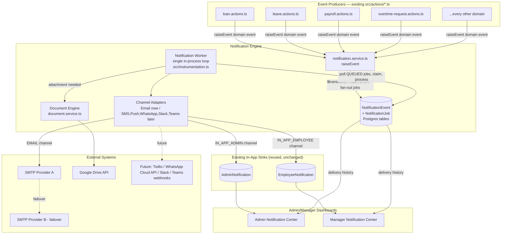

**Key idea:** the engine does not replace anything — it sits *beside* the existing action layer as a new domain (`notification-engine.actions.ts` + `src/lib/services/notification.service.ts` + `src/lib/services/document.service.ts`), consumed the same way `loan.service.ts` is consumed today. In-app notifications keep flowing through the existing tables; the engine adds durable, retryable, multi-channel delivery on top.

---

## 3. Notification Lifecycle

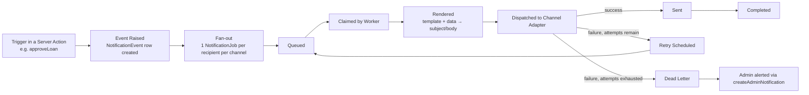

Every step writes an immutable `NotificationDeliveryAttempt` row (see [§4](#4-database-er-diagram)), so the full lifecycle of any single notification — including every retry and every provider tried — is reconstructable from history alone, independent of the current `NotificationJob.status`.

---

## 4. Database ER Diagram

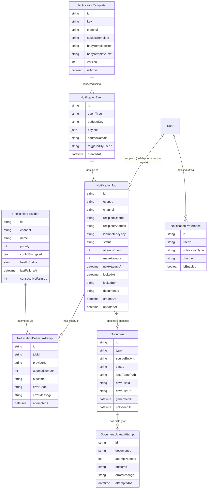

All new models follow existing conventions: `cuid()` ids except `NotificationSettings` (a new singleton row, `id: "global"`, alongside `SystemControlSettings`/`EmailConfig`). See [§31](#31-suggested-prisma-models) for full field-by-field responsibility notes.

---

## 5. Queue Lifecycle

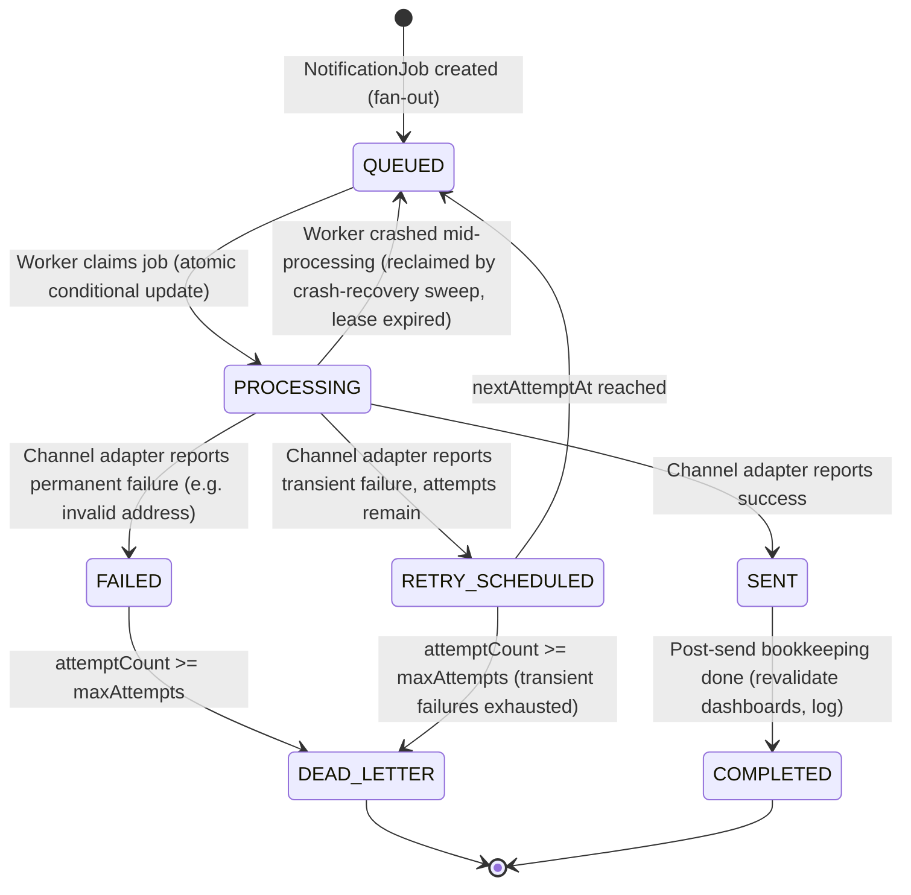

This matches the requirement's `Queued → Processing → Sent → Failed → Retry → Completed` chain, with two refinements made explicit because they materially affect correctness:
- **`FAILED` is not terminal by itself** — a job only reaches the terminal `DEAD_LETTER` state once retries are exhausted; `FAILED` is a transient marker inspected by the same tick that decides retry-vs-dead-letter.
- **Crash recovery is a first-class transition** (`PROCESSING → QUEUED`), not an afterthought — see [§19](#19-crash-recovery-strategy).

---

## 6. Notification Event Architecture

A `NotificationEvent` is the durable, replayable record of "something happened that might need to notify someone." It is intentionally decoupled from delivery:

- **Producer side** (any `src/actions/*.ts` file): calls `notificationService.raiseEvent({ eventType, dedupeKey, payload, sourceDomain })`. The producer does not know or care which channels/recipients are involved — that's resolved by an **event-type → recipient-resolution + channel mapping**, described next.
- **Resolution side**: a per-event-type resolver (a plain lookup table, not a class hierarchy — matching the existing "enum + scope field" pattern from `AllowanceType.scope`/`BreakingNotice.targetType`) determines:
  1. Which `NotificationTemplate` key to render.
  2. Which recipients (a `User` id list, or "all SUPERADMINs", or "the employee's manager").
  3. Which channels apply per recipient (checked against `NotificationPreference` if the user has opted out of a channel for that type).
- **Fan-out**: for each (recipient × channel) pair, one `NotificationJob` row is created inside the same `$transaction` as the `NotificationEvent` insert (see [§20](#20-database-transaction-strategy)).

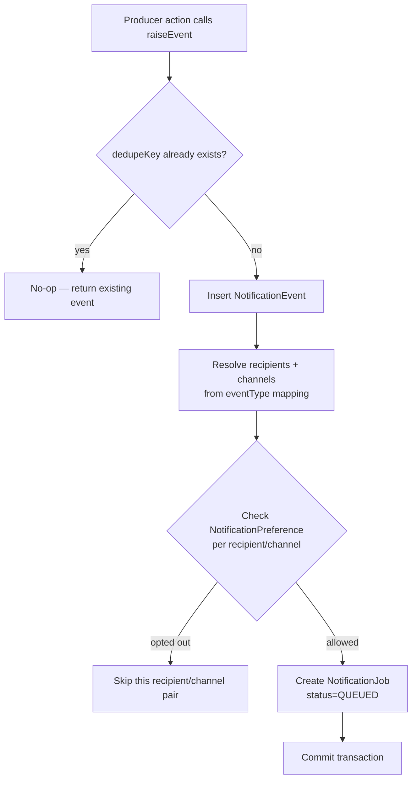

This is deliberately event-sourcing-*lite*, matching the "Idempotent reconciliation" and "Audit log (partial)" patterns already observed in [ARCHITECTURE.md](../../../ARCHITECTURE.md#design-patterns-observed) rather than introducing a full event-sourcing framework the app doesn't otherwise use.

---

## 7. Notification Service Architecture

`src/lib/services/notification.service.ts` is the singleton service (same shape as `emailService`/`zkTecoService`) that owns:

| Responsibility | Notes |
|---|---|
| `raiseEvent(...)` | Producer-facing entry point. Idempotent on `dedupeKey`. |
| Recipient/channel resolution | Internal — reads the event-type mapping table (see [§6](#6-notification-event-architecture)). |
| Template rendering | Delegates to a small in-house placeholder-substitution helper (`{{firstName}}` style) — **not** a new templating dependency (see [§43](#43-tradeoffs--alternatives-considered)). |
| Dispatch to channel adapter | Delegates to the relevant adapter (`emailChannelAdapter` today; `smsChannelAdapter`, etc. later) via a shared `NotificationChannelAdapter` interface (see [§22](#22-service-interfaces)). |
| Delivery bookkeeping | Writes `NotificationDeliveryAttempt` rows; updates `NotificationJob.status`/`attemptCount`/`nextAttemptAt`. |

It does **not** own the polling loop — that's the worker's job (§8). The service is a pure "given a job, try to send it once" unit, callable both from the worker loop and from a manual "resend" admin action.

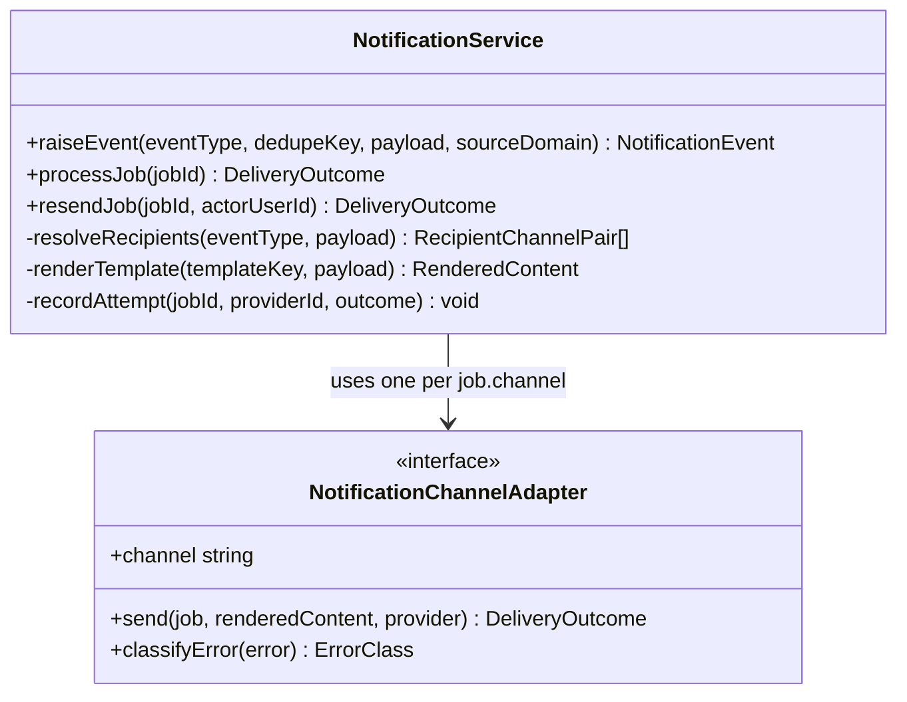

---

## 8. Worker Architecture

The worker is **one more self-scheduling loop registered from `src/instrumentation.ts`**, following the exact structure of `startZKTecoSyncCron()` (single-flight lock, DB-driven enable flag, `setInterval`), not a new process/container:

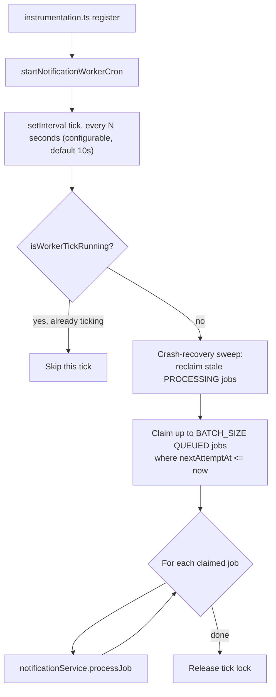

- **Poll interval**: far tighter than the existing 60s cron loops (notifications are latency-sensitive) — default 10 seconds, itself DB-configurable via the new `NotificationSettings` singleton, same "DB overrides env-seeded default" pattern as `SystemControlSettings`.
- **Batch size**: claim N jobs per tick (default 20) rather than one-at-a-time, to keep throughput reasonable under a single worker without needing concurrency primitives beyond a simple in-process `for` loop (sequential processing — no `Promise.all` fan-out, to keep SMTP connection reuse predictable and avoid provider rate-limit bursts).
- **Global start-guard**: same `globalThis.__notificationWorkerStarted` flag pattern as the three existing loops, preventing double-registration under Next.js dev-mode hot reload.

---

## 9. SMTP Provider Architecture

Today, `EmailConfig` is a *singleton* row (`id: "global"`) — one SMTP account, no failover. This design generalizes it to **N ordered providers** without breaking the existing simple case:

- New model `NotificationProvider` (channel = `EMAIL` for phase 1) replaces the *conceptual* role of `EmailConfig` for the engine's purposes, but **`EmailConfig` itself is left untouched** — it continues to back the existing System Control → Email Config screen and the existing `emailService.sendMail()` used by the one current caller (test-mail sending). The engine's `emailChannelAdapter` reads from `NotificationProvider` rows instead, seeded initially from the existing `EmailConfig` row (migration-time backfill, not a schema change to `EmailConfig`).
- Each `NotificationProvider` row: `priority` (lower = tried first), `configEncrypted` (AES-256-GCM via the **existing** `src/lib/crypto.ts` — reused, not reinvented), `healthStatus` (`HEALTHY`/`DEGRADED`/`DOWN`), `consecutiveFailures`, `lastFailureAt`.
- Credential encryption reuses `EMAIL_SECRET_KEY` and `encryptSecret`/`decryptSecret` exactly as today — **no new secret-key management introduced** (see [CLAUDE.md](../../../CLAUDE.md#what-should-not-be-changed)).

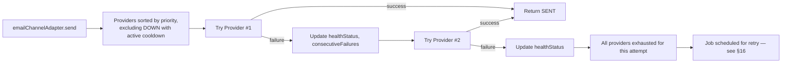

---

## 10. SMTP Failover Architecture

Failover is **within a single job-processing attempt**, not across separate retry cycles — i.e. one `NotificationDeliveryAttempt` row per provider tried, but only one increment to `NotificationJob.attemptCount` per worker tick (trying providers 1→2→3 in the same tick is "one attempt at delivering," not three retries).

- **Error classification** (reused concept from `email.service.ts`'s existing `mapSmtpError`, generalized):
  - **Provider-level failure** (`ECONNREFUSED`, `ETIMEDOUT`, `ENOTFOUND`, `EAUTH`) → mark this provider `DEGRADED`/`DOWN`, immediately try the next provider in the same tick.
  - **Recipient-level failure** (`EENVELOPE`, invalid address, `EMESSAGE`) → do **not** try another provider (a different SMTP server won't fix a bad recipient address) — mark the job `FAILED` and proceed to the retry/dead-letter decision directly.
- **Circuit breaker / cooldown**: after `consecutiveFailures` crosses a threshold (default 5), a provider enters a cooldown window (default 5 minutes) during which it's skipped from the priority list entirely, so a fully-down provider doesn't add latency to every single job. A background health-probe (see [§35](#35-suggested-background-workers)) periodically re-tests `DOWN` providers, mirroring the existing ZKTeco reachability-probe pattern (`isZKTecoBaseUrlReachable` in `instrumentation.ts`) applied to SMTP instead.
- **All-providers-exhausted**: if every configured provider fails within one tick, the job is treated as a transient failure of the whole channel and goes to the standard retry schedule (§16) — the *next* attempt re-sorts providers, so a provider that recovers mid-cooldown is naturally retried later without special-casing.

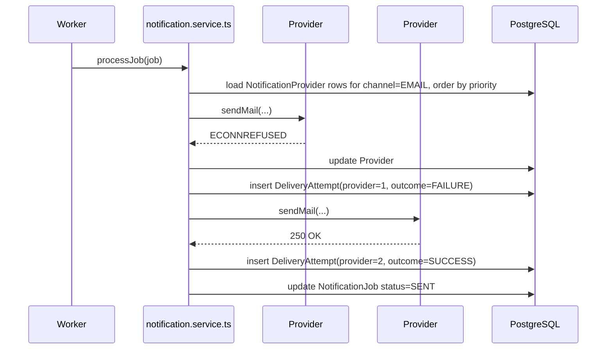

---

## 11. Document Engine Architecture

A document (payslip PDF, offer letter, EMI schedule, etc.) is a **separate lifecycle** from a notification job, because generation and cloud upload have different failure modes and different retry needs than sending an email. A `NotificationJob` optionally references a `Document` row via `documentId`; the worker will not attempt to send an email that requires an attachment until that `Document` reaches `UPLOADED` (or the design allows a documented degraded mode — see below).

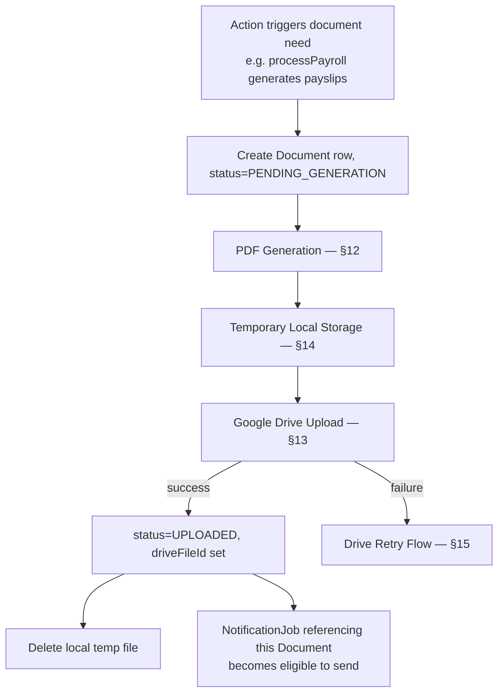

**Degraded-mode decision (flagged for product sign-off, [§44](#44-open-questions-requiring-product-sign-off)):** should an email send anyway with a "document pending, will follow" note if Drive upload is still retrying, or must it wait? Default recommendation: **wait**, capped at a configurable max wait (e.g. 30 minutes) after which the notification sends without the attachment plus a link placeholder, and an `AdminNotification` is raised for manual follow-up — this avoids indefinitely blocking a time-sensitive notification (e.g. "payroll processed") on an external Drive outage.

---

## 12. PDF Generation Flow

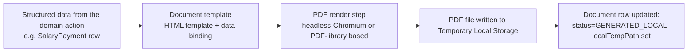

- **Templates** live alongside `NotificationTemplate` conceptually but as their own `DocumentTemplate` notion (an HTML layout + CSS, independent of email templates) — kept in `src/lib/documents/templates/` (see [§21](#21-folder-structure)).
- **Library choice is an explicit open decision** — not assumed here (see [§44](#44-open-questions-requiring-product-sign-off)): either a headless-browser renderer (accurate CSS, heavier dependency) or a programmatic PDF library (lighter, less flexible layout). Both are "new dependency" decisions requiring sign-off per [CONTRIBUTING.md](../../../CONTRIBUTING.md#logging)'s low-dependency norm.
- Generation runs on the **same single worker tick loop** as notification dispatch is deliberately avoided — PDF rendering can be CPU-heavy and would starve the notification queue. Instead it runs on its **own separate interval loop** (`startDocumentGenerationCron`, same `instrumentation.ts` pattern, independent single-flight lock) so a slow PDF render never delays an unrelated email send. See [§35](#35-suggested-background-workers).

---

## 13. Google Drive Flow

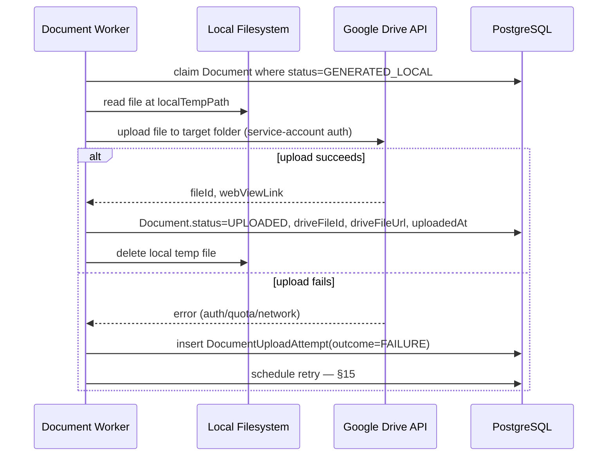

- **Auth model**: a Google **service account** with domain-wide delegation or a shared Drive folder shared to the service account — not per-user OAuth (per-user OAuth would require every employee to individually grant access, which doesn't fit an HR system generating documents *about* employees, not *for* their personal Google accounts to author). This is flagged in [§44](#44-open-questions-requiring-product-sign-off) since it requires a Google Workspace admin decision outside this codebase.
- **Folder structure in Drive**: `/{OrgRoot}/{DocumentType}/{Year}/{EmployeeId}-{EmployeeName}/filename.pdf` — mirrors the existing `User` model's already-present `loanPapersLink`/`nomineesPapersLink`/etc. fields, which suggests documents-per-employee is already a recognized concept in this schema; the new `Document` table generalizes those ad hoc link fields into a proper history rather than a single overwritable URL string.

---

## 14. Temporary Local Storage Flow

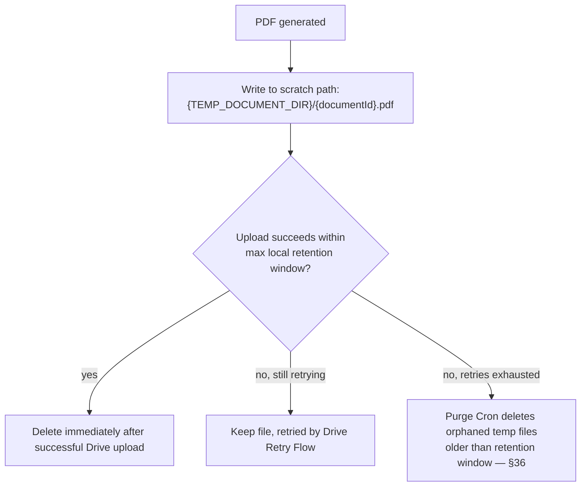

- Local temp storage is **only a staging area**, never the system of record — `Document.localTempPath` is cleared once `UPLOADED`, and a scheduled cron (not the hot worker path) purges any leftover files whose `Document` never reached `UPLOADED` within a bounded window (defensive cleanup against a crash between "file written" and "row updated").
- Directory should be **outside** the Next.js build output and **not** committed/served statically — a plain OS temp/scratch directory the container already has write access to (the existing Docker image runs as a non-root `nextjs` user; the directory must be created with appropriate permissions in the Dockerfile if this differs from the existing `/tmp`-equivalent).

---

## 15. Drive Retry Flow

Distinct from notification-job retry (§16) because Drive failures have different characteristics (quota errors need longer backoff than transient network blips; auth errors need a human, not a retry, to fix):

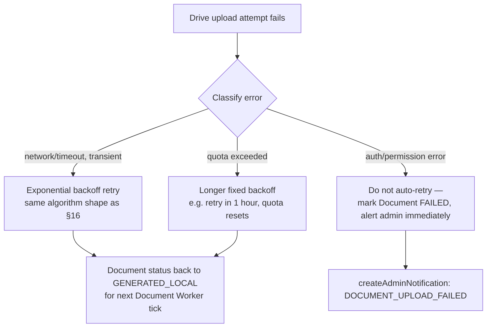

---

## 16. Retry Algorithm

Exponential backoff with a cap and jitter, applied uniformly to `NotificationJob` retries (channel-agnostic — SMS/Push/etc. reuse the identical algorithm, only the adapter differs):

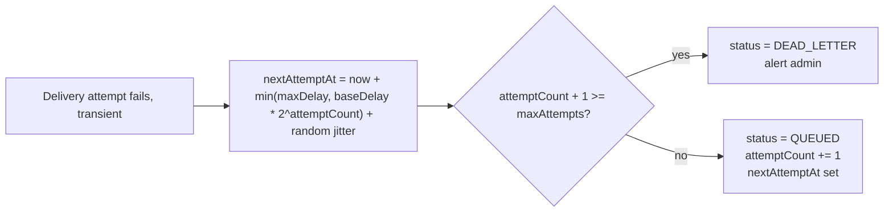

Suggested defaults (configurable via `NotificationSettings`, not hardcoded — matching the DB-overridable pattern used for cron timings elsewhere):

| Parameter | Default | Notes |
|---|---|---|
| `baseDelaySeconds` | 30 | First retry ~30s after failure |
| `maxDelaySeconds` | 3600 | Backoff caps at 1 hour between retries |
| `maxAttempts` | 5 | After 5 failed attempts → dead letter |
| `jitterRatio` | 0.2 | ±20% randomization to avoid thundering-herd retries if many jobs fail simultaneously (e.g. SMTP provider outage) |

Recipient-level permanent failures (invalid email address) **skip straight to dead letter** regardless of `attemptCount`, since retrying a structurally invalid address wastes attempts and delays the dead-letter alert.

---

## 17. Duplicate Prevention Algorithm

Two independent layers, because duplication can be introduced at two different points:

1. **Event-level dedupe**: `NotificationEvent.dedupeKey` is a **unique** constraint. A producer computes a deterministic key from the domain event, e.g. `LOAN_APPROVED:{loanId}` or `PAYROLL_RUN:{month}:{userId}`. If `raiseEvent()` is called twice for the same underlying business event (e.g. a double-click on an approve button, or a retried Server Action after a network blip), the second call detects the existing row (via `upsert`/catch-unique-violation) and is a no-op — no second fan-out occurs.
2. **Job-level dedupe**: `NotificationJob.idempotencyKey` (derived as `{dedupeKey}:{channel}:{recipientUserId}`) is also **unique**. This protects against a bug in the fan-out logic itself (e.g. a resolver accidentally listing the same recipient twice) independently of whether the event-level key worked correctly — defense in depth, not redundant, since the two keys guard different code paths.

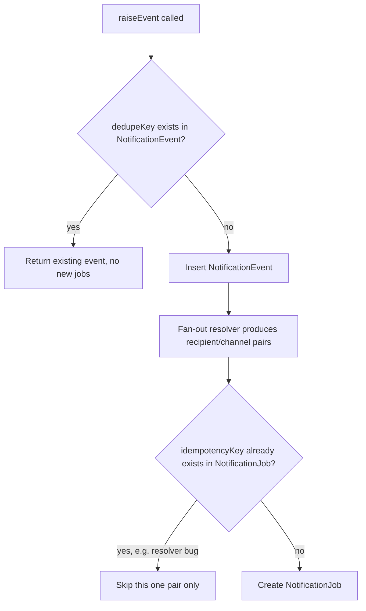

---

## 18. Idempotency Strategy

Idempotency is not only about *creating* jobs once — it also matters when the **worker retries a job that may have partially succeeded** (e.g. the SMTP send succeeded but the process crashed before the DB was updated to `SENT`). Strategy:

- **Outbound side-effect ordering**: for channels where the provider itself is idempotent-friendly (most transactional email/SMS providers accept a client-supplied idempotency key or de-facto tolerate a duplicate send as low-cost), the adapter passes `NotificationJob.idempotencyKey` (or a derived per-attempt key) to the provider where the provider API supports it (SMS/WhatsApp providers commonly do; raw SMTP does not — this is a **known limitation carried forward**, not solved by this design: a crash between "SMTP accepted the message" and "DB updated to SENT" can cause a duplicate email on the next retry. This is called out explicitly in [§44](#44-open-questions-requiring-product-sign-off) as an accepted risk for email specifically, mitigated only by tightening the crash-recovery lease window, not eliminated).
- **At-least-once delivery, not exactly-once**: this design targets **at-least-once** semantics for email (occasional duplicate email is a minor UX annoyance, not a correctness bug, matching the low-stakes tolerance already implicit in this app's `Float`-money/no-test-suite risk posture per [DECISIONS.md](../../../DECISIONS.md)). Channels with idempotency-key support at the provider (SMS/WhatsApp in the future) get closer to exactly-once for free.
- **Idempotent status transitions**: every worker-side status update is a conditional `UPDATE ... WHERE status = 'PROCESSING' AND lockedBy = ourWorkerId` — never a blind overwrite — so a duplicate/late-arriving update from a previous crashed attempt can't clobber a newer state.

---

## 19. Crash Recovery Strategy

The single worker process can die mid-tick (deploy restart, OOM, uncaught exception). Recovery must not require manual intervention:

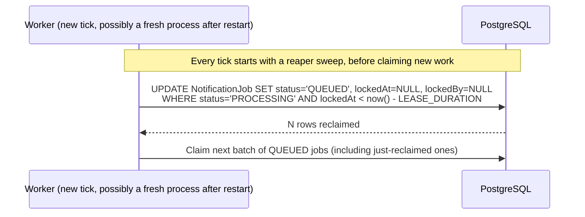

- **Lease duration** default: 5 minutes (must exceed the realistic max time to process one job across all provider-failover attempts; configurable).
- This is the DB-persisted analogue of the existing **in-memory** `isSyncRunning` lock in `instrumentation.ts`'s ZKTeco loop — that in-memory lock protects against *overlapping ticks within the same live process*; the reaper protects against *a process dying entirely*, which an in-memory flag cannot do (it resets to `false` on restart, silently abandoning any row it had marked `PROCESSING`). Both mechanisms are needed; they solve different halves of the same problem.
- **Attempt count is preserved** across a crash-reclaim (a reclaimed job is not a "fresh" job — it already used up an attempt if it actually reached the provider before crashing; since we cannot know for certain whether the send happened, the conservative choice is to count the reclaimed run as a used attempt, consistent with the at-least-once/duplicate-tolerant stance in §18).

---

## 20. Database Transaction Strategy

Following the exact precedent in [CLAUDE.md](../../../CLAUDE.md#backend-patterns-server-actions) ("`prisma.$transaction` required whenever a mutation touches more than one of..."), applied to this domain:

| Operation | Transaction? | Why |
|---|---|---|
| `raiseEvent`: insert `NotificationEvent` + create N `NotificationJob` rows | **Yes**, `$transaction` | A crash between event insert and job insert must not leave an event with zero jobs (silently "swallowing" a notification) — matches the existing "money + status transition" transactional precedent. |
| Worker claim: conditional update of one `NotificationJob` row (`QUEUED → PROCESSING`) | No — single-row update is already atomic | No need for `$transaction` around a single `UPDATE ... WHERE status = 'QUEUED'`; Postgres row-level locking makes this atomic on its own. |
| Post-attempt bookkeeping: update `NotificationJob` status **and** insert `NotificationDeliveryAttempt` | **Yes**, `$transaction` | Two tables written together describing one outcome — if only one write succeeded, the job's status and its own history would disagree, which breaks the "history reconstructable from attempts alone" guarantee in §3. |
| Crash-recovery reaper sweep | No — a single `updateMany` is used, which is itself atomic per row | Simpler than wrapping a set-based update in `$transaction`; matches how other bulk status resets are done elsewhere in the codebase. |
| Document generation → upload → job unblocking | **Yes**, `$transaction`, at the "mark Document UPLOADED and flip any blocked NotificationJob out of its wait state" step | Two tables (`Document`, `NotificationJob`) transition together. |

No new transactional pattern is introduced — this section exists to make explicit, ahead of implementation, exactly which of the engine's dozen or so write operations qualify under the existing rule, since getting this wrong either loses notifications (under-transacting) or needlessly serializes throughput (over-transacting a single-row update).

---

## 21. Folder Structure

Follows the existing `src/actions/*.ts` + `src/lib/services/*.service.ts` + `src/components/<role>/*` conventions exactly — no new top-level layering introduced:

```
src/
├── actions/
│   ├── notification-engine.actions.ts       # raiseEvent-adjacent server actions: resend, mark-reviewed, dashboard queries
│   ├── notification-provider.actions.ts     # CRUD for NotificationProvider (SMTP failover config) — admin-only
│   └── document.actions.ts                  # trigger document generation, query Document status
├── lib/
│   ├── services/
│   │   ├── notification.service.ts          # raiseEvent, processJob, resendJob (singleton, like emailService)
│   │   ├── document.service.ts              # PDF generation + Drive upload orchestration (singleton)
│   │   └── channels/
│   │       ├── email-channel.adapter.ts     # implements NotificationChannelAdapter for EMAIL
│   │       ├── sms-channel.adapter.ts        # future
│   │       ├── whatsapp-channel.adapter.ts   # future
│   │       ├── push-channel.adapter.ts       # future
│   │       ├── slack-channel.adapter.ts      # future
│   │       └── teams-channel.adapter.ts      # future
│   ├── notification-worker.ts               # the interval-loop implementation, imported by instrumentation.ts
│   ├── document-worker.ts                   # the PDF/Drive interval-loop implementation
│   └── documents/
│       └── templates/                        # HTML document templates (payslip, offer letter, EMI schedule)
├── components/
│   ├── admin/notifications/                  # Admin Notification Center + Provider/Template settings UI
│   ├── manager/notifications/                # Manager-scoped notification center mirror
│   └── shared/notifications/                  # Shared notification badge/list primitives used by both
└── app/
    ├── (admin)/admin/notifications/
    │   ├── page.tsx                           # Notification Center — history, filters, resend
    │   ├── providers/page.tsx                 # SMTP/channel provider management (failover priority, health)
    │   ├── templates/page.tsx                 # Template editor per event type/channel
    │   └── settings/page.tsx                  # NotificationSettings (worker interval, retry policy, retention)
    ├── (manager)/manager/notifications/
    │   └── page.tsx                           # Manager-scoped read-only history for their team's notifications
    └── api/webhooks/
        ├── sms-delivery-status/route.ts       # future — provider delivery-status callbacks (Route Handler, not a Server Action, matching the webhook precedent)
        └── whatsapp-delivery-status/route.ts  # future
```

---

## 22. Service Interfaces

Described by responsibility, not TypeScript — each row is one method's contract in plain language.

### `NotificationService` (singleton, `notification.service.ts`)

| Method | Input | Output | Responsibility |
|---|---|---|---|
| `raiseEvent` | event type, dedupe key, payload data, source domain name | the event record (existing or newly created) | Idempotently records a domain event and fans it out into per-recipient, per-channel jobs. |
| `processJob` | a job id | delivery outcome (sent / retry-scheduled / dead-lettered) | Renders the template, resolves the provider list for the job's channel, attempts delivery with failover, records the attempt(s), advances the job's state. |
| `resendJob` | a job id, the admin user id performing the resend | delivery outcome | Manually re-queues a dead-lettered or failed job outside the normal retry schedule; used from the Admin Notification Center. |

### `NotificationChannelAdapter` (interface — one implementation per channel)

| Property/Method | Responsibility |
|---|---|
| `channel` | The channel this adapter handles (`EMAIL`, `SMS`, `WHATSAPP`, `PUSH`, `SLACK`, `TEAMS`). |
| `send` | Given a job, its rendered content, and a specific provider config, attempt delivery once. Returns success or a classified failure. |
| `classifyError` | Maps a provider-specific error into `PROVIDER_LEVEL` (try next provider) vs `RECIPIENT_LEVEL` (do not fail over, go straight to retry/dead-letter decision) — generalizes the existing `mapSmtpError` concept in `email.service.ts` to every channel. |

### `DocumentService` (singleton, `document.service.ts`)

| Method | Responsibility |
|---|---|
| `generateDocument` | Given a document type and source data, render the template to a local PDF file and create/update the `Document` row. |
| `uploadDocument` | Given a `Document` in `GENERATED_LOCAL` state, upload to Google Drive, update the row, clean up the local file on success. |
| `retryUpload` | Re-attempt a previously failed upload, applying the Drive-specific backoff from §15. |

No class hierarchy or dependency-injection container is introduced — each service remains a plain exported singleton instance, exactly matching the existing `emailService`/`zkTecoService` pattern, per [CLAUDE.md](../../../CLAUDE.md#existing-reusable-services).

---

## 23. State Machine Diagrams

### `NotificationJob` (full detail, supersedes the simplified view in §5)

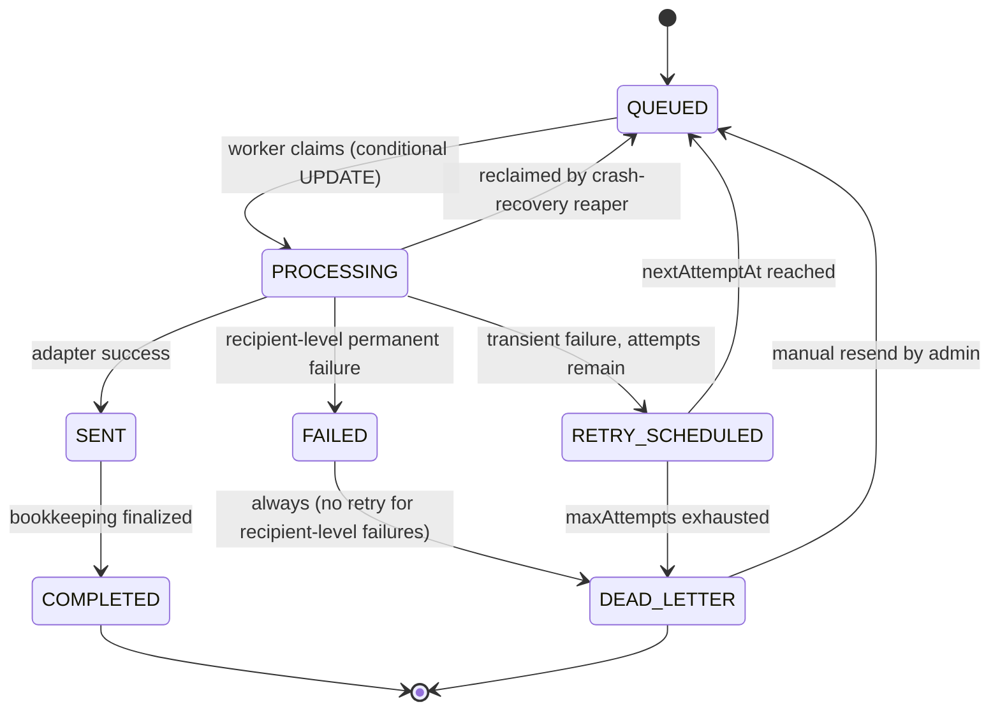

### `Document`

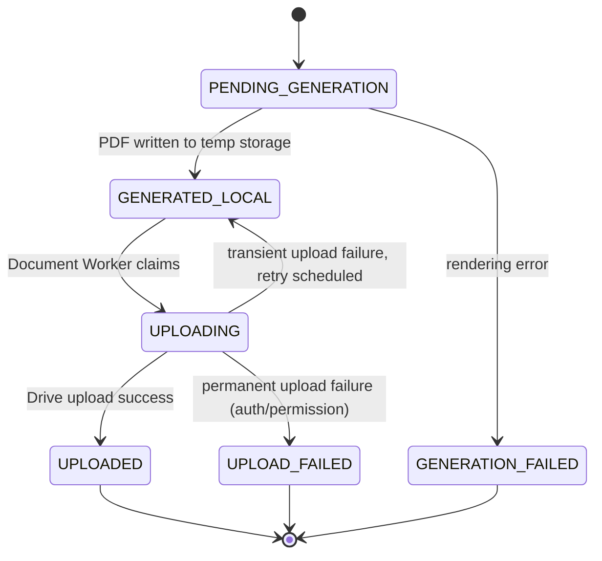

### `NotificationProvider` health

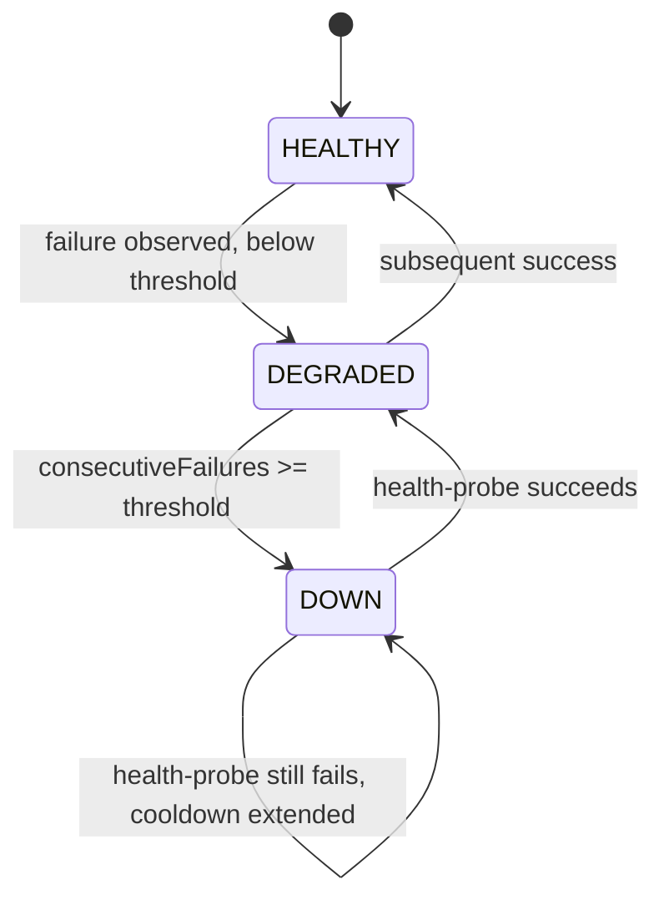

---

## 24. Sequence Diagrams

### End-to-end: Loan approval triggers an email

```mermaid
sequenceDiagram
    participant Admin as SUPERADMIN
    participant LoanAct as loan.actions.ts
    participant NS as notification.service.ts
    participant DB as PostgreSQL
    participant W as Notification Worker
    participant Email as emailChannelAdapter

    Admin->>LoanAct: approveLoan(loanId)
    LoanAct->>DB: $transaction: Loan.status=ACTIVE, EmiState created, wallet credited
    LoanAct->>NS: raiseEvent("LOAN_APPROVED", dedupeKey=`LOAN_APPROVED:${loanId}`, payload)
    NS->>DB: $transaction: insert NotificationEvent + NotificationJob(channel=EMAIL, recipient=employee)
    Note over W: Independent tick, up to POLL_INTERVAL later
    W->>DB: claim QUEUED jobs
    W->>NS: processJob(job)
    NS->>Email: send(rendered content, provider #1)
    Email-->>NS: success
    NS->>DB: $transaction: DeliveryAttempt(SUCCESS), Job.status=SENT
```

### Retry after transient SMTP failure

```mermaid
sequenceDiagram
    participant W as Notification Worker
    participant NS as notification.service.ts
    participant DB as PostgreSQL

    W->>NS: processJob(job) [attemptCount=0]
    NS->>NS: try all providers, all fail (transient)
    NS->>DB: $transaction: DeliveryAttempt(FAILURE) x N, Job.status=RETRY_SCHEDULED, attemptCount=1, nextAttemptAt=+30s
    Note over W: Next tick, 30s+ later
    W->>DB: claim jobs where nextAttemptAt <= now
    W->>NS: processJob(job) [attemptCount=1]
    NS->>NS: succeeds on provider #1 this time
    NS->>DB: Job.status=SENT
```

### Crash mid-send, recovered by reaper

```mermaid
sequenceDiagram
    participant W1 as Worker (process A)
    participant DB as PostgreSQL
    participant W2 as Worker (process B, after restart)

    W1->>DB: claim job, status=PROCESSING, lockedAt=now
    Note over W1: Process crashes here — no further DB write
    Note over DB: Job stuck in PROCESSING
    Note over W2: New process boots, first tick
    W2->>DB: reaper sweep: PROCESSING AND lockedAt < now-5min → QUEUED
    W2->>DB: claim reclaimed job
    W2->>W2: processJob (attemptCount incremented, treated as a used attempt)
```

---

## 25. Scalability Strategy

The stated requirement is explicitly **single worker** — this section documents what that means and what the deliberate limits are, rather than over-engineering for a scale this phase doesn't need:

- **Vertical, not horizontal, scaling first**: increase `BATCH_SIZE` and decrease `POLL_INTERVAL` (both DB-configurable) before considering multiple workers. A single Node process sending sequentially through nodemailer can plausibly handle low-thousands of emails/day comfortably, which covers this app's single-organization scale (per [DECISIONS.md](../../../DECISIONS.md), tens of employees, not tens of thousands).
- **The design does not preclude a future second worker**: the atomic conditional-claim (`UPDATE ... WHERE status='QUEUED'`, checking rows-affected) is safe under concurrent claimers even though only one worker runs today — this is "cheap insurance," not speculative engineering, since it costs nothing extra to write the claim this way versus a naive read-then-write. If a second worker replica is ever introduced, the *only* additional requirement is a unique `lockedBy` per process instance (already in the schema) — no redesign needed.
- **Explicitly deferred, not solved here**: distributed leader election, a message broker, or horizontal auto-scaling — consistent with [DECISIONS.md](../../../DECISIONS.md#in-process-interval-loops-instead-of-a-job-queue)'s existing acceptance of single-replica assumptions elsewhere in this app. If the org ever needs multi-replica `app` containers (e.g. for zero-downtime deploys), the notification worker (and the existing three cron loops) would need to move to a dedicated single-replica "worker" service — flagged as a future infra decision, not something this design silently assumes away.
- **Table growth management**: `NotificationJob`/`NotificationDeliveryAttempt` are append/high-volume tables; a retention/archival cron (§36) keeps them from growing unbounded, since there's no read-replica or partitioning strategy in this app today (per [DECISIONS.md](../../../DECISIONS.md#prisma--postgresql-as-the-only-datastore)).

---

## 26. Future Channel Support: SMS

- New `NotificationProvider` rows with `channel = SMS` (e.g. Twilio, or a regional Bangladesh SMS gateway given the org's location).
- New `smsChannelAdapter` implementing the same `NotificationChannelAdapter` interface — `send()` calls the provider's REST API instead of SMTP; `classifyError()` maps provider-specific codes (e.g. Twilio's error codes) into the same `PROVIDER_LEVEL`/`RECIPIENT_LEVEL` classification used by email.
- **Recipient resolution**: needs `User.phoneNumber` (already exists in the schema) rather than `User.email` — the event-resolution layer (§6) already resolves "a recipient," the adapter just picks the right address field per channel.
- **Delivery-status webhooks**: unlike SMTP (fire-and-forget from the app's perspective), SMS providers typically POST delivery-status callbacks — this requires a new Route Handler (`src/app/api/webhooks/sms-delivery-status/route.ts`), matching the existing precedent that asynchronous external callbacks are Route Handlers, not Server Actions (see [ARCHITECTURE.md](../../../ARCHITECTURE.md#request-flow), point 6).
- **No schema change needed** beyond adding `SMS` as a valid `NotificationProvider.channel`/`NotificationJob.channel` value — the queue, retry, dead-letter, and crash-recovery machinery is entirely channel-agnostic already.

---

## 27. Future Channel Support: Push Notification

- Requires a new concept not yet in the schema: a **device/subscription registry** (`PushSubscription`: `userId`, `endpoint`/`token`, `platform`, `isActive`) — this is genuinely new state, not reused from an existing model, so it's called out as an additional model beyond the core engine tables in §31.
- `pushChannelAdapter` sends to a push gateway (e.g. Firebase Cloud Messaging or a Web Push service) using the stored subscription token(s) for the recipient; a recipient may have zero, one, or several active subscriptions (multiple browser tabs/devices) — the fan-out resolver (§6) would expand "one recipient, push channel" into one `NotificationJob` per active subscription, or a single job that internally iterates subscriptions (recommendation: one job per subscription, for cleaner failure isolation — a stale/expired token failing shouldn't affect delivery to the user's other devices).
- **Recipient-level permanent failure** for push specifically includes "subscription expired/unsubscribed," which should also **deactivate** the `PushSubscription` row (not just dead-letter the job) — a push-specific side effect the generic engine doesn't otherwise need.

---

## 28. Future Channel Support: WhatsApp

- `whatsappChannelAdapter` against the WhatsApp Business/Cloud API. Two structural differences from email/SMS worth flagging now so the interface doesn't need reshaping later:
  - **Template pre-approval**: WhatsApp requires message templates to be pre-registered and approved by Meta before use — this means `NotificationTemplate` needs an optional `externalTemplateId`/`approvalStatus` pair for WhatsApp-channel templates specifically (a nullable field, not a schema fork), and the admin Template UI (§37) needs a "this template requires WhatsApp approval" indicator.
  - **Session vs. template messages**: WhatsApp distinguishes free-form replies within a 24-hour customer-service window from outbound template messages outside it — largely irrelevant for this app's outbound-only, no-two-way-chat use case (HR notifications, not customer support), so the design assumes **template messages only**, simplifying the adapter considerably. This assumption is flagged in §44 in case a future two-way use case (e.g. leave-application-via-WhatsApp) is ever considered — that would be a materially different feature, not a simple adapter addition.
- Delivery-status webhooks follow the same Route Handler pattern as SMS (§26).

---

## 29. Future Channel Support: Slack & Teams

- Structurally the simplest future channels: both are effectively "post a message to a webhook URL" — `slackChannelAdapter`/`teamsChannelAdapter` implement `send()` as an HTTP POST to a per-recipient or per-channel-room incoming-webhook URL, with each platform's own message-formatting schema (Slack Block Kit / Teams Adaptive Cards) as the "rendered content" produced by the template-rendering step.
- **Recipient model differs**: Slack/Teams notifications are typically **room/channel-targeted** ("post to #hr-alerts"), not always **user-targeted** like email/SMS/push — the event-resolution layer (§6) needs a recipient "kind" beyond `User` (a configured webhook target string), which the `NotificationJob.recipientAddress` field already accommodates generically (it's a free-form address string, not strictly an email/phone column) — no schema change required, just a resolver-side convention.
- Most likely first real use case for this app specifically: mirroring high-severity `AdminNotification`s (e.g. `SYSTEM_ALERT`, `TIMELINE_GENERATION_FAILED`) to a Slack/Teams ops channel — i.e. this channel pairing is a natural fit for the existing `createAdminNotification()` integration point described in [§6](#6-notification-event-architecture).

---

## 30. Future API Contracts

Since this app is Server-Actions-first (per [ARCHITECTURE.md](../../../ARCHITECTURE.md)), the engine's *primary* contract is TypeScript function signatures, not REST — consistent with [API.md](../../../API.md)'s own framing ("there is no separate REST/RPC contract for [Server Actions] beyond their TypeScript function signatures"). The only genuine HTTP contracts this engine introduces are the inbound webhook receivers future channels need, described conceptually (not as code) below:

| Contract | Direction | Shape (conceptual) | Precedent |
|---|---|---|---|
| Internal: `raiseEvent` | Producer action → engine | event type, dedupe key, payload object, source domain string | Same shape discipline as every other action's plain-object return (`{ success, ... }`) |
| Internal: dashboard queries | Admin/Manager UI → engine | filter params (date range, channel, status, recipient) → paginated `NotificationJob` + latest attempt summary | Mirrors existing `getAllLoans`/`getMyLoans`-style listing conventions from [CONTRIBUTING.md](../../../CONTRIBUTING.md#function--variable-naming) |
| External: SMS delivery-status webhook | SMS provider → `POST /api/webhooks/sms-delivery-status` | provider-specific signature header + delivery status payload, mapped to a `NotificationDeliveryAttempt` update | Same authentication shape as the existing Clerk webhook (verify a provider signature, not a Clerk/App session) |
| External: WhatsApp delivery-status webhook | WhatsApp Cloud API → `POST /api/webhooks/whatsapp-delivery-status` | Meta's webhook verification handshake (`hub.challenge` on `GET`) + status payload on `POST` | Same Route-Handler-not-Server-Action reasoning as the Clerk webhook |
| External: Slack/Teams — none needed inbound | Outbound only (this app posts, doesn't receive) | N/A | — |

No REST contract is proposed for the engine's own read/write surface — that would contradict the app's established architecture (per [DECISIONS.md](../../../DECISIONS.md#nextjs-app-router--server-actions-instead-of-a-separate-api-backend)) and isn't requested.

---

## 31. Suggested Prisma Models

**Names, relationships, and responsibilities only — no field types, no Prisma syntax, no migration.**

| Model | Responsibility | Key relationships |
|---|---|---|
| `NotificationEvent` | Durable record of "a notifiable thing happened." Idempotent on a dedupe key. | Belongs to no fixed entity (payload carries context); has many `NotificationJob`. |
| `NotificationJob` | One unit of delivery work: one recipient, one channel, one event. Carries the entire queue/retry/crash-recovery state described in §5/§16/§19. | Belongs to one `NotificationEvent`; optionally belongs to one `User` (recipient) and one `Document`; has many `NotificationDeliveryAttempt`. |
| `NotificationDeliveryAttempt` | Immutable log of a single provider try (success or failure), for full auditability independent of the job's current status. | Belongs to one `NotificationJob`; optionally references one `NotificationProvider`. |
| `NotificationTemplate` | Versioned subject/body content per event type per channel. | Referenced by `NotificationEvent`'s resolution logic (not necessarily a hard FK, since resolution is by `eventType` + `channel` key lookup). |
| `NotificationProvider` | One configured delivery account (SMTP account, SMS gateway credentials, etc.), with priority ordering and health tracking for failover. | Referenced by `NotificationDeliveryAttempt`. |
| `NotificationPreference` | Per-user opt-in/opt-out for a given notification type + channel combination. | Belongs to one `User`. |
| `NotificationSettings` | Singleton (`id: "global"`, same pattern as `SystemControlSettings`/`EmailConfig`) — worker poll interval, retry policy defaults, retention days, per-channel enable flags. | None (singleton). |
| `Document` | One generated file's lifecycle: local generation → Drive upload. | Has many `DocumentUploadAttempt`; referenced by zero or more `NotificationJob`. |
| `DocumentUploadAttempt` | Immutable log of one Drive-upload try. | Belongs to one `Document`. |
| `PushSubscription` *(future, §27)* | One device/browser's push endpoint registration for a user. | Belongs to one `User`. |

**Deliberately not modified:** `AdminNotification`, `EmployeeNotification`, `EmailConfig`, `SystemControlSettings`, `SystemAudit` — all remain exactly as they are today; the engine is additive.

---

## 32. Suggested Server Actions

Following the `getAll.../getMy.../getPending...` and `approve.../reject...`-style naming split from [CONTRIBUTING.md](../../../CONTRIBUTING.md#function--variable-naming). Names and responsibilities only — no implementation.

**`src/actions/notification-engine.actions.ts`**

| Action | Caller | Responsibility |
|---|---|---|
| `getAllNotificationJobs` | Admin | Paginated/filterable dashboard listing (status, channel, date range, recipient). |
| `getNotificationJobsForManager` | Manager | Same, scoped to the manager's team (mirrors the `ForManager` suffix convention). |
| `getNotificationJobDetail` | Admin/Manager | Full history (all `NotificationDeliveryAttempt` rows) for one job. |
| `resendNotificationJob` | Admin | Manually re-queue a `DEAD_LETTER`/`FAILED` job; logs who triggered it. |
| `getNotificationEventDetail` | Admin | Inspect one event and every job it fanned out to (useful for "did this employee get notified" support questions). |

**`src/actions/notification-provider.actions.ts`**

| Action | Caller | Responsibility |
|---|---|---|
| `getAllNotificationProviders` | Admin | List configured providers per channel with health status. |
| `createNotificationProvider` / `updateNotificationProvider` | Admin | Add/edit a provider's credentials (encrypted) and priority. |
| `reorderNotificationProviders` | Admin | Change failover priority ordering for a channel. |
| `deactivateNotificationProvider` | Admin | Remove a provider from the active failover chain without deleting history. |
| `sendTestNotification` | Admin | Send a one-off test message through a specific provider (mirrors the existing "send a test email" System Control feature). |

**`src/actions/notification-template.actions.ts`**

| Action | Caller | Responsibility |
|---|---|---|
| `getAllNotificationTemplates` | Admin | List templates per event type/channel. |
| `updateNotificationTemplate` | Admin | Edit subject/body, creates a new version rather than overwriting (append-style history, matching `BaseSalary`'s pattern). |
| `previewNotificationTemplate` | Admin | Render a template against sample data without sending. |

**`src/actions/document.actions.ts`**

| Action | Caller | Responsibility |
|---|---|---|
| `getDocumentStatus` | Admin/Manager/Employee (scoped) | Check generation/upload status for a document tied to an entity they're allowed to see. |
| `retryDocumentUpload` | Admin | Manually re-trigger a stuck `UPLOAD_FAILED` document. |

**Integration change to existing files (additive, not breaking):** `notification.actions.ts`'s existing `createAdminNotification()` gains an optional internal call to `notificationService.raiseEvent(...)` for `NotificationType` values flagged as "also multi-channel" in a small mapping table — every existing call site is untouched.

---

## 33. Suggested Services

| Service file | Pattern | Responsibility |
|---|---|---|
| `src/lib/services/notification.service.ts` | Singleton (like `emailService`) | Event raising, job processing, template rendering, dispatch orchestration — see [§7](#7-notification-service-architecture)/[§22](#22-service-interfaces). |
| `src/lib/services/document.service.ts` | Singleton | PDF generation + Drive upload orchestration — see [§11](#11-document-engine-architecture)/[§22](#22-service-interfaces). |
| `src/lib/services/channels/*.adapter.ts` | One small module per channel, exporting a plain object implementing `NotificationChannelAdapter` | Channel-specific send/error-classification logic only — no queue/retry logic duplicated here (that's the engine's job, adapters stay thin). |

No new class hierarchy, no dependency-injection framework — each adapter is a plain object literal satisfying the shared interface shape, matching this codebase's existing preference for simple singletons over frameworks (per [DECISIONS.md](../../../DECISIONS.md#no-repositoryservice-layer-for-most-domains)).

---

## 34. Suggested Components

Namespaced by primary consumer, per [CONTRIBUTING.md](../../../CONTRIBUTING.md#file--folder-naming):

| Component | Folder | Responsibility |
|---|---|---|
| `NotificationCenterClient` | `components/admin/notifications/` | Main dashboard: filterable table of `NotificationJob`s, status badges, resend action. |
| `NotificationDetailDialog` | `components/admin/notifications/` | Drill-down into one job's full `NotificationDeliveryAttempt` history. |
| `NotificationProviderTable` | `components/admin/notifications/` | Manage SMTP/channel providers, drag-to-reorder priority, health indicators. |
| `NotificationTemplateEditor` | `components/admin/notifications/` | Edit subject/body per event type/channel, live preview against sample data. |
| `NotificationSettingsForm` | `components/admin/notifications/` | Worker interval, retry policy, retention days — mirrors `EmailConfigCard`'s existing shape. |
| `ManagerNotificationCenterClient` | `components/manager/notifications/` | Read-only team-scoped mirror of the admin center (no provider/template editing — manager-scoped, per the field-level authorization precedent in [CLAUDE.md](../../../CLAUDE.md#authorization-flow)). |
| `NotificationStatusBadge` | `components/shared/notifications/` | Small status-pill renderer (`QUEUED`/`SENT`/`DEAD_LETTER`/etc.), used by both admin and manager centers. |
| `DocumentStatusIndicator` | `components/shared/notifications/` | Small "attachment: generating / ready / failed" indicator embedded in job rows that reference a `Document`. |

All built from existing `src/components/ui/*` shadcn primitives (table, dialog, badge, select) — no new UI primitive introduced.

---

## 35. Suggested Background Workers

All registered from the single `src/instrumentation.ts` entry point, each with its own `globalThis` start-guard and single-flight lock, exactly matching the three existing loops:

| Worker | Interval (default) | Responsibility |
|---|---|---|
| `startNotificationWorkerCron` | 10s | Crash-recovery reaper sweep + claim/process `NotificationJob` batch — see [§8](#8-worker-architecture). |
| `startDocumentGenerationCron` | 30s | Claim `Document` rows in `PENDING_GENERATION`, render PDFs — see [§12](#12-pdf-generation-flow). Separate loop from the notification worker so heavy rendering never delays email sends. |
| `startDocumentUploadCron` | 30s | Claim `Document` rows in `GENERATED_LOCAL`, upload to Drive — see [§13](#13-google-drive-flow). Separate from generation so a Drive outage doesn't block new PDFs from being rendered. |
| `startProviderHealthProbeCron` | 60s | Re-test `DOWN`/`DEGRADED` providers (mirrors the existing `isZKTecoBaseUrlReachable` reachability-probe pattern applied to SMTP/future channel endpoints) — see [§10](#10-smtp-failover-architecture). |

---

## 36. Suggested Cron Jobs

Distinct from the always-on interval workers above — these are periodic *batch/maintenance* tasks, DB-configured the same way as the existing timeline/ZKTeco/leave-automation cron hour/minute settings:

| Cron | Suggested schedule | Responsibility |
|---|---|---|
| Notification retention/archival | Nightly | Delete or archive `NotificationJob`/`NotificationDeliveryAttempt` rows older than `NotificationSettings.retentionDays` and in a terminal state (`COMPLETED`/`DEAD_LETTER`) — keeps the table bounded, per [§25](#25-scalability-strategy). |
| Orphaned temp-file purge | Nightly | Delete local temp PDF files whose `Document` never reached `UPLOADED` within the retention window — see [§14](#14-temporary-local-storage-flow). |
| Dead-letter digest | Daily | One `AdminNotification` summarizing all jobs that entered `DEAD_LETTER` in the last 24h, instead of one alert per job (avoids flooding the admin inbox during a provider outage). |
| Provider cooldown reset audit | Hourly | Sanity check that no provider has been stuck `DOWN` for an unreasonable period without an admin being alerted at least once (a safety net on top of the dead-letter digest). |

---

## 37. Suggested Admin UI

Route group: `src/app/(admin)/admin/notifications/*` (gated by the existing `(admin)/layout.tsx` SUPERADMIN check — no new authorization pattern):

- **`/admin/notifications`** — Notification Center (see [§39](#39-notification-center-layout)).
- **`/admin/notifications/providers`** — SMTP/channel provider management: list, add, reorder priority, view health status, send test message.
- **`/admin/notifications/templates`** — Template list per event type × channel, editor with live preview, version history.
- **`/admin/notifications/settings`** — `NotificationSettings` form (worker interval, retry policy, retention, per-channel enable toggles).

Every mutating action here follows the existing pattern: permission check inline, `revalidatePath` for both `/admin/notifications/*` — no manager mirror needed for *provider*/*template*/*settings* pages specifically (these are admin-only org-config, analogous to how System Control's ZKTeco credentials are SUPERADMIN/HR-only today).

---

## 38. Suggested Manager UI

Route group: `src/app/(manager)/manager/notifications/*` (gated by the existing `(manager)/layout.tsx` check):

- **`/manager/notifications`** — read-only mirror of the Notification Center, scoped to notifications concerning the manager's own team (their direct reports), following the existing `getActiveEmployeesForManager`-style scoping convention. No provider/template/settings access — matches the existing precedent that managers get operational visibility but not system-configuration access (e.g. ZKTeco/SMTP credentials are blanked for managers today per [CLAUDE.md](../../../CLAUDE.md#authorization-flow)).
- A manager **can** trigger `resendNotificationJob` for their own team's failed notifications (a manager-privileged action) — if this is enabled, it should log via the existing `logManagerEmployeeEditAction` audit helper, per [CLAUDE.md](../../../CLAUDE.md#backend-patterns-server-actions)'s rule that manager-privileged mutations must use the shared audit helpers, not ad hoc logging.

---

## 39. Notification Center Layout

Wireframe (ASCII, not a component spec) — same shell as every other admin page (`SidebarProvider`/`AppSidebar`/`Header`):

```
┌─────────────────────────────────────────────────────────────────┐
│ Header (existing AppSidebar/Header shell)                        │
├─────────────────────────────────────────────────────────────────┤
│ Notification Center                                               │
│                                                                     │
│ [Channel: All ▾] [Status: All ▾] [Date range ▾] [Search recipient]│
│                                                                     │
│ ┌─────────────────────────────────────────────────────────────┐ │
│ │ Status   Channel   Recipient        Event            Time    │ │
│ │ ● SENT    Email    jane@bit.com    LOAN_APPROVED    2m ago   │ │
│ │ ● RETRY   Email    john@bit.com    PAYROLL_RUN       5m ago  │ │
│ │ ● DEAD    Email    old@bit.com     LEAVE_APPROVED    1h ago  │ │
│ │   [Resend]                                                     │ │
│ └─────────────────────────────────────────────────────────────┘ │
│                                                                     │
│ Click a row → drill-down dialog:                                  │
│  - Event payload summary                                          │
│  - Attempt history (provider, outcome, timestamp, error)          │
│  - Attached document status, if any                                │
│  - [Resend] [View rendered content]                                │
└─────────────────────────────────────────────────────────────────┘
```

A small **summary strip** above the table (queued count / dead-letter count / providers currently down) gives an at-a-glance health signal, similar in spirit to the existing dashboard's aggregate cards (`dashboard.actions.ts`'s raw-SQL aggregates).

---

## 40. Suggested Settings Layout

```
┌─────────────────────────────────────────────────────────────────┐
│ Notification Settings                                             │
│                                                                     │
│  Worker                                                             │
│  ┌───────────────────────────────────────────────────────────┐   │
│  │ Poll interval (seconds)        [ 10        ]                 │   │
│  │ Batch size                     [ 20         ]                 │   │
│  └───────────────────────────────────────────────────────────┘   │
│                                                                     │
│  Retry Policy                                                       │
│  ┌───────────────────────────────────────────────────────────┐   │
│  │ Base delay (seconds)           [ 30         ]                 │   │
│  │ Max delay (seconds)            [ 3600       ]                 │   │
│  │ Max attempts                   [ 5          ]                 │   │
│  └───────────────────────────────────────────────────────────┘   │
│                                                                     │
│  Retention                                                          │
│  ┌───────────────────────────────────────────────────────────┐   │
│  │ Keep completed jobs for (days) [ 90         ]                 │   │
│  │ Keep dead-letter jobs for (days)[ 180        ]                 │   │
│  └───────────────────────────────────────────────────────────┘   │
│                                                                     │
│  Channels                                                            │
│  ┌───────────────────────────────────────────────────────────┐   │
│  │ ☑ Email      (implemented)                                    │   │
│  │ ☐ SMS        (not yet available)                               │   │
│  │ ☐ WhatsApp   (not yet available)                               │   │
│  │ ☐ Push       (not yet available)                               │   │
│  │ ☐ Slack      (not yet available)                               │   │
│  │ ☐ Teams      (not yet available)                               │   │
│  └───────────────────────────────────────────────────────────┘   │
│                                                                     │
│                                          [ Save Settings ]          │
└─────────────────────────────────────────────────────────────────┘
```

Mirrors `EmailConfigCard`'s existing card-based settings layout style, backed by the new `NotificationSettings` singleton row — same "singleton config upsert" pattern already used for `SystemControlSettings`/`EmailConfig`.

---

## 41. Suggested Storage Strategy

| Layer | Storage | Lifetime | Notes |
|---|---|---|---|
| Notification content (rendered subject/body) | Not persisted separately — re-renderable from `NotificationTemplate` + `NotificationEvent.payload` at any time | N/A | Avoids storing large rendered HTML blobs per job; only the *template key + data* is stored, keeping `NotificationJob` rows small. |
| Generated PDF (transient) | Local filesystem, scratch directory | Until Drive upload succeeds, or purge-cron window elapses | See [§14](#14-temporary-local-storage-flow). |
| Generated PDF (durable) | Google Drive | Indefinite (subject to org's own Drive retention policy) | See [§13](#13-google-drive-flow). `Document.driveFileId`/`driveFileUrl` are the durable pointers; the app itself stores no binary long-term. |
| Delivery/audit history | PostgreSQL (`NotificationDeliveryAttempt`, `DocumentUploadAttempt`) | Bounded by retention cron (§36) | Consistent with this app having no object storage layer of its own beyond the Postgres-backed `barman-cloud` DB backups already in place. |
| Encrypted provider credentials | PostgreSQL (`NotificationProvider.configEncrypted`), AES-256-GCM via existing `src/lib/crypto.ts` | Indefinite, admin-editable | Reuses `EMAIL_SECRET_KEY` — **no new secret key introduced**, avoiding a second "never change this key" liability alongside the existing one (see [CLAUDE.md](../../../CLAUDE.md#what-should-not-be-changed)). |

**Explicitly out of scope for phase 1:** any S3-compatible object storage for documents — Google Drive is the only long-term document store requested. If a future need arises for a storage backend Google Drive doesn't fit well (e.g. very large files, or a desire to drop the Google dependency), the `Document` model's `driveFileId`/`driveFileUrl` fields would need a `storageProvider` discriminator to stay generic — flagged here so the schema isn't accidentally Drive-specific if that ever comes up, without building unused abstraction now.

---

## 42. Rollout Phasing

| Phase | Scope | Depends on |
|---|---|---|
| **Phase 1** | Core engine: `NotificationEvent`/`NotificationJob`/`NotificationDeliveryAttempt`/`NotificationProvider`/`NotificationTemplate`/`NotificationSettings`. Single worker. Email channel only, with 1–2 SMTP providers for failover. Admin Notification Center (read/resend). No Document Engine yet — email bodies are plain rendered HTML, no attachments. | Dependency sign-off on template-rendering approach (§43). |
| **Phase 2** | Document Engine: PDF generation + Google Drive upload, wired to one real use case first (e.g. monthly payslip email with attachment). | Google Workspace service-account decision (§44); PDF library choice (§44). |
| **Phase 3** | `NotificationPreference` (user opt-in/out), manager-scoped Notification Center, dead-letter digest cron, provider health-probe automation. | Phase 1 stable in production. |
| **Phase 4** | SMS channel adapter (first new channel — validates the adapter interface with a second real implementation). | SMS provider contract selected. |
| **Phase 5** | WhatsApp, Push, Slack, Teams adapters, roughly in whichever order the business prioritizes — each is additive and independent once Phase 4 has proven the adapter interface holds up for a non-email channel. | Per-channel provider/API decisions. |

Each phase is independently shippable and does not require the next phase's models to exist — e.g. Phase 1's `NotificationJob.documentId` is simply always `null` until Phase 2 exists.

---

## 43. Tradeoffs & Alternatives Considered

Written in the same "What / Why / Tradeoffs / Alternatives" style as the existing [DECISIONS.md](../../../DECISIONS.md), since that's this project's established convention for architectural rationale.

### DB-backed queue instead of Redis/BullMQ

**What:** The queue is a Postgres table (`NotificationJob`) polled by a single interval loop, not a dedicated broker.
**Why:** Explicitly required (no Redis/RabbitMQ/Kafka/BullMQ) and consistent with this app's existing zero-cache-layer, zero-broker architecture (per [DECISIONS.md](../../../DECISIONS.md#in-process-interval-loops-instead-of-a-job-queue)).
**Tradeoffs:** Polling (even at 10s) has more latency than a push-based broker; Postgres absorbs both transactional HR data and now queue churn, with no separate scaling path for the two. Acceptable at this app's scale (single org, no evidence of high notification volume).
**Alternatives:** BullMQ+Redis (rejected per requirement); a dedicated lightweight queue library atop Postgres (e.g. `pg-boss`) — would reduce hand-rolled claim/lease logic but is a **new dependency** requiring the same sign-off flagged in §44; hand-rolling was chosen here to keep the design fully within existing conventions until that tradeoff is explicitly decided.

### Single worker via `instrumentation.ts` loop, not a separate process

**What:** The worker is a fourth `setInterval` loop in the same Next.js process, not a standalone Node service/container.
**Why:** Matches every existing background job in this app; avoids a new deployable, a new Dockerfile stage, and new Compose service — all real operational cost for a single-organization internal tool.
**Tradeoffs:** Shares fate with the web server process — a web-tier crash also halts notification delivery until restart (mitigated by crash recovery, §19, once restarted). Cannot be scaled independently of the web tier.
**Alternatives:** A separate worker container in `docker-compose.yml` (cleaner separation, independent scaling) — deliberately not chosen for Phase 1 given the "single worker" requirement and this app's existing single-replica posture; worth revisiting only if web-tier restarts become frequent enough to matter for notification latency.

### In-house template placeholder substitution, not a templating library

**What:** `{{firstName}}`-style substitution implemented directly, rather than adding Handlebars/Mustache/EJS.
**Why:** [CONTRIBUTING.md](../../../CONTRIBUTING.md#logging) explicitly discourages new dependencies without discussion, and this app's needs (flat key/value substitution into HTML email bodies) don't require a full templating language (no loops/conditionals needed for the notification types surveyed in [DATABASE.md](../../../DATABASE.md)'s `NotificationType` enum).
**Tradeoffs:** No conditional/loop logic in templates (e.g. "list each leave day") — if a future template genuinely needs that, this becomes a real constraint, not a style preference.
**Alternatives:** A minimal templating library — flagged in §44 as a decision point if a template with real logic needs is identified during Phase 1 template-writing.

### Generalizing `EmailConfig` into `NotificationProvider` rather than modifying it in place

**What:** A new table for failover-capable provider config, leaving `EmailConfig` as-is.
**Why:** `EmailConfig` already backs a live, working feature (test-mail sending, per the most recent commit in [CHANGELOG.md](../../../CHANGELOG.md)) — changing its shape risks breaking that working path for a benefit (failover) it doesn't need yet. Additive is lower-risk than in-place modification here.
**Tradeoffs:** Two SMTP-config-shaped tables exist simultaneously for a period, which is a real (if temporary and clearly labeled) duplication — similar in spirit to the already-accepted `formatCurrency()` duplication noted in [DECISIONS.md](../../../DECISIONS.md#observed-inconsistencies-not-treated-as-deliberate-decisions), but here it's a deliberate migration bridge, not drift.
**Alternatives:** Migrate `EmailConfig` into a single-row `NotificationProvider` and update the existing test-mail feature to read from the new table — cleaner long-term, but expands this phase's blast radius into a currently-working, recently-shipped feature; recommended as a **Phase 1 cleanup task**, not a Phase-0-design blocker.

---

## 44. Open Questions Requiring Product Sign-Off

These are decision points this document deliberately does not resolve unilaterally, since they involve new dependencies, external service accounts, or product-behavior tradeoffs outside a pure architecture decision:

1. **PDF generation library choice** — headless-browser-based (accurate CSS, heavier) vs. a programmatic PDF library (lighter, less flexible). Both are new dependencies.
2. **Google Drive authentication model** — service account with a shared/delegated Drive vs. some other org-level Drive access pattern. Requires a Google Workspace admin decision outside this codebase.
3. **Degraded-mode behavior when a document upload is still retrying** — send the notification without the attachment after a timeout (recommended default, §11) vs. always block until the document is ready.
4. **Email duplicate-send tolerance** — this design accepts at-least-once (occasional duplicate) delivery for email specifically (§18) rather than building exactly-once guarantees SMTP doesn't natively support. Confirm this UX tradeoff is acceptable.
5. **Whether managers can trigger `resendNotificationJob`** for their team (§38) — a new manager-privileged action type, worth a deliberate decision per [CLAUDE.md](../../../CLAUDE.md#what-should-not-be-changed)'s general caution about extending manager privileges.
6. **`EmailConfig` → `NotificationProvider` migration** — whether to fold the existing single-provider config into the new table as a Phase 1 cleanup (§43) or leave both indefinitely.
7. **New dependency approvals in general** — any SMS/WhatsApp/Push/Slack/Teams SDK, and the templating/PDF library choices above, each need the explicit go-ahead [CONTRIBUTING.md](../../../CONTRIBUTING.md#logging) calls for before Phase 1 implementation begins.

---

## 45. Requirement Coverage Map

| # | Requested item | Section |
|---|---|---|
| 1 | Overall architecture diagram | [§2](#2-overall-architecture) |
| 2 | Notification lifecycle | [§3](#3-notification-lifecycle) |
| 3 | Database ER diagram | [§4](#4-database-er-diagram) |
| 4 | Queue lifecycle | [§5](#5-queue-lifecycle) |
| 5 | Notification Event architecture | [§6](#6-notification-event-architecture) |
| 6 | Notification Service architecture | [§7](#7-notification-service-architecture) |
| 7 | Worker architecture | [§8](#8-worker-architecture) |
| 8 | SMTP Provider architecture | [§9](#9-smtp-provider-architecture) |
| 9 | SMTP Failover architecture | [§10](#10-smtp-failover-architecture) |
| 10 | Document Engine architecture | [§11](#11-document-engine-architecture) |
| 11 | PDF generation flow | [§12](#12-pdf-generation-flow) |
| 12 | Google Drive flow | [§13](#13-google-drive-flow) |
| 13 | Temporary Local Storage flow | [§14](#14-temporary-local-storage-flow) |
| 14 | Drive Retry flow | [§15](#15-drive-retry-flow) |
| 15 | Retry algorithm | [§16](#16-retry-algorithm) |
| 16 | Duplicate prevention algorithm | [§17](#17-duplicate-prevention-algorithm) |
| 17 | Idempotency strategy | [§18](#18-idempotency-strategy) |
| 18 | Crash recovery strategy | [§19](#19-crash-recovery-strategy) |
| 19 | Database transaction strategy | [§20](#20-database-transaction-strategy) |
| 20 | Folder structure | [§21](#21-folder-structure) |
| 21 | Service interfaces | [§22](#22-service-interfaces) |
| 22 | State machine diagrams | [§23](#23-state-machine-diagrams) |
| 23 | Sequence diagrams | [§24](#24-sequence-diagrams) |
| 24 | Scalability strategy | [§25](#25-scalability-strategy) |
| 25 | Future SMS support | [§26](#26-future-channel-support-sms) |
| 26 | Future Push support | [§27](#27-future-channel-support-push-notification) |
| 27 | Future WhatsApp support | [§28](#28-future-channel-support-whatsapp) |
| 28 | Future API contracts | [§30](#30-future-api-contracts) (+ [§29](#29-future-channel-support-slack--teams) for Slack/Teams) |
| 29 | Suggested Prisma models | [§31](#31-suggested-prisma-models) |
| 30 | Suggested Server Actions | [§32](#32-suggested-server-actions) |
| 31 | Suggested Services | [§33](#33-suggested-services) |
| 32 | Suggested Components | [§34](#34-suggested-components) |
| 33 | Suggested Background Workers | [§35](#35-suggested-background-workers) |
| 34 | Suggested Cron Jobs | [§36](#36-suggested-cron-jobs) |
| 35 | Suggested Admin UI | [§37](#37-suggested-admin-ui) |
| 36 | Suggested Manager UI | [§38](#38-suggested-manager-ui) |
| 37 | Notification Center layout | [§39](#39-notification-center-layout) |
| 38 | Suggested Settings layout | [§40](#40-suggested-settings-layout) |
| 39 | Suggested Document Engine | [§11](#11-document-engine-architecture)–[§15](#15-drive-retry-flow) |
| 40 | Suggested Storage strategy | [§41](#41-suggested-storage-strategy) |

---

**End of blueprint.** No code, schema, or configuration has been written. Implementation should begin only after the open questions in [§44](#44-open-questions-requiring-product-sign-off) are resolved, starting with Phase 1 as scoped in [§42](#42-rollout-phasing).
