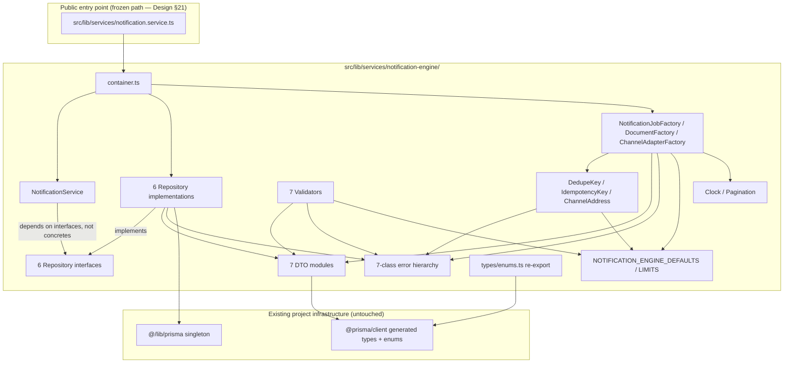
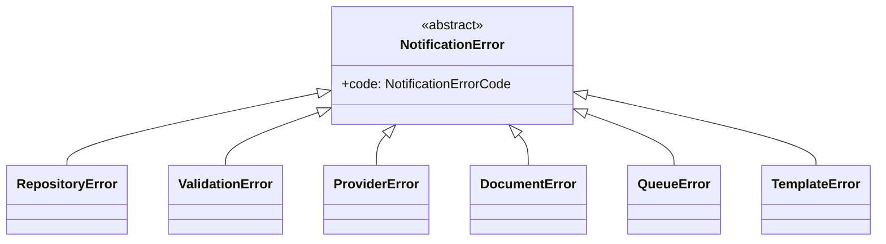

# Notification Engine — Core Infrastructure Report (Phase 2)

**Scope:** Infrastructure layer only — repositories, DTOs, value objects, constants, validators, error hierarchy, factories, and a `NotificationService` façade whose business-logic methods are typed stubs. **Nothing in this phase sends email, talks to SMTP, enqueues or processes a job, generates a PDF, calls Google Drive, renders a template, runs on a schedule, or is wired into any business module (`loan.actions.ts` etc.).** Verified by `tsc --noEmit` (strict, whole project, zero errors) and `eslint` (zero issues) — see [Verification](#verification).

**Inputs (frozen, unchanged by this phase):** [NotificationEngineDesign.md](../design/NotificationEngineDesign.md), [DatabaseImplementationReport.md](DatabaseImplementationReport.md), [MigrationRecoveryReport.md](../audits/MigrationRecoveryReport.md), [NotificationEngineDatabaseAudit.md](../audits/NotificationEngineDatabaseAudit.md).

---

## A Deliberate, Explicit Architectural Divergence

This phase's instructions ask for Repositories, DTOs, Value Objects, Factories, an error hierarchy, and Dependency Injection — a classic layered/Clean Architecture shape. **This is not what the rest of this codebase does.** [CLAUDE.md](../../../CLAUDE.md) and [DECISIONS.md](../../../DECISIONS.md#no-repositoryservice-layer-for-most-domains) are explicit that this project has *no* repository/DAO layer anywhere else, and that introducing one "piecemeal without a project-wide decision... would make the codebase inconsistent." The frozen design doc's own §33 ("Suggested Services") describes `notification.service.ts` as a plain singleton calling Prisma directly, matching `email.service.ts` — not a repository-based architecture.

This phase's instructions are explicit and detailed enough (exact repository names matching each table, an exact 7-class error hierarchy, explicit SOLID/DI/Clean-Architecture requirements) that they read as a deliberate, informed decision to give this one new, bounded-context subsystem a different, more rigorously layered treatment than the rest of the app — reasonable for a module explicitly designed to grow into six channels over several future phases. **This report treats that as an intentional, scoped decision, not an oversight, and isolates the entire divergence inside one folder (`src/lib/services/notification-engine/`) so it cannot leak into or contradict the conventions the rest of the codebase still follows.** Nothing outside this new folder (and one thin re-export file, discussed below) was touched.

---

## Folder Structure

```
src/lib/services/
├── notification.service.ts                          # PUBLIC entry point — exact path fixed by Design §21.
│                                                      # Thin re-export of the singleton built by the container below,
│                                                      # matching the existing emailService/zkTecoService pattern.
│
└── notification-engine/                              # Everything else lives here — isolated from the rest of src/lib.
    ├── index.ts                                      # Barrel export of the whole module
    ├── container.ts                                  # Manual DI wiring (see "Dependency Injection" below)
    ├── notification.service.ts                       # The actual NotificationService class
    │
    ├── errors/
    │   ├── notification-error.ts                     # Abstract base
    │   ├── repository-error.ts
    │   ├── validation-error.ts
    │   ├── provider-error.ts                          # reserved — no provider integration yet
    │   ├── document-error.ts                          # reserved — no PDF/Drive yet
    │   ├── queue-error.ts                              # reserved — no worker/queue yet; also thrown by the 3 service stubs
    │   ├── template-error.ts                          # reserved — no rendering yet
    │   └── index.ts
    │
    ├── constants/
    │   ├── notification-engine.constants.ts           # NOTIFICATION_ENGINE_DEFAULTS, NOTIFICATION_ENGINE_LIMITS
    │   └── index.ts
    │
    ├── types/
    │   └── enums.ts                                    # Re-exports the 5 Prisma enums — never redefines them
    │
    ├── value-objects/
    │   ├── dedupe-key.ts
    │   ├── idempotency-key.ts                          # implements Design §17's exact construction rule
    │   ├── channel-address.ts
    │   └── index.ts
    │
    ├── dto/                                            # One file per model, all derived from `@prisma/client` types
    │   ├── notification-event.dto.ts
    │   ├── notification-job.dto.ts
    │   ├── notification-delivery-attempt.dto.ts
    │   ├── notification-template.dto.ts
    │   ├── notification-provider.dto.ts
    │   ├── document.dto.ts                             # `Document` aliased to `DocumentModel` — collides with the DOM type
    │   ├── document-upload-attempt.dto.ts
    │   └── index.ts
    │
    ├── validators/                                     # Structural checks only — no business rules
    │   ├── notification-event.validator.ts
    │   ├── notification-job.validator.ts
    │   ├── notification-delivery-attempt.validator.ts
    │   ├── notification-template.validator.ts
    │   ├── notification-provider.validator.ts
    │   ├── document.validator.ts
    │   ├── document-upload-attempt.validator.ts
    │   └── index.ts
    │
    ├── repositories/
    │   ├── base.repository.ts                          # Shared error-wrapping only (see "Why no generic BaseRepository<T>")
    │   ├── notification.repository.ts                  # NotificationEvent
    │   ├── notification-job.repository.ts               # NotificationJob
    │   ├── notification-history.repository.ts            # NotificationDeliveryAttempt
    │   ├── notification-template.repository.ts           # NotificationTemplate
    │   ├── notification-provider.repository.ts           # NotificationProvider
    │   ├── document.repository.ts                        # Document + DocumentUploadAttempt
    │   ├── interfaces/                                    # One interface per repository (Dependency Inversion)
    │   │   ├── notification-repository.interface.ts
    │   │   ├── notification-job-repository.interface.ts
    │   │   ├── notification-history-repository.interface.ts
    │   │   ├── notification-template-repository.interface.ts
    │   │   ├── notification-provider-repository.interface.ts
    │   │   ├── document-repository.interface.ts
    │   │   └── index.ts
    │   └── index.ts
    │
    ├── factories/
    │   ├── notification-job.factory.ts                  # Fully implemented (construction only, no persistence/resolution)
    │   ├── document.factory.ts                          # Fully implemented (construction only)
    │   ├── channel-adapter.factory.ts                    # EMPTY — every channel throws ProviderError until registered
    │   ├── channel-adapter.interface.ts                  # The contract future channel adapters will implement
    │   └── index.ts
    │
    └── utils/
        ├── clock.ts                                     # IClock / SystemClock — testability for time-dependent code
        ├── pagination.util.ts                           # normalizePagination — bounds-checking only
        └── index.ts
```

53 files total. No file outside `src/lib/services/notification-engine/` was created, except the one thin re-export at the frozen `src/lib/services/notification.service.ts` path — no `src/actions/*.ts`, no component, no `instrumentation.ts` change, nothing under `src/app/`.

---

## Dependency Graph



**Direction of dependency is strictly one-way**: `notification.service.ts` (entry) → `container.ts` (wiring) → `NotificationService` (depends only on interfaces) ← implemented by → concrete repositories → Prisma. Nothing in `errors/`, `constants/`, `types/`, `value-objects/`, or `dto/` depends on anything else in this module — they are the leaves of the graph, which is what makes them safely reusable by validators, factories, *and* repositories without any circular dependency.

---

## Repository Responsibilities

Every repository: (1) implements one interface, (2) extends `BaseRepository` for consistent error wrapping, (3) contains **only** Prisma calls — no branching business logic, no cross-table orchestration, no decisions.

| Repository | Table(s) | Methods | Explicitly NOT included |
|---|---|---|---|
| `NotificationRepository` | `NotificationEvent` | `create`, `findById`, `findByDedupeKey`, `findMany` | Fan-out to jobs, recipient/channel resolution |
| `NotificationJobRepository` | `NotificationJob` | `create`, `findById`, `findByIdempotencyKey`, `findMany`, `update` | Atomic "claim next batch" / lease semantics, retry-scheduling |
| `NotificationHistoryRepository` | `NotificationDeliveryAttempt` | `create`, `findById`, `findByJobId` | Any `update`/`delete` (table is an immutable log by design) |
| `NotificationTemplateRepository` | `NotificationTemplate` | `create`, `findById`, `findActiveByKeyAndChannel`, `findMany`, `update` | Placeholder rendering, template selection logic |
| `NotificationProviderRepository` | `NotificationProvider` | `create`, `findById`, `findActiveByChannelOrderedByPriority`, `updateHealth` | Circuit-breaker/cooldown *decision* of when to skip a degraded provider |
| `DocumentRepository` | `Document`, `DocumentUploadAttempt` | `create`, `findById`, `findMany`, `update`, `addUploadAttempt`, `findUploadAttemptsByDocumentId` | PDF generation, Google Drive upload |

**Why no generic `BaseRepository<T>` bound to a Prisma delegate:** Prisma's per-model delegate types aren't uniform enough (different relation shapes, different unique-lookup keys) to make a single generic useful without fighting the ORM's own typing. What genuinely is shared — "catch whatever Prisma throws, wrap it as a `RepositoryError`, never leak a raw Prisma error to a caller" — is factored into `BaseRepository.wrap()`, which every repository method funnels through. This is the DRY boundary that was actually worth drawing.

---

## Service Responsibilities

`NotificationService` (the class; `src/lib/services/notification.service.ts` exports its singleton as `notificationService`, matching the `emailService` convention):

| Method | Status this phase | Why |
|---|---|---|
| `getEventById`, `getEventByDedupeKey` | **Fully implemented** | Pure delegation to `INotificationRepository` — zero decisions made |
| `getJobById`, `getJobHistory` | **Fully implemented** | Pure delegation to `INotificationJobRepository` / `INotificationHistoryRepository` |
| `getActiveTemplate` | **Fully implemented** | Pure delegation to `INotificationTemplateRepository` — returns the stored row, does not render it |
| `getActiveProvidersForChannel` | **Fully implemented** | Pure delegation to `INotificationProviderRepository` — returns the sorted list, does not decide failover |
| `getDocumentById` | **Fully implemented** | Pure delegation to `IDocumentRepository` |
| `raiseEvent` | **Stub — throws `QueueError`** | Requires recipient/channel resolution + job fan-out (Design §6) — business logic, explicitly out of scope |
| `processJob` | **Stub — throws `QueueError`** | Requires template rendering + provider dispatch + retry scheduling (Design §7-§10, §16) — explicitly out of scope |
| `resendJob` | **Stub — throws `QueueError`** | Requires queue-processing logic (Design §7, §32) — explicitly out of scope |

The three stubs share one deliberate design point: their signatures already match what Design §7/§22 describes, so a later phase implements *behavior* inside an existing method rather than changing this class's public contract or touching any future caller (Open/Closed Principle in practice, not just in a bullet list).

`document.service.ts` (the PDF/Drive orchestrator Design §33 also names) was **not created this phase** — its entire job is PDF generation and Google Drive upload, both explicitly forbidden. Building an empty stub for it would add a file with no honest content; it's listed under [Intentionally Postponed](#intentionally-postponed) instead.

---

## Interfaces

Six repository interfaces (`repositories/interfaces/*.interface.ts`), each named `I<Name>Repository`, each the sole thing `NotificationService`'s constructor depends on:

```ts
constructor(
  private readonly notificationRepository: INotificationRepository,
  private readonly jobRepository: INotificationJobRepository,
  private readonly historyRepository: INotificationHistoryRepository,
  private readonly templateRepository: INotificationTemplateRepository,
  private readonly providerRepository: INotificationProviderRepository,
  private readonly documentRepository: IDocumentRepository,
  private readonly channelAdapterFactory: ChannelAdapterFactory
) {}
```

Plus one forward-looking interface, `NotificationChannelAdapter` (`factories/channel-adapter.interface.ts`), matching Design §22's channel-adapter contract exactly — `{ channel, send(job, content) }`. No implementation of it exists yet (see Factories below); it exists now so `ChannelAdapterFactory.register()` has a real type to accept later without redefining anything.

---

## Factories

| Factory | Status | Responsibility |
|---|---|---|
| `NotificationJobFactory` | **Fully implemented** | Builds a well-formed `CreateNotificationJobInput` — constructs the `IdempotencyKey` per Design §17's exact rule, applies the `maxAttempts` default from `NOTIFICATION_ENGINE_DEFAULTS`, stamps `nextAttemptAt` via an injectable `IClock`. Does **not** decide which recipients/channels an event should produce jobs for. |
| `DocumentFactory` | **Fully implemented** | Builds a well-formed `CreateDocumentInput` with the correct initial state (`PENDING_GENERATION`). Does **not** generate a PDF. |
| `ChannelAdapterFactory` | **Empty, as required** | `getAdapter(channel)` throws `ProviderError` for every channel — nothing is registered. `register(adapter)` exists as the extension point a later phase will call once a real `NotificationChannelAdapter` (starting with email) is implemented — Open/Closed by construction, not just by convention. |

---

## Validators

Seven validators (`validators/*.validator.ts`), one per model that has a "create" DTO. Every validator: (1) collects **all** structural issues into a list rather than throwing on the first one, (2) throws a single `ValidationError` carrying that list, (3) checks presence/length/enum-membership only.

**Explicitly not checked by any validator in this module** (all reserved for later, business-logic-bearing phases):
- Whether a `dedupeKey`/`idempotencyKey` already exists (a repository unique-constraint concern, surfaced as `RepositoryError`, not a validation concern)
- Whether a recipient has opted out via `NotificationPreference`
- Whether a template's placeholder syntax is well-formed
- Whether a provider's `configEncrypted` actually decrypts to a usable credential
- Whether an `eventType`/`sourceDomain` string is a recognized, real domain event

---

## Errors

The exact 7-class hierarchy requested, all in `errors/`:



| Class | Thrown by, in this phase | Reserved for |
|---|---|---|
| `NotificationError` | Never directly (abstract) | Base type every caller can catch with one `instanceof` check |
| `RepositoryError` | `BaseRepository.wrap()`, on any unexpected Prisma failure | — |
| `ValidationError` | Every validator, every value object | — |
| `ProviderError` | `ChannelAdapterFactory.getAdapter()` (no channel registered yet) | SMTP/channel failover phase |
| `DocumentError` | Nothing yet | PDF/Drive phase |
| `QueueError` | `NotificationService.raiseEvent/processJob/resendJob` stubs | Worker/queue phase |
| `TemplateError` | Nothing yet | Template-rendering phase |

Every subclass carries an optional domain-specific identifier (`repositoryName`, `providerId`, `documentId`, `jobId`, `templateKey`) and an optional `cause` — enough for a later phase's logging/observability to discriminate without inspecting message strings.

---

## Constants

`constants/notification-engine.constants.ts` — `NOTIFICATION_ENGINE_DEFAULTS` mirrors exactly the column defaults already declared on `NotificationSettings` in `prisma/schema.prisma` (worker poll interval/batch size, retry base/max delay/max attempts/jitter, retention days, provider priority/failure threshold, template initial version) — a single source so a later phase's factories/repositories never hard-code a number that could drift from the schema's own default. `NOTIFICATION_ENGINE_LIMITS` holds only structural bounds used by validators (string lengths) — no business thresholds.

---

## Enums

Not redefined — `types/enums.ts` re-exports the 5 Prisma-generated enums (`NotificationChannel`, `NotificationJobStatus`, `AttemptOutcome`, `NotificationProviderHealthStatus`, `DocumentStatus`) verbatim from `@prisma/client`, giving the rest of this module one stable import path without a second, duplicate type definition anywhere (directly satisfying this phase's "No duplicated interfaces" requirement).

---

## Dependency Injection

This project has **no DI framework anywhere** — every existing service (`emailService`, `zkTecoService`, `loan.service.ts`'s functions) is a plain exported function or singleton instance, no InversifyJS/tsyringe/NestJS-style container. Per this phase's own instruction ("DI if the project already uses it, otherwise follow current architecture"), no DI library was added — that would be a new dependency requiring the sign-off [CONTRIBUTING.md](../../../CONTRIBUTING.md#logging) calls for, for a project that has never needed one.

Instead: **manual constructor injection**, wired once in `container.ts`:

- `NotificationService`'s constructor takes 6 repository *interfaces* + `ChannelAdapterFactory` — it has no idea it's talking to Prisma-backed repositories, satisfying Dependency Inversion without a framework.
- `createNotificationEngineContainer(overrides?)` is a factory function a future test suite can call with fake repositories to get an isolated `NotificationService` — the reason the container is a function, not just inline singleton construction.
- `notificationEngineContainer` is the one real, Prisma-backed instance, built by calling that factory with no overrides — and `src/lib/services/notification.service.ts` re-exports its `.notificationService` as `notificationService`, so callers import it exactly the way they already import `emailService`.

---

## Type Safety

`tsc --noEmit -p tsconfig.json` (strict mode, the project's existing config, unmodified) run against the **entire project** after adding these 53 files: **zero errors.** `eslint` against every new file: **zero issues.** No `any` appears anywhere in this module — every DTO is derived from `@prisma/client`'s generated types via `Pick`/`Partial` rather than hand-duplicated, and the one genuine Prisma typing quirk encountered (`Json?` fields needing `Prisma.JsonNull` instead of a bare `null` for the `create` input) was resolved with the correct Prisma-provided type, not an `any`/`as unknown` escape hatch.

A full runtime execution smoke test (actually calling the repositories against the live database) was **not** performed in this phase, for two reasons: (1) nothing in this phase is wired into any Server Action or route yet, so there is no real caller to exercise, and (2) the underlying Prisma delegate operations these repositories use (`create`/`findUnique`/`findMany`/`update` on all 9 tables, including relation `include`s) were already directly verified against the live database during the Phase-2-audit work earlier in this engagement (see [NotificationEngineDatabaseAudit.md](../audits/NotificationEngineDatabaseAudit.md) §6-§7) — these repositories use exactly those same call shapes. The framework-independent pieces (value objects, factories, validators, error hierarchy) were exercised with a standalone runtime script during development; it's not retained since it required import-path adjustments incompatible with this project's `bundler` module resolution (see [Verification](#verification)).

---

## Intentionally Postponed

| Item | Why postponed |
|---|---|
| `document.service.ts` | Its entire purpose (Design §11-§15) is PDF generation and Google Drive orchestration — both explicitly forbidden this phase. An empty stub would add a file with no honest content to stub; `DocumentRepository` (the data-access half it would eventually call) is already built. |
| Channel adapters (email, SMS, WhatsApp, Push, Slack, Teams) | Explicitly forbidden ("NOT Email. NOT SMTP."). `ChannelAdapterFactory`/`NotificationChannelAdapter` exist as the registration point. |
| Queue worker / claim-and-lease logic | Explicitly forbidden ("NOT the Queue... NOT Worker"). `QueueError` and the read-only job query shape exist; no polling, claiming, or crash-recovery logic does. |
| Retry-scheduling algorithm | Explicitly forbidden ("NOT ... Retry"). `NOTIFICATION_ENGINE_DEFAULTS.retry` holds the numbers; nothing computes a backoff. |
| Template rendering | Explicitly forbidden ("NOT Templates"). `NotificationTemplateRepository` reads/writes rows; nothing turns a template + payload into a rendered subject/body. |
| Cron registration (`instrumentation.ts`) | Explicitly forbidden ("NOT Cron"). Untouched. |
| `NotificationPreferenceRepository` / `NotificationSettingsRepository` | Not in this phase's explicit 6-repository list. `NotificationPreference`/`NotificationSettings` tables exist (Phase 1) but have no dedicated repository yet — expected to arrive alongside whichever future phase first needs to read/write them (recipient-preference resolution, or the settings admin UI). |
| Server Actions (`notification-engine.actions.ts`, etc.) | Explicitly forbidden ("NOT Business Module Integration"). Nothing in `src/actions/` was created — this phase's code has no "use server" entry point yet and is not reachable from any component. |
| Business module integration (`loan.actions.ts` calling `raiseEvent`, etc.) | Explicitly forbidden. No existing action file was touched. |

---

## Verification

| Check | Result |
|---|---|
| `npx prisma validate` (pre-existing, unaffected) | Not re-run — no schema change this phase |
| `npx tsc --noEmit -p tsconfig.json` (whole project, strict mode) | ✅ Zero errors, including all 53 new files |
| `npx eslint` on every new file | ✅ Zero issues |
| `any` usage | ✅ None — grep-confirmed zero occurrences of `: any` / `as any` in this module |
| Duplicated interfaces/enums | ✅ None — enums re-exported from `@prisma/client`, DTOs derived via `Pick`/`Partial`, not hand-copied |
| Files outside `src/lib/services/notification-engine/` (besides the one frozen re-export) | ✅ None created or modified |
| `src/actions/*`, `src/app/*`, `instrumentation.ts` | ✅ Untouched |
| Business module files (`loan.actions.ts`, etc.) | ✅ Untouched |

No file was created outside the scope declared above. No migration, schema, or database write occurred in this phase — this phase is TypeScript source only.
