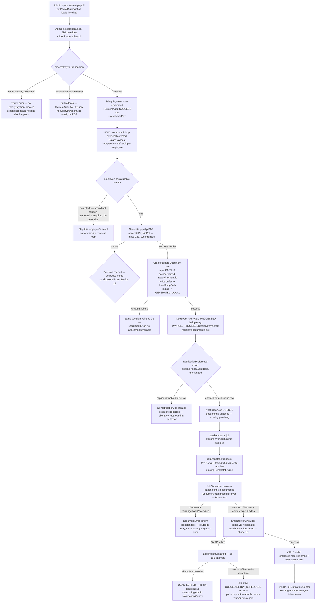

# Payroll Email + PDF: Architecture & Flow (Design Only — Not Implemented)

**Status: documentation only.** No code, schema, or migration was changed while producing this report. This is the design to review before any implementation phase begins.

## 0. Correcting the assumed starting point

The brief's proposed flow opens with "CSV Payroll Data → Payroll Processing / Import." **This does not match the actual codebase and has been corrected below, not forced to fit.**

Inspected `src/actions/payroll.actions.ts`, `src/components/admin/PayrollClient.tsx`, and every file under `src/app/(admin)/admin/payroll/`: there is **no CSV import anywhere** in this system. Payroll is not derived from an uploaded file. The only CSV-related code is `generatePayrollCSVData()`, which **exports** a bank-submission file (employee name, account number, net pay) — and it runs client-side, as a browser `Blob` download, **after** `processPayroll()` has already succeeded. There is no file upload input, no CSV parser, no "validate CSV rows" step anywhere in this app.

The real entry point is: an admin opens `/admin/payroll`, the page loads live-aggregated data via `getPayrollAggregation(month, year)` (a pure read over `User`/`Loan`/`MedicalClaim`/`BonusType`/`AllowanceType`), the admin selects bonuses/EMI overrides in `PayrollClient.tsx`, and clicks "Process Payroll" — which calls `processPayroll(payrollMonth, selectedBonuses, emiDisabledUsers)`. That's the actual trigger. The flowchart below uses this real flow, not the CSV-import one.

## 1. Current architecture (as found)

### 1a. Payroll lifecycle
- **Calculation** — `getPayrollAggregation(month, year)`: pure read, computes each eligible employee's `baseSalary`, `totalAllowances`, `totalMedical`, `totalLoanDeduction`, `netPay`, plus `email`, `firstName`/`lastName`, `bankAccountNumber`. No writes.
- **Processing/finalization** — `processPayroll()`: **one single `prisma.$transaction` looping over every eligible employee for the entire month in one call.** Guarded against double-running by a month-level `existingPayment` check *before* the transaction starts. Inside the transaction, per employee: creates a `SalaryPayment` row, zeroes `walletBalance` (+ `WalletTransaction`), marks `APPROVED` medical claims `PAID`, updates loan/EMI state, writes one `SystemAudit` row for the whole run. On any error, the transaction rolls back and a `SystemAudit` `FAILED` row is written outside it.
- **Post-processing (client-side, not in the transaction)** — `PayrollClient.tsx` calls `generatePayrollCSVData()` and downloads a bank-submission CSV.

### 1b. Payroll email — confirmed missing
Zero email/notification code anywhere in `payroll.actions.ts` or the payroll UI. `payroll.actions.ts` has **no import of `notificationEngineContainer`** (confirmed by grep — every other business domain wired to the engine so far, `leave.actions.ts`/`overtime-request.actions.ts`, imports it via `import { notificationEngineContainer } from "@/lib/services/notification-engine";`; payroll has none).

### 1c. Payslip PDF — built in Phase 18a, not yet wired to anything
`src/lib/services/payslip-pdf.service.ts` exports `generatePayslipPdf(data: PayslipData): Promise<Buffer>` — pure, synchronous-in-effect (no DB/network), pdfkit-based, ~7–8 KB output, sub-second. Takes exactly the real `SalaryPayment` fields (`month`, `baseSalary`, `totalBonuses`, `totalAllowances`, `medicalReimbursement`, `loanDeduction`, `walletAdjustment`, `netAmount`) plus `employeeName`/`employeeEmail`. Bundles a small Noto Sans Bengali subset (OFL-1.1) so the real `৳` symbol renders correctly (Helvetica alone can't render it). **Nothing calls this function today** — it exists and is fully tested (16 tests, independently verified via `pdfjs-dist`), but is not invoked from `payroll.actions.ts` or anywhere else.

### 1d. Document attachment plumbing — built in Phase 18b, not yet wired to payroll
- `Document` model (Phase 1, previously dormant): `type` (free-form, e.g. `"PAYSLIP"` — already the schema comment's own example), `sourceEntityId` (plain string, no FK — the established polymorphic-reference pattern also used by `AuditLog.userId`), `status` (`DocumentStatus`: `PENDING_GENERATION → GENERATED_LOCAL → ...`), `localTempPath`.
- `NotificationJob.documentId` (Phase 1): optional FK to `Document`. Already fully wired end-to-end through `raiseEvent()` → `NotificationJobFactory` → `QueueRepository` (proven by an existing passing test asserting `documentId` flows through correctly).
- **Phase 18b's addition**: `RenderedNotificationContent.attachments?: NotificationAttachment[]` (additive field, frozen interface otherwise unchanged); `DocumentAttachmentResolver` (`worker/document-attachment-resolver.ts`) — turns `job.documentId` into `{ filename, contentType, content: Buffer }` by loading the `Document` row and reading `localTempPath` off disk, throwing `DocumentError` for missing/not-ready/empty/oversized files; `JobDispatcher.renderContent()` calls it (optionally injected, fully backward compatible) and merges the result onto rendered content; `SmtpDeliveryProvider.deliver()` forwards `content.attachments` into `nodemailer`'s `sendMail()` only when present. Wired into the real `container.ts`/`create-worker-runtime.ts` production path already — this is live, not just built-and-unused.
- **What's still missing**: nothing yet ever calls `documentRepository.create()`/`.update()` with a real generated file. The whole Document Engine's write side remains dormant — Phase 18b built the *read/attach* path, not a *producer*.

### 1e. Notification event/preference/dispatch pipeline (all pre-existing, Phase 9–17)
- `NotificationService.raiseEvent(request)` — the **one entry point** business actions call. Validates, derives/accepts a `dedupeKey`, **event-level dedup** (a repeat `raiseEvent` call with the same `dedupeKey` is a no-op — returns the existing event/jobs), then per-recipient: checks `NotificationPreference` (see below), and for every still-opted-in recipient calls `queueEngine.enqueue()` (job-level idempotency via `idempotencyKey`, independent of event-level dedup).
- **Preference check** (`isOptedOut()`, inside `raiseEvent`): looks up `(recipientUserId, eventType, channel)` directly against `NotificationPreference` — **works for any `eventType` automatically**, no registration needed. "No row" = enabled by default; only an explicit `isEnabled: false` row opts a recipient out. `preferences/preference-catalog.ts`'s `MANAGEABLE_NOTIFICATION_TYPES` is a **separate, UI-only** list (Phase 14's Notification Center) controlling what an employee can *see and toggle* — not a functional gate on enforcement itself.
- **Worker** (`WorkerRuntime`/`NotificationWorker`/`JobDispatcher`) — polls, claims `QUEUED`/due `RETRY_SCHEDULED` jobs, renders the template (`TemplateEngine`, keyed by `eventType` + `channel`), resolves the attachment if `documentId` is set (Phase 18b), dispatches to `DeliveryManagerChannelAdapter` → `DeliveryManager` → `SmtpDeliveryProvider` → real SMTP via `nodemailer`. Failure → existing retry/backoff (5 attempts) → `DEAD_LETTER` on exhaustion, all unchanged.
- **No existing payroll event/template**: confirmed no `PAYROLL_*` eventType anywhere in `prisma/seed.js`'s template blocks or `preference-catalog.ts`.

## 2. Proposed payroll email architecture

**Trigger point: after `processPayroll()`'s `$transaction` commits — never inside it.** The payroll transaction must remain fully independent of email/PDF code; this is non-negotiable per your own framing and is also how every existing business event in this codebase already works (`leave.actions.ts`, `overtime-request.actions.ts` both call `raiseEvent()` after their transaction, in a best-effort `try/catch`, per employee).

**PDF generation: synchronous, inline in that post-commit loop — not a separate background job.** Reasoning:
- `generatePayslipPdf()` is a pure, in-memory, sub-second operation (no network, no external process) — there is no real latency problem to solve by deferring it.
- This app has no general-purpose background-job infrastructure outside the Notification Engine itself; introducing one just to defer a sub-second PDF render would be new architecture for no real benefit — the same kind of over-engineering the frozen-architecture constraints on this whole project explicitly rule out.
- Generating synchronously means the `Document` row is already `GENERATED_LOCAL` with real bytes on disk *before* `raiseEvent()` ever enqueues the job — eliminating any race where a worker could claim a job whose attachment isn't ready yet.
- This matches the existing Document Engine's own designed state machine (`PENDING_GENERATION → GENERATED_LOCAL`) — a synchronous local-generation step is exactly what `GENERATED_LOCAL` was designed to represent, no async "still generating" polling required for this use case.

The one real cost: for a large employee count, this makes `processPayroll()`'s Server Action response take longer (CPU-bound, sequential, one PDF per employee). Given this codebase's own framing ("single global database serving one organization," not a multi-tenant SaaS), this is very unlikely to be a real problem at realistic company sizes — flagged as a future optimization (parallelize the loop), not a blocker now.

## 3. Complete flowchart



## 4. Data flow

`SalaryPayment` (already committed) → `PayslipData` (mapped 1:1, no new fields, no recalculation) → `generatePayslipPdf()` → `Buffer` → written to a local temp path → `Document` row (`type: "PAYSLIP"`, `sourceEntityId: salaryPayment.id`, `status: "GENERATED_LOCAL"`, `localTempPath`) → `raiseEvent()`'s recipient `documentId` → `NotificationJob.documentId` → `DocumentAttachmentResolver` re-reads the same file at delivery time → `NotificationAttachment` → `nodemailer` attachment. The PDF's *content* is never re-derived at any later stage — it's generated once, from the authoritative `SalaryPayment` row, and the exact same bytes are what gets attached (this is the same "no recomputation" guarantee `payslip-pdf.service.ts`'s own doc comment already states).

## 5. Failure / retry flow

| Failure | Existing mechanism reused | New behavior needed |
|---|---|---|
| Payroll month already processed | `existingPayment` check, pre-transaction | None |
| Payroll transaction fails (any reason) | Full rollback, `SystemAudit` FAILED row | None — email code runs strictly after commit, never reached |
| Missing/blank employee email | Practically unreachable (`User.email` required) | Defensive skip-and-log per employee, don't block the loop |
| PDF generation fails | — (new code) | **Decision needed** — see §14 |
| Document create/write fails | — (new code) | Same decision as above |
| Preference disabled | `raiseEvent()`'s `isOptedOut()` — silent skip | None |
| SMTP transient failure | `QueueEngine` retry/backoff (5 attempts) | None |
| Max retries reached | `DEAD_LETTER`, visible + manually requeueable in Admin Notification Center | None |
| Document unresolvable at delivery time | `DocumentAttachmentResolver` throws `DocumentError` → same retry/dead-letter path as any dispatch failure | None (Phase 18b already built this) |
| Worker/server temporarily offline | Job sits `QUEUED`/`RETRY_SCHEDULED`, claimed on next worker run | None |
| Duplicate payroll email | Event-level dedup (`dedupeKey`) + job-level idempotency (`idempotencyKey`), both existing | None — just use `PAYROLL_PROCESSED:${salaryPayment.id}` as the dedupeKey |

**The payroll transaction is structurally incapable of depending on email delivery** in this design — the email/PDF loop is not inside `prisma.$transaction`, each employee's `raiseEvent()` call is independently try/caught (matching Phase 15's `LEAVE_APPROVED`/`LEAVE_REJECTED` pattern exactly), and the worker's own retry/dead-letter machinery already handles SMTP being down indefinitely without any payroll-specific code.

## 6. Where the payroll event should be triggered

Inside `processPayroll()`, immediately after the `revalidatePath(...)` calls and before `return result` — i.e., after the transaction has fully committed. **Not** a separate cron/cleanup job, **not** triggered from the CSV-export step (that's a client-side download, not a reliable server-side hook, and per §0 it's not even part of the real "processing" step).

## 7. Where PDF generation should happen

Recommended: **synchronously, in the same post-commit loop**, per §2's reasoning. The alternative (a separate async job that generates the PDF later) would require new infrastructure this app doesn't have and would introduce exactly the kind of "worker claims a job before the attachment exists" race that synchronous generation avoids for free.

## 8. How the PDF reaches SMTP as an attachment

Already fully built (Phase 18b), reused unmodified: `Document.localTempPath` → `DocumentAttachmentResolver.resolve(documentId)` → `NotificationAttachment` → `JobDispatcher.renderContent()` merges it onto `RenderedNotificationContent.attachments` → `SmtpDeliveryProvider.deliver()` forwards it to `nodemailer.sendMail({ attachments: [...] })`. Nothing here needs to change for payroll — this pipeline is generic, not payroll-specific (matches the explicit "provider must remain generic" rule from Phase 18b).

## 9. Idempotency / deduplication strategy

`dedupeKey: \`PAYROLL_PROCESSED:${salaryPayment.id}\`` — mirrors the existing `LOAN_APPROVED:${loanId}` convention exactly. Two independent layers already guarantee no duplicate email: (1) `processPayroll()`'s own month-level `existingPayment` check means a whole payroll run can't happen twice for the same month; (2) even if `raiseEvent()` were somehow called twice for the same `salaryPayment.id` (e.g. a retried request), `NotificationService.raiseEvent()`'s event-level dedup on `dedupeKey` returns the existing event/jobs as a no-op — no second job is ever created. No new dedup logic required.

## 10. Notification preference behaviour

Works automatically, zero new engine code: the moment `raiseEvent({ eventType: "PAYROLL_PROCESSED", ... })` is called, `isOptedOut()` already checks `(recipientUserId, "PAYROLL_PROCESSED", "EMAIL")` against `NotificationPreference` (default: enabled). **Recommended, not required**: add one entry to `MANAGEABLE_NOTIFICATION_TYPES` so employees can actually see/toggle "Payroll processed" in the Notification Center's existing preference UI (Phase 14) — purely additive, same one-line-per-event pattern as the 5 existing entries.

## 11. Worker / retry behaviour

Entirely unchanged and already correct for this use case — the worker doesn't know or care that a job came from payroll vs. loans vs. leave. Retry/backoff, `DEAD_LETTER` on exhaustion, and the Admin Notification Center's manual-requeue action all already work for any `EMAIL` job with a `documentId`, proven by Phase 18b's own integration test (`document-attachment.integration.test.ts`).

## 12. What existing components can be reused (unchanged)

`NotificationService.raiseEvent()`, `QueueEngine`, `WorkerRuntime`/`NotificationWorker`, `JobDispatcher` (already `documentId`-aware since Phase 18b), `TemplateEngine`, `DeliveryManager`, `DeliveryManagerChannelAdapter`, `SmtpDeliveryProvider` (already attachment-aware since Phase 18b), `DocumentAttachmentResolver`, `generatePayslipPdf()` (Phase 18a), the `Document`/`NotificationJob.documentId` schema (Phase 1, no migration needed), the Admin Notification Center's existing retry/dead-letter UI, `formatCurrency()` (used as-is inside `payslip-pdf.service.ts` already).

## 13. What new code will actually be required

1. **`payroll.actions.ts`**: capture each created `SalaryPayment`'s `id` from inside the transaction (small addition — push `{ userId, email, ..., salaryPaymentId }` into an array as each `tx.salaryPayment.create()` call happens, return it from the transaction) — needed because the transaction doesn't currently surface created row IDs to the caller.
2. **`payroll.actions.ts`**: a new post-commit loop calling `generatePayslipPdf()`, then creating/updating a `Document` row, then `notificationEngineContainer.notificationService.raiseEvent(...)` — per employee, independently try/caught, matching the exact `leave.actions.ts`/`overtime-request.actions.ts` pattern.
3. **A small new function to write the PDF `Buffer` to a local temp path** — doesn't exist yet anywhere (Phase 18a returns a `Buffer`, doesn't write files). A few lines using `node:fs/promises`, likely into `os.tmpdir()`.
4. **A way to call `documentRepository.create()`/`.update()` from `payroll.actions.ts`** — see the decision point in §14; this is a real architectural fork, not a mechanical detail.
5. **`prisma/seed.js`**: one new idempotent `PAYROLL_PROCESSED`/`EMAIL` template block, matching the 5 existing ones.
6. **`preferences/preference-catalog.ts`**: one new entry (recommended, not required — see §10).

No Prisma migration, no `NotificationService`/`QueueEngine`/`WorkerRuntime`/`JobDispatcher`/`DeliveryManager`/`SmtpDeliveryProvider` changes — everything at the engine level Phase 18a/18b already built is sufficient as-is.

## 14. Risks / decisions that need your sign-off before implementation

1. **PDF generation or Document-write failure — degraded send, or no send at all?** Two real options: (a) send the email anyway without the attachment, with a note in the body and/or an admin alert (`createAdminNotification`) — matches the Notification Engine design doc's own "degraded mode" recommendation; (b) skip the email entirely for that employee and only alert an admin, so an employee never gets a payroll email that's missing its payslip. **This is a product decision, not a technical one — please choose.**
2. **How does `payroll.actions.ts` reach the `Document` write path?** `NotificationService`'s own doc comment states it is "the ONLY entry point business modules should ever call" — but it currently only exposes a *read* passthrough (`getDocumentById`), no `create`/`update`. Two options: (a) add a small, purely additive `createDocument()`/`markDocumentGenerated()` passthrough method to `NotificationService`, preserving that stated convention; (b) have `payroll.actions.ts` reach directly into `notificationEngineContainer.repositories.documentRepository`, which is more expedient but breaks that convention for the first time. **Recommend (a)**, but flagging as a decision since it touches a class every other business domain currently treats as the single front door.
3. **Local temp file storage** — `Document.localTempPath` writes to local disk. Fine for this app's current single-container deployment (confirmed via `deployment-infra`), but worth being aware of before any future multi-instance scale-out; not a blocker now.
4. **Sequential per-employee processing time** — for a very large payroll run, generating N PDFs synchronously inside one Server Action adds latency proportional to employee count. Not a concern at this app's realistic scale, but worth measuring once real usage data exists.
5. **Employee-facing template content** — the actual subject/body wording for the `PAYROLL_PROCESSED` email template isn't specified anywhere yet; needs your input (or a reasonable draft) before the `prisma/seed.js` template block can be written.

---

## Summary for review

**Found**: no CSV import exists (corrected from the brief's assumption — payroll is computed live from the DB); payroll email is completely missing; Phase 18a's PDF generator and Phase 18b's attachment-delivery pipeline are both fully built, tested, and already live in production wiring, but nothing calls either of them yet.

**Proposed flow**: trigger strictly after `processPayroll()`'s transaction commits; generate each payslip PDF synchronously in that same post-commit loop; store it via the existing (currently unused) `Document` model; pass its id through the already-proven `raiseEvent()` → `documentId` → `DocumentAttachmentResolver` → SMTP pipeline untouched.

**Files that would need to change** (future phase, not now): `src/actions/payroll.actions.ts` (the only real logic change), `prisma/seed.js` (+1 template), `preferences/preference-catalog.ts` (+1 entry, optional), possibly `notification.service.ts` (+1 small passthrough method — see decision 2).

**Files that should NOT change**: `prisma/schema.prisma` (no migration needed), `NotificationService.raiseEvent()`'s existing methods, `QueueEngine`, `WorkerRuntime`, `JobDispatcher`, `DeliveryManager`, `SmtpDeliveryProvider`, `DocumentAttachmentResolver`, `payslip-pdf.service.ts`, any loan-notification code.

**Decisions needed from you before implementation** (§14): degraded-send vs. no-send on PDF/Document failure; how `payroll.actions.ts` should reach the Document-write path; template wording.

No code was written or modified while producing this report.

---

# Part 2 — Google Drive Integration (Design Only — Not Implemented)

Extends Part 1 above with Google Drive archival. Same status: documentation only, nothing implemented.

## 1. Current payroll processing flow

Unchanged from Part 1 §0/§1a — no CSV import exists; `/admin/payroll` → `processPayroll()` → one `$transaction` creating `SalaryPayment` rows. Re-confirmed this session by re-reading `payroll.actions.ts` in full.

**One gap found that matters for Drive specifically**: `getPayrollAggregation()` (the function `processPayroll()` calls to get each employee's data) does **not** currently select the employee's branch — no `include: { branch: ... }` on its `prisma.user.findMany()` call, and `PayrollAggregation` has no `branchName` field. The required `Payroll/{Month}/{Branch}/...` folder structure needs branch per employee, so this is a small, safe, read-only addition this feature will require (adding one more `include`, mirroring how `loans`/`medicalClaims` are already included there).

## 2. Current payslip/PDF flow

Unchanged from Part 1 §1c: `generatePayslipPdf(data: PayslipData): Promise<Buffer>` (Phase 18a) is fully built and tested, takes exact `SalaryPayment` fields, has no DB/network dependency, renders the real `৳` symbol via the bundled Noto Sans Bengali subset. **Confirmed again this session: still uncalled from anywhere.** This is the one and only PDF generator to reuse — no second implementation.

## 3. Current SMTP configuration flow (the pattern Drive config must mirror)

Inspected in full this session:

- **Schema**: `EmailConfig` — a singleton row (`id: "global"`, upserted), plain fields (`provider`, `smtpHost`, `smtpPort`, `secure`, `senderEmail`) plus exactly one encrypted secret column: `appPasswordEncrypted`.
- **Encryption**: `src/lib/crypto.ts` — `encryptSecret`/`decryptSecret`, AES-256-GCM, key derived from the `EMAIL_SECRET_KEY` env var via SHA-256. Generic — not SMTP-specific — already reusable as-is for a Drive secret.
- **Actions** (`src/actions/email-config.actions.ts`), all gated by `canManageEmailConfig()` (`SUPERADMIN || HR`):
  - `getEmailConfig()` — returns config **with the secret masked**: `hasAppPassword: !!config.appPasswordEncrypted` (a boolean), never the plaintext or ciphertext itself.
  - `updateEmailConfig(payload)` — validates, encrypts the new secret only if one was actually submitted (`if (newPassword) data.appPasswordEncrypted = encryptSecret(newPassword)`) — leaving an unchanged secret alone if the admin didn't retype it, exactly the UX a "Test Connection" flow needs (never forces re-entry of a working secret).
  - `sendTestEmail(receiverEmail)` — exercises the **real** external service (sends an actual test email) using the currently-saved config; returns `{ success, message }`, never leaks credentials in the response.
- **Storage of the resolved config**: `src/lib/email-config.ts`'s `resolveEmailConfig()` — reads the row, decrypts the secret in-memory, returns a plain object; used both by the legacy `email.service.ts` and `SmtpDeliveryProvider` (via `register-smtp-provider.ts`), so both paths resolve config identically.
- **UI**: `src/components/system/EmailConfigCard.tsx`, rendered inside `SystemControlClient` on `/admin/system-control`, fed by `getEmailConfig()`/`getSystemControlConfig()` server-side in `page.tsx`.

**This is the exact pattern a Google Drive config should mirror**: a singleton settings row, one (or more) encrypted secret column(s) via the same `crypto.ts` functions, a masked `getXConfig()`, an `updateXConfig()` that only overwrites a secret when a new one is submitted, a `testXConnection()` that exercises the real API without side effects on real data, and a new card component next to `EmailConfigCard` in the same `/admin/system-control` page.

## 4. Current Notification Engine flow

Unchanged from Part 1 §1e — `NotificationService.raiseEvent()` is the one entry point, event/job-level dedup, preference check via `isOptedOut()` (works for any `eventType` automatically), `WorkerRuntime`/`JobDispatcher` render + dispatch, `SmtpDeliveryProvider` sends. No `PAYROLL_*` event exists yet.

## 5. Current Document/attachment flow

Unchanged from Part 1 §1d, with one addition confirmed this session: **`DocumentUploadAttempt` already exists in the schema, purpose-built for exactly this feature** —

```prisma
model DocumentUploadAttempt {
  id String @id @default(cuid())
  documentId String
  document   Document @relation(fields: [documentId], references: [id], onDelete: Cascade)
  attemptNumber Int
  outcome       AttemptOutcome   // SUCCESS | FAILURE
  errorMessage  String?
  attemptedAt DateTime @default(now())
}
```

`IDocumentRepository.addUploadAttempt()`/`.findUploadAttemptsByDocumentId()` (Phase 1) already implement the read/write for this table — confirmed, currently zero real callers. This is the audit trail Drive upload attempts should write to; **no schema change needed for observability of Drive attempts.**

Also re-confirmed: `Document.driveFileId`/`driveFileUrl` (currently unused) are exactly the two fields meant to hold the result of a successful Drive upload — no schema change needed there either.

**Existing design intent, found in `docs/notification-engine/design/NotificationEngineDesign.md` §11–§15** (written well before Phase 18a/18b existed, describing what became this exact feature): confirms `Document`→PDF-generation→Drive-upload as a deliberately separate lifecycle from the notification job, specifies the target folder convention (`/{Root}/{DocumentType}/{Year}/{EmployeeId}-{EmployeeName}/...` — an earlier draft of the same idea you're now specifying more precisely with the Branch level), and — most importantly — **already flags the Drive auth model as an explicit open decision requiring a Google Workspace admin decision** (§44): *"a Google service account with domain-wide delegation or a shared Drive folder shared to the service account — not per-user OAuth."* This is not something I'm inventing now; the design already anticipated it needs your (or your Workspace admin's) input.

## 6. What needs to be added for Google Drive

Confirmed via `package.json`: **no Google API library of any kind is installed today** (`googleapis`, `google-auth-library`, etc. all absent). This is genuinely new, from scratch:

1. **Auth**: a Google **service account** (matching the design doc's own recommendation, and the only auth model that makes sense for an unattended background worker — no human is present to complete an OAuth consent screen or refresh an expiring user token). Requires, at minimum: a service account's `client_email` and `private_key` (from a Google Cloud service-account JSON key), plus **either** a Shared Drive the service account has been added to as a member, **or** a specific folder in someone's Drive shared with the service account's email as Editor — because a bare service account has no personal Drive storage quota of its own. **This is a decision only you (or your Google Workspace admin) can make** — see §12.
2. **A Drive client module** — new, e.g. `src/lib/services/google-drive.service.ts`, mirroring `email.service.ts`'s shape: a thin class wrapping the actual API calls (`findOrCreateFolder`, `uploadFile`, `testConnection`), resolving credentials the same way `resolveEmailConfig()` does.
3. **Config schema + actions + UI** — a new `GoogleDriveConfig` singleton model (mirroring `EmailConfig` exactly) + `google-drive-config.actions.ts` (mirroring `email-config.actions.ts`) + a `GoogleDriveConfigCard.tsx` next to `EmailConfigCard.tsx`.
4. **SDK choice — a real decision, not assumed**: (a) the official `googleapis` npm package — comprehensive, simplest to write correctly, but large (pulls in every Google API's types, tens of MB); or (b) `google-auth-library` alone (just for service-account JWT auth, much smaller) + hand-written `fetch` calls to the Drive v3 REST API directly (multipart upload, `files.list`, `files.create`) — more code, much smaller footprint. Given this project's own demonstrated preference (Phase 18a chose `pdfkit` over Puppeteer/Chromium specifically to avoid a heavy dependency) and this design doc's own explicit rule that *"PDF library, Google Drive SDK... are flagged explicitly as new dependencies requiring sign-off, not silently assumed,"* **I'd lean toward option (b)**, but this needs your sign-off either way since both are genuinely new dependencies.

## 7. Exact files that would need to change (future implementation, not now)

**New files**:
- `src/lib/services/google-drive.service.ts` — the Drive client.
- `src/actions/google-drive-config.actions.ts` — admin settings actions (mirrors `email-config.actions.ts`).
- `src/components/system/GoogleDriveConfigCard.tsx` — admin settings UI (mirrors `EmailConfigCard.tsx`).
- A small local-temp-file writer (Part 1 §13 item 3) — `generatePayslipPdf()`'s `Buffer` needs to land on disk once, and both the Drive upload and the email attachment read that same file.

**Modified files**:
- `prisma/schema.prisma` — new `GoogleDriveConfig` model (see §8 — **the only schema change this feature needs**).
- `src/actions/payroll.actions.ts` — the real logic: capture created `SalaryPayment` ids (Part 1 §13 item 1), post-commit per-employee loop (PDF → local file → Drive upload attempt → Document update → `raiseEvent`).
- `src/app/(admin)/admin/system-control/page.tsx` — fetch + pass Drive config alongside `emailConfig`.
- `src/components/system/SystemControlClient.tsx` — render the new card.
- `prisma/seed.js` — new `PAYROLL_PROCESSED`/`EMAIL` template block.
- `preferences/preference-catalog.ts` — one new entry (recommended).
- Possibly `notification.service.ts` — one small additive passthrough (Part 1 §14 decision 2).

**Not touched** (per your explicit list, and confirmed nothing here needs to change): loan notification logic, `SmtpDeliveryProvider`'s existing behavior, `QueueEngine`, `WorkerRuntime`, `JobDispatcher`'s attachment behavior (already generic since Phase 18b — it only ever reads `Document.localTempPath`, has no idea Drive exists and doesn't need to), `payslip-pdf.service.ts`, unrelated leave/overtime/medical logic.

## 8. Database/schema changes

**One new model required** — this is a genuine, unavoidable schema change (unlike Part 1, which needed none), because there is currently nowhere to store Drive credentials:

```prisma
model GoogleDriveConfig {
  id                     String   @id @default("global")
  serviceAccountEmail    String   @default("")
  privateKeyEncrypted    String   @default("")   // via the existing crypto.ts, same as EmailConfig.appPasswordEncrypted
  sharedDriveId          String?                 // or a root folder ID shared with the service account — see §12 decision
  rootFolderName         String   @default("Payroll")
  updatedById            String?
  updatedByEmail         String?
  updatedByRole          String?
  createdAt              DateTime @default(now())
  updatedAt              DateTime @updatedAt
}
```

No changes to any other model. `Document.driveFileId`/`driveFileUrl`/`DocumentUploadAttempt` already exist and are sufficient as-is.

## 9. Complete Mermaid flowchart

```mermaid
flowchart TD
    A["Admin clicks Process Payroll<br/>/admin/payroll"] --> B[Payroll validation<br/>existing month-guard + aggregation]
    B --> C{payroll $transaction}
    C -->|fails| C1[Payroll fails<br/>rollback, SystemAudit FAILED<br/>— nothing below this runs]
    C -->|commits| D[Post-commit loop:<br/>process each employee independently]

    D --> E[Generate payslip PDF<br/>generatePayslipPdf — Phase 18a, reused as-is]
    E -->|fail| E1[Record failure<br/>DocumentUploadAttempt-style log + AdminNotification<br/>NO email sent for this employee — skip to next]
    E -->|success| F[Write PDF Buffer to local temp path<br/>create/update Document row: GENERATED_LOCAL]

    F --> G[Attempt Google Drive upload<br/>find-or-create Payroll/Month/Branch folders]
    G -->|fail| G1[Record DocumentUploadAttempt outcome=FAILURE<br/>AdminNotification: PAYROLL_NOTIFICATION<br/>Document stays GENERATED_LOCAL — local file kept]
    G -->|success| G2[Document -> driveFileId/driveFileUrl set<br/>DocumentUploadAttempt outcome=SUCCESS]
    G1 --> H
    G2 --> H

    H[raiseEvent PAYROLL_PROCESSED<br/>dedupeKey: PAYROLL_PROCESSED + salaryPayment.id<br/>recipient.documentId = this Document]
    H --> I{NotificationPreference<br/>existing isOptedOut check}
    I -->|disabled| I1[No NotificationJob created<br/>event still recorded — existing behavior, unchanged]
    I -->|enabled/default| J[NotificationJob QUEUED<br/>documentId attached]

    J --> K[Worker claims job — existing WorkerRuntime]
    K --> L[JobDispatcher renders PAYROLL_PROCESSED/EMAIL template]
    L --> M[DocumentAttachmentResolver reads localTempPath<br/>Phase 18b, unmodified]
    M --> N[SmtpDeliveryProvider sends via nodemailer<br/>Phase 18b, unmodified]

    N -->|fail| N1[Existing retry/backoff, up to 5 attempts]
    N1 -->|exhausted| N2[DEAD_LETTER — admin can requeue]
    N -->|success| O[Job -> SENT]
    O --> P[Employee receives email + PDF attachment]

    style G1 fill:#3a2020,stroke:#a55
    style E1 fill:#3a2020,stroke:#a55
    style G2 fill:#203a20,stroke:#5a5
```



**The critical property this diagram is drawn to make obvious**: G1 (Drive failure) and G2 (Drive success) both flow into the exact same next step, H. Drive's outcome never gates or delays the email path — it only changes what gets written to `Document`/`DocumentUploadAttempt` for later admin visibility.

## 10. Failure/retry handling

| Failure | Recommended handling | New code needed? |
|---|---|---|
| PDF generation fails | Skip this employee entirely — no email, no Drive attempt, no `Document` row created. Record via `AdminNotification` (`PAYROLL_NOTIFICATION` type, already exists). Continue to next employee. | Yes — new, small |
| Drive upload fails | **Never blocks email.** Record `DocumentUploadAttempt(outcome: FAILURE, errorMessage)` (existing method, first real caller), leave `Document.status = GENERATED_LOCAL` (local file stays — the email attachment step still needs it), raise `AdminNotification`. Proceed to `raiseEvent()` regardless. | Yes — new, small, reuses existing repository method |
| Drive retry | **Recommend: no automatic retry in this phase.** A single synchronous attempt per employee, with a clear failure record, is the simplest reliable approach your own instructions ask for — building a separate Drive-retry cron/backoff system (as the original design doc's §15 sketched) is real new background-worker infrastructure this app doesn't have today, and isn't required for the actual business requirement (email delivery, which has its own independent retry already). A manual "retry Drive upload for this Document" admin action is a reasonable **future**, optional addition — not proposed for this phase. | No (deliberately deferred — flagging as decision §12.3) |
| Preference disabled | Existing `isOptedOut()` — silent skip, unchanged. | No |
| SMTP failure | Existing `QueueEngine` retry/backoff (5 attempts). | No |
| Max retries reached | Existing `DEAD_LETTER`, manually requeueable via Admin Notification Center. | No |
| Document unresolvable at delivery time | Existing `DocumentAttachmentResolver` → `DocumentError` → same retry/dead-letter path as any dispatch failure. | No |
| Worker offline | Job sits `QUEUED`/`RETRY_SCHEDULED`, claimed on next worker run. | No |
| Duplicate payroll run | Existing month-level guard in `processPayroll()` + event-level `dedupeKey` dedup in `raiseEvent()`. `dedupeKey: PAYROLL_PROCESSED:${salaryPayment.id}` — using the actual `SalaryPayment` row's own id, not an invented composite, per your instruction. | No — reuses existing dedup layers |
| Duplicate Drive file | Before uploading, check whether a file with the exact target filename already exists in the resolved branch folder (one `files.list` query); if found, treat as already-archived (skip re-upload, optionally update `Document` to point at the existing file) rather than creating a second copy. | Yes — new, small |
| Local temp file cleanup | **Recommend: do not build automated cleanup in this phase** — see decision §12.4. The Phase 18b attachment path only ever reads `Document.localTempPath`, so deleting it eagerly (e.g. immediately after a successful Drive upload) would break the email attachment if the notification job hasn't been delivered yet. Files are tiny (~8KB each) and this app processes payroll monthly, so accumulation is negligible for the foreseeable term. | No (deliberately deferred) |

## 11. Security considerations

- **Drive credentials follow the exact `EmailConfig` pattern**: the service account's private key stored via `encryptSecret()`/`decryptSecret()` (same AES-256-GCM, same `EMAIL_SECRET_KEY`-derived key — reused as-is, no new secret-management mechanism invented). `getGoogleDriveConfig()` (the future action) must mask the key the same way `getEmailConfig()` masks the SMTP password (`hasPrivateKey: boolean`, never the value).
- **Never logged**: the private key, the PDF bytes/content (matching `DocumentAttachmentResolver`'s existing rule from Phase 18b), and — following `SmtpDeliveryProvider`'s existing precedent of logging `hasPassword`/`passwordLength` but never the password itself — any Drive error log should include the same non-sensitive shape (`hasPrivateKey`, folder path, error code/message) and nothing else.
- **Authorization**: the new admin actions must reuse `canManageEmailConfig()`'s exact same gate (`SUPERADMIN || HR`) — no new permission model, matching every other admin-settings action in this codebase.
- **Test Connection must not touch real payroll data**: per your explicit instruction, the Drive test action should verify auth + folder create/access permission on the root "Payroll" folder only — never upload a real employee's PDF. A small throwaway probe (e.g., create-then-immediately-delete a zero-byte test file, or just verify folder listing/creation permission without ever writing a file) satisfies this without misleading "success" if write permission is actually missing — this needs your input on which probe is acceptable (see §12.5).
- **No secrets in the browser**: the Drive config UI component follows `EmailConfigCard.tsx`'s exact pattern — the private key field is write-only from the browser's perspective (submitted, never redisplayed after save), matching how the SMTP app password field already behaves.

## 12. Decisions I need from you before implementation

1. **Google Workspace auth setup** — a service account needs either (a) membership on a Shared Drive, or (b) a specific folder in a real Google account's My Drive, shared with the service account's email as Editor. This is an action outside this codebase (your Google Cloud/Workspace admin console) — which will you use, and do you already have a service account JSON key, or does one need to be created first?
2. **SDK choice** — official `googleapis` package (heavier, simpler to write) vs. `google-auth-library` + hand-written Drive v3 REST calls (lighter, more code, matches this project's established low-dependency preference). Both are genuinely new dependencies requiring your sign-off either way.
3. **Employee identifier for the filename** — you specified `EMP001_Abdul_Kader_February_2026.pdf`, but **no such short employee-code field exists anywhere in this schema** (only `User.id`, a long non-sequential `cuid`). Options: (a) use the real `User.id` in the filename (ugly but zero schema change); (b) add a new human-readable `employeeCode` field to `User` (a real, if small, migration). Per your own instruction not to invent an ID when an existing one can be reused, I want your call on this one specifically since neither existing option is a clean fit for "EMP001"-style formatting.
4. **Drive retry policy** — confirm you're fine with a single synchronous attempt + failure record (no automatic retry, no separate cron) for this phase, deferring an admin-triggered manual retry to a future phase if ever needed.
5. **Local temp file cleanup** — confirm you're fine with no automated purge in this phase (files are tiny and payroll runs monthly), deferring the design doc's original "purge cron" idea to a future phase if disk usage ever becomes a real concern.
6. **PDF-generation failure alerting** — should the per-employee `AdminNotification` for a failed PDF/Drive upload be a single alert per payroll run listing all failures, or one alert per failed employee? (Affects notification-center noise for a large payroll run with several failures.)
7. **Test Connection probe** — confirmed no real employee data should be touched; need your input on whether creating-then-deleting a zero-byte test file inside the "Payroll" folder is acceptable, or whether a permission-check-only probe (no write at all) is preferred.

No code was written or modified while producing this extension. Awaiting your review before any implementation begins.
