# Payroll Email Implementation Plan (Read-Only — Not Implemented)

**Status: documentation only.** No code, dependency, schema, or database change was made while producing this report.

This consolidates and finalizes the design work already done in `PayrollEmailFlowReport.md` (Parts 1–2) and the Google Drive work already built and verified (`payslip-pdf.service.ts` — Phase 18a; `Document`/`DocumentAttachmentResolver` attachment pipeline — Phase 18b; `GoogleDriveConfig` migration + admin settings UI — already applied and verified) into one concrete, ready-to-implement plan for the one remaining piece: wiring `processPayroll()` itself.

---

## A. Exact current flow of `processPayroll()`

`src/actions/payroll.actions.ts`, re-read in full this session:

1. **Duplicate-run guard**: `prisma.salaryPayment.findFirst({ where: { month: payrollMonth } })` — throws immediately if the month was already processed. No transaction opened yet.
2. **Aggregation**: `getPayrollAggregation(month, year)` — a pure read (no writes), computing every eligible employee's `baseSalary`, `totalAllowances`, `totalMedical`, `totalLoanDeduction`, `netPay`, plus `email`, `firstName`/`lastName`, `bankAccountNumber`, `userId`. **Does not currently select branch** (see D).
3. **`prisma.$transaction(async (tx) => { ... })`** — one single transaction, looping over every employee in `data`:
   - `tx.salaryPayment.create(...)` — the row this whole feature keys off of.
   - Wallet balance zeroed + `WalletTransaction` recorded (if nonzero).
   - `AuditLog` per applied bonus.
   - `MedicalClaim` status `APPROVED → PAID`.
   - Loan/EMI state updates + `Payment` records.
   - One `SystemAudit` row for the whole run.
   - Returns `{ success: true }`.
4. **After the transaction commits**: `revalidatePath("/admin/payroll")`, `revalidatePath("/profile")`, then `return result`.
5. **Catch block**: on any error, logs a `SystemAudit` `FAILED` row and re-throws.

## B. Where the transaction starts and commits

Starts at `prisma.$transaction(async (tx) => {` (line 342 in the current file) and commits when that async callback returns `{ success: true }` (line 523). Everything from `revalidatePath` onward (lines 525+) runs **after** commit, in the same function, same call stack, but outside the transaction — this is the correct, already-existing seam to hook payroll email into. No refactor of the transaction itself is needed.

## C. What data is available after payroll processing

The `data` array from `getPayrollAggregation()` (still in scope after the transaction, since it was computed before and the `for` loop only reads it) has everything **except** the created `SalaryPayment` row's own `id` — the transaction's `tx.salaryPayment.create()` return value is never captured into a variable today (the loop discards it). This is a genuinely required small addition (see §12): the transaction needs to collect `{ userId, salaryPaymentId }` pairs as it goes, and return them alongside `{ success: true }`, so the post-commit loop can construct `Document.sourceEntityId` and the `dedupeKey` from the real row id.

## D. How User connects to Branch

`User.branchId String?` → `User.branch Branch?` (nullable both directions — an employee can have no branch). `Branch.name String` is the display name needed for the folder level. **`getPayrollAggregation()`'s current `prisma.user.findMany()` call does not `include: { branch: true }`** — this is a required, small, read-only addition (mirrors how `loans`/`medicalClaims` are already included in that same query).

**Edge case requiring a decision**: since `branchId` is nullable, an employee with no branch has no folder-name to slot into `Payroll/{Month}/{Branch}/...`. See §11.

## E. Employee identifier for the filename

Re-confirmed: **no human-readable employee code (e.g. "EMP001") exists anywhere in this schema** — checked again this session (`grep -n "employeeId\|empId\|employeeCode\|employeeNumber" prisma/schema.prisma` returns only unrelated FK column names on other models). Per your prior decision (2026-08-29 conversation turn: "Do NOT add a new employee-code database field... use the existing identifier available from the payroll record"), the identifier to use is **`SalaryPayment.userId`** (equivalently `User.id`) — the real, already-existing, already-unique identifier tied to this exact payroll record. No schema change.

## F. Existing `Document` model and repository methods

`Document` (Phase 1, schema unchanged since): `id`, `type` (free-form — `"PAYSLIP"` already the schema's own documented example), `sourceEntityId` (plain string, polymorphic reference — no FK), `status` (`DocumentStatus`: `PENDING_GENERATION → GENERATED_LOCAL → UPLOADING → UPLOADED → GENERATION_FAILED → UPLOAD_FAILED`), `localTempPath`, `driveFileId`, `driveFileUrl`, `generatedAt`, `uploadedAt`.

`IDocumentRepository` (`src/lib/services/notification-engine/repositories/interfaces/document-repository.interface.ts`): `create(input)`, `findById(id)`, `findMany(criteria)`, `update(id, input)`, `addUploadAttempt(input)`, `findUploadAttemptsByDocumentId(documentId)`. `DocumentRepository` (the real Prisma-backed implementation) already implements all of these — `create`/`update` currently have **zero real callers anywhere** (confirmed again this session); this feature will be their first.

`CreateDocumentInput = Pick<Document, "type" | "sourceEntityId"> & Partial<Pick<Document, "status" | "localTempPath">>`. `UpdateDocumentInput = Partial<Pick<Document, "status" | "localTempPath" | "driveFileId" | "driveFileUrl" | "generatedAt" | "uploadedAt">>`.

`DocumentUploadAttempt` (audit trail for Drive attempts, already schema-complete, `addUploadAttempt()`/`findUploadAttemptsByDocumentId()` already implemented) — this is what Drive upload failures should write to, per your own prior decision to reuse it rather than build new observability.

## G. Existing Google Drive service/configuration (already implemented and verified this session)

- `GoogleDriveConfig` (Prisma model) — singleton row, already migrated and applied (migration `20260829133705_add_google_drive_config`, verified via `prisma migrate status` and direct `information_schema` inspection).
- `src/lib/services/google-drive.service.ts` — `getOrCreateGoogleDriveConfig()`, `resolveGoogleDriveConfig()` (decrypts the stored private key via the same `crypto.ts` used for SMTP), and the real `googleDriveService` singleton.
- `src/lib/services/google-drive-client.ts` — the pure, tested `GoogleDriveService` class (`testConnection()` only, today), `buildDriveClient()` (JWT service-account auth via `googleapis`), `mapDriveError()`. **Does not yet have `findOrCreateFolder()` or `uploadFile()` methods — these do not exist yet** and are the main new code this feature needs at the Drive-client layer.
- `src/actions/google-drive-config.actions.ts` + `GoogleDriveConfigCard.tsx` — admin settings, already built, SUPERADMIN/HR-gated, matching the SMTP pattern exactly. Already has a working, permission-check-only Test Connection.
- Package: `googleapis` already installed (confirmed in `package.json`), no new install needed for basic folder/upload operations (the `drive_v3.Drive` client already exposed by the same package covers `files.list`, `files.create`, and multipart media upload).

## H. Payslip PDF generator — exact input requirements

`src/lib/services/payslip-pdf.service.ts`: `generatePayslipPdf(data: PayslipData): Promise<Buffer>`, where

```ts
interface PayslipData {
  employeeName: string;
  employeeEmail?: string;
  month: string;
  baseSalary: number;
  totalBonuses: number;
  totalAllowances: number;
  medicalReimbursement: number;
  loanDeduction: number;
  walletAdjustment: number;
  netAmount: number;
}
```

Every field maps 1:1 to a real `SalaryPayment` column (already confirmed in Phase 18a) plus `employeeName`/`employeeEmail` from `User`. No DB/network access inside this function — pure, in-memory, ~7–8 KB output, sub-second. Bundles Noto Sans Bengali so `৳` renders correctly. This is the **only** PDF generator to call — confirmed, again, nothing else in the codebase generates a payslip PDF.

## I. `raiseEvent()` API and `documentId`

`notificationEngineContainer.notificationService.raiseEvent(request: RaiseEventRequest)` — `request.recipients: RaiseEventRecipient[]`, each with `{ channel, recipientAddress, recipientUserId?, documentId? }`. Already fully wired end-to-end and tested (Phase 18b's own integration test proves a job created this way resolves its attachment correctly through the whole worker→SMTP pipeline). No engine changes needed — this feature only needs to *call* `raiseEvent()` with a `documentId` set, exactly like every other business event already does, plus one new thing: **the `Document` row must actually exist and be `GENERATED_LOCAL` with a real file at `localTempPath` before `raiseEvent()` is called** — `DocumentAttachmentResolver` throws `DocumentError` (routing the job to retry/dead-letter, not a silent no-attachment send) if it isn't.

## J. Payroll notification/template conventions

**None exist yet.** No `PAYROLL_*` eventType anywhere in `prisma/seed.js` or `preference-catalog.ts` — confirmed again. The established convention (Phase 10 `LOAN_APPROVED`, Phase 15 `LEAVE_APPROVED`/etc.) is: an idempotent `prisma.notificationTemplate.findFirst(...) → create(...)` block in `prisma/seed.js`, `{{mustache}}`-style placeholders matching the event's `payload` shape exactly, plus one entry in `MANAGEABLE_NOTIFICATION_TYPES` (`preference-catalog.ts`) so employees can see/toggle it in the Notification Center. `PAYROLL_PROCESSED` is the right event name — matches this codebase's existing `VERB_NOUN_PAST_TENSE` convention (`LOAN_APPROVED`, `LEAVE_REJECTED`, `OVERTIME_REQUEST_APPROVED`) and nothing else in the codebase claims it.

## K. Post-transaction hook pattern

No generic hook mechanism exists — the established pattern (Phase 15, `leave.actions.ts`/`overtime-request.actions.ts`) is simply: call `notificationEngineContainer.notificationService.raiseEvent(...)` as plain code, placed textually after the `$transaction` call returns, wrapped in its own `try/catch` so a notification failure can never surface as a payroll failure. This feature follows the exact same pattern — no new abstraction needed.

## L. Multiple employees per transaction

**Yes, confirmed** — `processPayroll()`'s single `$transaction` loops over every eligible employee for the whole month in one call; there is no per-employee transaction or per-employee Server Action entry point. This is precisely why the post-commit email/PDF/Drive loop must be its own separate loop, over the same employee list, each iteration independently `try/catch`-ed (§9/§18 of the earlier flow report, unchanged).

---

## 1–2. Current architecture / exact files involved

| Concern | File | Status |
|---|---|---|
| Payroll processing | `src/actions/payroll.actions.ts` | Exists, unmodified, no email/PDF/Drive code |
| Payslip PDF | `src/lib/services/payslip-pdf.service.ts` | Built (Phase 18a), tested, uncalled |
| Document model/repo | `prisma/schema.prisma` (`Document`, `DocumentUploadAttempt`), `src/lib/services/notification-engine/repositories/document.repository.ts` | Built (Phase 1), `create`/`update` never called |
| Attachment resolution | `src/lib/services/notification-engine/worker/document-attachment-resolver.ts` | Built (Phase 18b), tested, wired into `JobDispatcher`/`container.ts`, working |
| SMTP attachment forwarding | `src/lib/services/notification-engine/delivery/providers/smtp/smtp-delivery-provider.ts` | Built (Phase 18b), tested, unmodified further |
| Google Drive config | `prisma/schema.prisma` (`GoogleDriveConfig`), `src/lib/services/google-drive.service.ts`, `src/actions/google-drive-config.actions.ts`, `GoogleDriveConfigCard.tsx` | Built, migrated, verified this session |
| Google Drive client | `src/lib/services/google-drive-client.ts` | Built — `testConnection()` only; **`findOrCreateFolder()`/`uploadFile()` do not exist yet** |
| Notification event/template | `prisma/seed.js`, `preferences/preference-catalog.ts` | No `PAYROLL_PROCESSED` entry yet |
| The actual trigger | `processPayroll()` in `payroll.actions.ts` | No wiring to any of the above yet |

---

## 3. Proposed implementation flow

1. `processPayroll()`'s transaction gains one small addition: collect `{ userId, salaryPaymentId }` for each `tx.salaryPayment.create()` call, return that array alongside `{ success: true }`.
2. After the transaction commits (after the existing `revalidatePath` calls, before `return result`), loop over the returned `{ userId, salaryPaymentId }` list. For each entry, independently `try/catch`ed:
   a. Look up the employee's name/email/branch (from `data`, the already-computed aggregation array, joined by `userId` — plus the newly-included `branch` field from §D).
   b. Call `generatePayslipPdf()` with that employee's real `SalaryPayment` field values.
   c. On success: write the `Buffer` to a local temp path, `documentRepository.create({ type: "PAYSLIP", sourceEntityId: salaryPaymentId, status: "GENERATED_LOCAL", localTempPath })`.
   d. Attempt a Google Drive upload (find-or-create `Payroll/{Month Year}/{Branch}/` folders, then find-or-create the file itself) — **in its own nested `try/catch`**, never allowed to affect steps (e)/(f). On success: `documentRepository.update(id, { status: "UPLOADED", driveFileId, driveFileUrl, uploadedAt })` + `addUploadAttempt({ outcome: "SUCCESS" })`. On failure: `addUploadAttempt({ outcome: "FAILURE", errorMessage })`, leave `Document.status` at `GENERATED_LOCAL` (the local file stays — the email step still needs it).
   e. `raiseEvent({ eventType: "PAYROLL_PROCESSED", dedupeKey: \`PAYROLL_PROCESSED:${salaryPaymentId}\`, recipients: [{ channel: "EMAIL", recipientAddress: email, recipientUserId: userId, documentId }] })`.
   f. On a PDF-generation failure (before step c ever runs): skip straight to failure recording, no `Document` row is created at all for this employee, no email is sent.
3. After the whole loop finishes, raise **one** summary `AdminNotification` (`PAYROLL_NOTIFICATION` type, already exists) — per your explicit prior decision — listing total employees, PDFs generated, Drive uploads succeeded/failed, jobs created.

## 4. Mermaid flowchart

```mermaid
flowchart TD
    A[Admin clicks Process Payroll] --> B[processPayroll transaction]
    B -->|fails| B1[Rollback — SystemAudit FAILED<br/>nothing below runs]
    B -->|commits| C[Post-commit loop over each<br/>userId, salaryPaymentId pair]

    C --> D[Generate payslip PDF<br/>generatePayslipPdf — unmodified]
    D -->|fail| D1[Record failure — no Document created<br/>no email sent — continue to next employee]
    D -->|success| E[Write PDF to local temp path<br/>Document.create: GENERATED_LOCAL]

    E --> F{Attempt Google Drive upload}
    F -->|fail| F1[DocumentUploadAttempt: FAILURE<br/>Document stays GENERATED_LOCAL, local file kept]
    F -->|success| F2[Document.update: driveFileId/Url/uploadedAt<br/>status stays GENERATED_LOCAL — see §17 note<br/>DocumentUploadAttempt: SUCCESS]
    F1 --> G
    F2 --> G

    G[raiseEvent PAYROLL_PROCESSED<br/>dedupeKey: PAYROLL_PROCESSED + salaryPaymentId<br/>recipient.documentId = this Document]
    G --> H{NotificationPreference check<br/>existing isOptedOut — unmodified}
    H -->|disabled| H1[No job created — event still recorded]
    H -->|enabled| I[NotificationJob QUEUED, documentId attached]

    I --> J[Worker claims job — unmodified]
    J --> K[Template renders PAYROLL_PROCESSED/EMAIL]
    K --> L[DocumentAttachmentResolver reads localTempPath — unmodified]
    L --> M[SmtpDeliveryProvider sends via nodemailer — unmodified]
    M -->|fail| M1[Existing retry/backoff, then DEAD_LETTER]
    M -->|success| N[Job SENT — employee has email + PDF]

    C -.after all employees.-> S[One summary AdminNotification:<br/>PAYROLL_NOTIFICATION — totals only]

    style F1 fill:#3a2020,stroke:#a55
    style D1 fill:#3a2020,stroke:#a55
    style F2 fill:#203a20,stroke:#5a5
```



**The property this diagram is drawn to make obvious**: both Drive branches (F1, F2) converge into the same next step G — Drive can never gate or delay the email.

## 5. Data flow

`SalaryPayment` (post-commit, real row) → `PayslipData` (1:1 field mapping, no recomputation) → `generatePayslipPdf()` → `Buffer` → local temp file → `Document` row (`GENERATED_LOCAL`) → **the same file bytes**, independently, feed both (a) the Drive upload and (b) `DocumentAttachmentResolver`'s later read at delivery time. The PDF is generated exactly once per employee; Drive and email both consume the identical bytes already on disk — never regenerated.

## 6. Failure handling — PDF generation

Wrapped in its own `try/catch` per employee. On failure: no `Document` row is created, no Drive attempt, no `raiseEvent()` call — this employee is entirely skipped for this run, recorded only in the end-of-run summary counts (§3 step 3) and, per your decision, **not** an individual admin alert. Does not affect any other employee or the already-committed payroll transaction.

## 7. Failure handling — Drive upload

Wrapped in its own nested `try/catch`, strictly *inside* the per-employee loop, *after* PDF/Document creation succeeds. A failure here never prevents `raiseEvent()` from being called — the local file remains valid and is still what `DocumentAttachmentResolver` will read. Recorded via `documentRepository.addUploadAttempt({ outcome: "FAILURE", errorMessage })` — the existing, purpose-built, currently-unused table. Per your explicit prior decision: **no automatic retry** — a single synchronous attempt, this phase.

## 8. Failure handling — email

Entirely the existing, unmodified Notification Engine machinery: `QueueEngine` retry/backoff (5 attempts) → `DEAD_LETTER` on exhaustion, requeueable from the Admin Notification Center exactly like every other channel/event today. Nothing payroll-specific to build here.

## 9. Duplicate/idempotency handling

- **Payroll-level**: existing `existingPayment` month-guard in `processPayroll()` — unchanged, already prevents a whole re-run.
- **Event-level**: `dedupeKey: \`PAYROLL_PROCESSED:${salaryPaymentId}\`` — uses the real `SalaryPayment.id`, not an invented composite, per your explicit instruction. `raiseEvent()`'s existing dedup makes a second call for the same id a no-op.
- **Job-level**: existing `idempotencyKey` (`{dedupeKey}:{channel}:{recipientUserId}`) — defense in depth, already built, unmodified.
- **Drive-level**: before creating a file, check whether a file with the exact target name already exists in the resolved branch folder (`files.list` query, scoped to that parent); if found, treat as already-archived rather than creating a duplicate.

## 10. Proposed filename generation

`{userId}_{sanitized employee name}_{Month}_{Year}.pdf` — using `SalaryPayment.userId` (§E) since no human-readable employee code exists. Name sanitization: strip/replace characters Drive filenames or filesystems reject (`/ \ : * ? " < > |` and control characters), collapse whitespace to single underscores, trim to a reasonable max length. A small, pure, easily-unit-testable function — no new dependency needed (plain string operations).

## 11. Proposed Google Drive folder creation/reuse logic

Three levels, each a find-or-create step against the configured `rootFolderId` (never a hardcoded "Payroll" root — the admin-configured `GoogleDriveConfig.rootFolderId`/`rootFolderName` from the already-built settings page is the actual parent):

1. Month folder (`"February 2026"`) directly under the root.
2. Branch folder under the month folder.
3. The PDF file itself under the branch folder (with the duplicate check from §9).

Each level: `files.list({ q: "name='X' and mimeType='application/vnd.google-apps.folder' and 'PARENT_ID' in parents and trashed=false", supportsAllDrives: true, includeItemsFromAllDrives: true })` → if found, reuse that id; if not, `files.create(...)`. This is deterministic and safe under repeated runs by construction — never creates a second folder with the same name under the same parent.

**Decision needed**: an employee with `branchId: null` (§D) has no branch name for the middle folder level. Recommend a fixed fallback folder name (e.g., `"Unassigned"`) rather than skipping the branch level entirely (which would break the folder structure's consistency) — needs your confirmation.

## 12. Exact files that will need modification

- `src/actions/payroll.actions.ts` — the real logic: capture `salaryPaymentId`s from the transaction; add `branch: { select: { name: true } }` to `getPayrollAggregation()`'s `include`; add the post-commit per-employee loop.
- `src/lib/services/google-drive-client.ts` — add `findOrCreateFolder()` and `uploadFile()` methods to the existing `GoogleDriveService` class (additive; `testConnection()` untouched).
- `src/lib/services/google-drive.service.ts` — likely a thin passthrough for the new methods, mirroring how `testConnection()` is already exposed.
- A small new pure module for filename sanitization/generation (or a few functions added to an existing small `lib/` file) — no natural existing home, so likely a new small file, e.g. `src/lib/payslip-filename.ts`.
- `prisma/seed.js` — new idempotent `PAYROLL_PROCESSED`/`EMAIL` template block.
- `preferences/preference-catalog.ts` — one new entry.
- A local-temp-file-write helper (Buffer → file) — small, likely inline in `payroll.actions.ts` or a tiny shared helper.

## 13. Exact files that should NOT be modified

`prisma/schema.prisma` (no migration needed — everything required already exists and is already migrated), `NotificationService`, `QueueEngine`, `WorkerRuntime`, `JobDispatcher`, `DeliveryManager`, `SmtpDeliveryProvider`, `DocumentAttachmentResolver`, `payslip-pdf.service.ts`, any loan-notification code, `google-drive-config.actions.ts`/`GoogleDriveConfigCard.tsx` (already complete — this phase only *uses* the config they manage, doesn't change how it's configured).

## 14. Database/schema impact

**None.** `SalaryPayment`, `Document`, `DocumentUploadAttempt`, `NotificationJob.documentId`, `GoogleDriveConfig` all already exist and are already migrated. No new migration for this phase.

## 15. Testing plan

- Pure unit tests (dependency-free `node --test` harness, matching this project's established convention): filename sanitization/generation function; the folder find-or-create logic against a fake Drive client (same injectable-factory pattern already proven in `google-drive-client.test.ts`); `uploadFile()`'s success/failure/duplicate-detection paths, same fake-client style.
- An integration-style test mirroring Phase 18b's `document-attachment.integration.test.ts`, extended (or a new sibling test) to prove: PDF failure → no `Document`, no job, no email, other employees unaffected; Drive failure → `Document` stays `GENERATED_LOCAL`, email still sends with the correct attachment; a repeated `dedupeKey` → no duplicate job.
- `payroll.actions.ts` itself remains untestable by the pure harness (imports `@/lib/prisma`, matching every other action file in this codebase) — verified manually, as already established for all payroll work this session.

---

## 16. Implemented — Google Drive folder/file capability (2026-08-30)

Decisions confirmed and implemented this stage: `branchId: null` fallback folder name is `"Unassigned"` (§11); filename scheme uses `SalaryPayment.userId` (§10, no employee-code field added); new code placed exactly where §12 proposed (`google-drive-client.ts` extended, new `src/lib/payslip-filename.ts`). `payroll.actions.ts` was **not** touched this stage — see §G below.

### A. Folder find/create logic

Added `GoogleDriveService.findOrCreateFolder(config, parentId, name): Promise<DriveFolder>` in `src/lib/services/google-drive-client.ts`. Implements exactly the §11 algorithm: `files.list` with `q: "'{parentId}' in parents and name = '{name}' and mimeType = 'application/vnd.google-apps.folder' and trashed = false"` (Shared Drive search scoped via `corpora`/`driveId` when `sharedDriveId` is configured) → reuse the first match if found, else `files.create(...)`. Generic over folder level — the same method is called once for the month folder (parent = configured `rootFolderId`) and once for the branch folder (parent = the month folder's id), so `Payroll/{Month Year}/{Branch}/` composition is the caller's responsibility (deferred to the `payroll.actions.ts` wiring stage), not baked into this method.

`"Unassigned"` requires no special-casing in the Drive client — it is just another folder name passed in by the caller (see §C, `resolveBranchFolderName()`).

### B. File upload logic

Added `GoogleDriveService.uploadFile(config, input): Promise<UploadedDriveFile>` in the same file. Accepts `{ parentFolderId, filename, content: Buffer, mimeType? }`, defaults `mimeType` to `application/pdf`, streams the buffer via `Readable.from(...)` into `drive.files.create({ media: { ... } })`, and returns `{ id, name, parentFolderId, webViewLink }` (`webViewLink: null` when Drive doesn't return one). Uses the exact filename supplied by the caller — no renaming, no existing-file check (see idempotency note below), no deletion of anything ever.

### C. Filename helper

New file `src/lib/payslip-filename.ts` (pure, no Prisma import): `getMonthName(1-12)` → full month name; `sanitizeForDriveName(input)` → strips `/ \ : * ? " < > |` and control characters, collapses whitespace/underscore runs to a single `_`, trims, caps length, falls back to `"unnamed"` if the result would be empty; `generatePayrollMonthFolderName(year, month)` → `"February 2026"`; `resolveBranchFolderName(branchName)` → sanitized branch name, or the fixed fallback `"Unassigned"` for `null`/`undefined`/blank; `generatePayslipFilename({ userId, employeeName, year, monthNumber })` → `{userId}_{sanitized name}_{Month}_{Year}.pdf`, e.g. `cmn123456_Abdul_Kader_February_2026.pdf`.

### D. Branch fallback

`resolveBranchFolderName(null | undefined | "")` → `"Unassigned"` (confirmed decision). A non-empty branch name that sanitizes down to nothing (all-invalid-character edge case) also falls back to `"Unassigned"` rather than a generic `"unnamed"`, so the payroll folder tree never gets an ambiguous branch-level name.

### E. Idempotency / duplicate prevention

`findOrCreateFolder`'s list-then-create sequence is what makes repeated payroll runs against the same month/branch safe: the same month or branch folder is looked up before any create call, so re-processing never produces a duplicate folder tree — verified by a dedicated test that calls it twice against a stateful fake client and asserts `files.create` fires only once. `uploadFile` does **not** itself check for or overwrite an existing file of the same name — duplicate-*upload* prevention for a re-processed payroll run is a `Document`-row-level decision (check the row before calling `uploadFile` at all) that belongs to the `payroll.actions.ts` wiring stage, per §F/§9 of this plan; nothing in this stage creates that wiring yet.

### F. Error handling

Both new methods wrap their Drive API calls in `try/catch` and re-throw via the existing `mapDriveError()` (same function `testConnection()` already uses) — callers never see a raw Gaxios/HTTP error object, and no code path logs or interpolates `config.privateKey` or file content into any error message (verified by tests). Errors are simple thrown `Error`s (not a `{ success, message }` result like `testConnection()`), since a future caller isolating failures per-employee (per this project's payroll failure-handling rules) needs a normal `try/catch`-able exception, not a result object to unwrap per employee.

### G. What was NOT done this stage (unchanged from §12/§15, per explicit stopping instruction)

`payroll.actions.ts` untouched — no `salaryPaymentId` capture, no `branch` include, no post-commit loop. No `Document` row creation. No `PAYROLL_PROCESSED` event/template/preference entry. No email sending wiring. No end-to-end integration test tying folder-creation → upload → Document → notification together (that requires the `payroll.actions.ts` wiring this stage explicitly excluded).

### H. Tests added

`src/lib/services/google-drive-client.test.ts` — 15 new cases across `findOrCreateFolder` (reuse at month level, create at month level, reuse at branch level, create at branch level, "Unassigned" branch handled with no special-casing, idempotent on repeated calls, never calls a delete/update method, mapped error on API rejection, no secret leakage on error) and `uploadFile` (`application/pdf` default MIME type, correct returned metadata, `webViewLink: null` fallback, exact buffer content forwarded unmodified, mapped error on API rejection, no secret/content leakage on error).

`src/lib/payslip-filename.test.ts` (new file) — `getMonthName` exact naming + range validation; `sanitizeForDriveName` (space→underscore, invalid-character stripping, no path separators survive, whitespace/underscore collapsing, trimming, control-character stripping, determinism, empty-input fallback); `generatePayrollMonthFolderName`; `resolveBranchFolderName` (`null`/`undefined`/blank → `"Unassigned"`, real branch name sanitized); `generatePayslipFilename` (exact documented example, determinism, special-character sanitization, `.pdf` suffix).

---

## 17. Implemented — full payroll email flow, `processPayroll()` wiring (Phase 18c, 2026-08-30)

Connects every already-built piece (PDF generation, Drive folder/upload capability, Document/attachment pipeline, Notification Engine) into the real post-payroll flow. No new PDF generator, no second Drive client, no second attachment mechanism, no new retry/queue infrastructure.

### Final flow

`processPayroll()` transaction commits → (unchanged `revalidatePath` calls) → `dispatchPayrollPayslips(payrollMonth, createdSalaryPayments)` runs **synchronously, awaited, in the same post-commit step** (matches §2's already-agreed rationale — no background-job infrastructure exists in this app, and synchronous generation is what guarantees the `Document` is `GENERATED_LOCAL` with real bytes before any worker could claim the job) → for each employee, independently: generate PDF → best-effort Drive upload → create `Document` → `raiseEvent("PAYROLL_PROCESSED")` → Notification Engine (unmodified) takes over: preference check → `NotificationJob` → worker → template render → `DocumentAttachmentResolver` → SMTP. One summary `AdminNotification` (`PAYROLL_NOTIFICATION`) is raised after the loop only if any employee had a failure.

### Deviation from §3/§4's original plan, discovered during integration

The plan's §3d/§4 (F2) assumed a successful Drive upload would transition `Document.status` to `UPLOADED`. Re-inspecting the frozen `DocumentAttachmentResolver` (`worker/document-attachment-resolver.ts`) during this stage found it throws unless `document.status === "GENERATED_LOCAL"` exactly — there is no `UPLOADED`-aware code path. Since the worker's dispatch is asynchronous (it could claim the job any time after `raiseEvent()`, including after a successful Drive upload had already flipped the status), transitioning to `UPLOADED` would make the email attachment silently stop resolving for jobs processed after that point. Fix: a payslip `Document`'s `status` now stays `GENERATED_LOCAL` for its entire lifetime — Drive's outcome is recorded exclusively through `driveFileId`/`driveFileUrl`/`uploadedAt` (on success) and a `DocumentUploadAttempt` row (always, success or failure), never through `status`. `document-attachment-resolver.ts` itself was **not modified** — this is a caller-side adaptation, per Task 16's "unless a real integration issue absolutely requires it," which was interpreted narrowly here as *not* touching the frozen resolver, since the caller-side fix was sufficient.

### A second real gap found and fixed: the production worker never resolved attachments

`production-worker.ts` — the file `instrumentation.ts` actually starts at boot — builds its own `createWorkerRuntime(...)` call and, before this stage, never passed a `documentAttachmentResolver` into it (only the *dormant*, never-started `notificationEngineContainer.workerRuntime` had one wired, in `container.ts`). Since `JobDispatcher.renderContent()` silently skips attachment resolution when no resolver is supplied (by design, for backward compatibility — see Phase 18b), every `documentId`-bearing job (payslips included) would have sent its email with **no attachment at all**, with no error, in the actually-running system. Fixed additively: `container.ts` now also returns the `documentAttachmentResolver` instance it already built (line ~122) as part of its exported object; `production-worker.ts` passes `notificationEngineContainer.documentAttachmentResolver` into its own `createWorkerRuntime` call. Neither `JobDispatcher`, `WorkerRuntime`, nor `QueueEngine` themselves were modified — only the two composition points that wire them together.

### Idempotency

`dedupeKey: \`PAYROLL_PROCESSED:${salaryPaymentId}\`` — the real `SalaryPayment.id`, per §9/§E. `NotificationService.raiseEvent()`'s own existing dedupe-by-`dedupeKey` logic (unmodified) guarantees a repeated call for the same `salaryPaymentId` never creates a second `NotificationJob` — proven by an integration test that calls the dispatch function twice with an identical input and asserts the job count stays at 1. **Known, accepted limitation**: this phase does not add Document- or Drive-level dedup — a second dispatch call for the same `salaryPaymentId` (not a normal `processPayroll()` path, since that function's own month-level immutability guard prevents payroll for one month ever running twice) would still generate a second local PDF file and a second orphaned `Document` row before hitting the no-op at the `raiseEvent()` layer. Not built because nothing in this app can trigger that path today, and Task 12 explicitly says to reuse existing infrastructure rather than build a second competing idempotency system.

### Files created

- `src/lib/services/payroll-payslip-dispatch.service.ts` — the new orchestration module: `dispatchPayslipForEmployee()` (single employee, all 4 stages, per-stage isolation), `dispatchPayslipsForPayrollRun()` (per-employee isolation across a whole run), `writePayslipTempFile()` (real local-temp-file writer), `createPayslipDriveTarget()` (wires the existing `GoogleDriveService.findOrCreateFolder`/`uploadFile` to a resolved config, with two-level month/branch folder caching for one run). No Prisma import (kept dependency-free/testable — uses deep imports from `notification-engine/dto` and `notification-engine/repositories/interfaces`, never the top-level barrel, to avoid pulling in `container.ts`'s Prisma dependency into the test harness).
- `src/lib/services/payroll-payslip-dispatch.service.test.ts` — unit tests (fakes, no real PDF/fs/network).
- `src/lib/services/notification-engine/integration/payroll-processed.integration.test.ts` — full pipeline integration test: real `generatePayslipPdf`, real local files, real `NotificationService`/`QueueEngine`/`NotificationWorker`/`JobDispatcher`/`DocumentAttachmentResolver`/`TemplateEngine`/`DeliveryManager`/`SmtpDeliveryProvider`; only Google Drive and the SMTP transporter are faked.

### Files modified

- `src/actions/payroll.actions.ts` — `getPayrollAggregation()` now includes `branch: { select: { name: true } }` and returns `branchName`; `processPayroll()`'s transaction captures `{ userId, salaryPaymentId, email, firstName, lastName, branchName, baseSalary, totalBonuses, totalAllowances, medicalReimbursement, loanDeduction, walletAdjustment, netAmount }` per created `SalaryPayment` (previously discarded) and returns it; a new private `dispatchPayrollPayslips()` (real Drive-config resolution + real container wiring) is awaited, in its own `try/catch`, immediately after the existing `revalidatePath` calls. No calculation, amount, or transaction-semantics change.
- `src/lib/services/notification-engine/container.ts` — additive: also returns the `documentAttachmentResolver` it already builds.
- `src/lib/services/notification-engine/production-worker.ts` — additive: passes that resolver into its own `createWorkerRuntime` call (the real production gap above).
- `prisma/seed.js` — idempotent `PAYROLL_PROCESSED`/`EMAIL` template (same `findFirst`-then-`create` pattern as every other template), exact content from Task 10.
- `src/lib/services/notification-engine/preferences/preference-catalog.ts` — one new `PAYROLL_PROCESSED`/`EMAIL` entry, same shape as the 5 existing entries.
- `tsconfig.test.json` / `package.json` — register the two new dependency-free test files.

### Not modified

`prisma/schema.prisma`, any migration, `payslip-pdf.service.ts`, `document-attachment-resolver.ts`, `JobDispatcher`, `DeliveryManager`, `SmtpDeliveryProvider`, `QueueEngine`, `WorkerRuntime` (class), existing SMTP config, Google Drive config UI/actions/authentication, any loan-notification code/templates, any payroll calculation formula.

### Security review (Task 17)

No credential, private key, PDF content, or file byte ever appears in a log line, error message, or `AdminNotification` — every failure path passes only `{ salaryPaymentId, userId, stage, message }`, and Drive errors are pre-sanitized by the existing `mapDriveError()`. Filenames are sanitized (`sanitizeForDriveName`, already tested against `/`, `\`, and control characters) before ever reaching the filesystem or Drive API, preventing path traversal. Recipient email/userId and the `Document.sourceEntityId` are sourced exclusively from the server-side `getPayrollAggregation()`/transaction result — never from client input — so no employee can trigger or redirect another employee's payslip notification. Each employee's dispatch is a fully independent call with its own local `Document`/`documentId`, so cross-employee attachment mix-up is structurally impossible. **Pre-existing gap, not introduced by this phase and out of scope to fix here**: `processPayroll()` itself has no `getDbUser()`/role check inline — its only enforcement is the `(admin)` route-group layout gating the page that calls it. Flagging per Task 17's spirit; not fixed, since CLAUDE.md's "don't change unrelated payroll... logic" and this phase's own scope (connect the pieces, don't touch payroll authorization) both argue against it, and it wasn't part of any of the 18 tasks.

---

## Summary for review

**Found**: every piece this feature needs except two things already exists, is already tested, and is already live: (1) `GoogleDriveService` needs two new methods (`findOrCreateFolder`, `uploadFile`) it doesn't have yet; (2) `processPayroll()` itself needs the actual wiring — capturing `salaryPaymentId`s, including `branch`, and the post-commit loop. Everything else (PDF generation, the Document/attachment pipeline, SMTP, preferences, Drive auth/config) is already built and proven.

**Status as of 2026-08-30 (end of day)**: both gaps are now closed. Gap (1) — §16. Gap (2) — §17: `processPayroll()` is wired end to end, the `PAYROLL_PROCESSED` event/template/preference entry exists, and both the unit and full-pipeline end-to-end tests are in place. Two additional, real integration gaps were found and fixed during this stage (§17): the Document-status/attachment-resolver conflict, and the production worker never having a `documentAttachmentResolver` wired in at all.

No code was written or modified while producing the original report (§A-§15) — §16 and §17 document this session's and the following session's implementation stages, each done only after the relevant decisions were confirmed.
