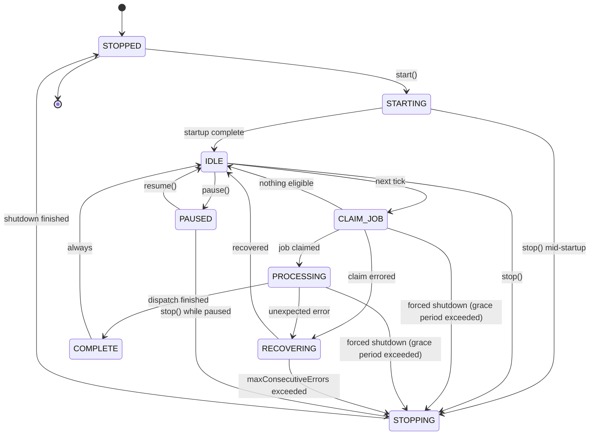
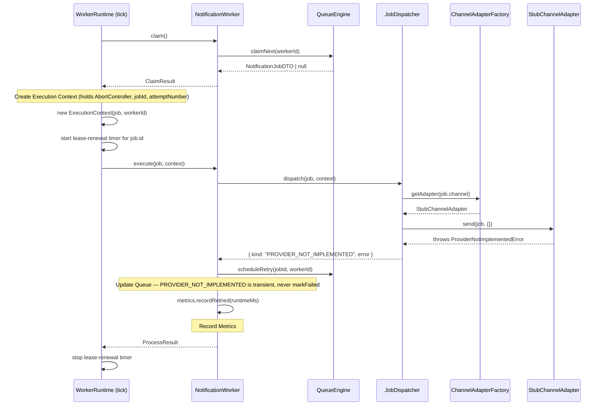
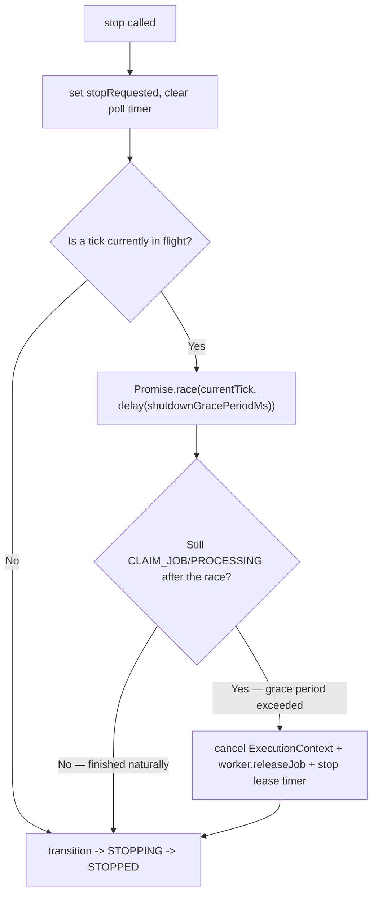

# Notification Worker Runtime Report (Phase 4)

**Scope:** Executing queue jobs — lifecycle, heartbeat, health, metrics, graceful shutdown, lease renewal, provider resolution/dispatch, cancellation, configuration. **No SMTP, no Nodemailer, no Google Drive, no PDF, no template rendering, no business-module integration, no Notification Center UI.** Every registered provider adapter throws `ProviderNotImplementedError`. Verified by `tsc --noEmit` (strict, whole project, zero errors), `eslint` (zero issues), and 129 passing unit tests (zero touching the live database) — including 2 real defects the tests caught and that were fixed, not just tests adjusted to match buggy behavior (see [Testing](#testing)).

**Inputs (frozen, unchanged in behavior by this phase):** [NotificationEngineDesign.md](../design/NotificationEngineDesign.md), [DatabaseImplementationReport.md](DatabaseImplementationReport.md), [MigrationRecoveryReport.md](../audits/MigrationRecoveryReport.md), [NotificationEngineDatabaseAudit.md](../audits/NotificationEngineDatabaseAudit.md), [CoreInfrastructureReport.md](CoreInfrastructureReport.md), [QueueEngineReport.md](QueueEngineReport.md).

---

## Architecture Compliance

Everything lives under `src/lib/services/notification-engine/worker/` — a new sibling to Phase 3's `queue/`, inside the same bounded-context folder Phase 2 established. No new top-level location.

### Disclosed extensions to already-frozen phases (all additive, none change existing behavior)

| Extension | Where | Why |
|---|---|---|
| `renewLease(jobId, workerId)` | `IQueueRepository`, `QueueRepository`, `QueueEngine` (Phase 3) | Phase 3's own report explicitly deferred this: *"the worker that would call it [on a schedule] is not built"* — this phase is that worker. New method only; every existing method on these three types is untouched. Same guarded compare-and-swap pattern as every other transition (`WHERE status='PROCESSING' AND lockedBy=workerId`). |
| `IQueueEngine` interface | `queue/queue-engine.interface.ts` (new file) | Extracted from `QueueEngine`'s already-existing public method shape — no method added, removed, or changed. Necessary because `QueueEngine` has private constructor fields, so TypeScript's structural typing does not let a plain fake object satisfy the class type directly (only an interface). This is what makes "Mock QueueEngine" (this phase's own testing instruction) possible at all. `QueueEngine implements IQueueEngine` is the only change to `queue-engine.ts`. |
| `BaseRepository.wrap()` broadened error passthrough | Already extended once in Phase 3 (`RepositoryError` → `NotificationError`) | Not touched again this phase — mentioned here only because `renewLease`'s error path relies on that Phase 3 fix already being in place. |

### This phase's own new interface, for the same reason

`INotificationWorker` (`worker/notification-worker.interface.ts`) — extracted from `NotificationWorker`'s public shape for the identical reason `IQueueEngine` exists: `WorkerRuntime` depends on the interface (Dependency Inversion), which is what lets `WorkerRuntime`'s own tests use a lightweight fake worker instead of a real dispatch pipeline.

### Enum/state naming: this phase's prompt vs. the frozen Notification Engine

This phase's lifecycle is genuinely new territory — no prior phase defined a worker lifecycle (Phase 3 built only the queue side). The given sequence (`STOPPED → STARTING → IDLE → CLAIM_JOB → PROCESSING → COMPLETE → IDLE → STOPPING → STOPPED`) is implemented as the **repeating happy-path cycle** (`IDLE ↔ CLAIM_JOB ↔ PROCESSING ↔ COMPLETE` loops every tick; `STARTING`/`STOPPING`/`STOPPED` bookend one run — see [Worker Lifecycle](#worker-lifecycle)), plus two states the sequence doesn't show but the required API (`pause()`/`resume()`) and health tracking ("Paused", "Recovering") make necessary: `PAUSED` and `RECOVERING`. Nothing about the **queue's** own state machine (`RETRY_SCHEDULED`, `DEAD_LETTER`, etc. — already frozen in Phase 3) was touched or renamed.

---

## Worker Lifecycle

`WorkerStateMachine` (`worker-state-machine.ts`) is the single authoritative transition table, in the same pure/stateless/table-driven style as Phase 3's `QueueStateMachine`. `WorkerLifecycle` (`worker-lifecycle.ts`) is the stateful tracker — every mutation goes through `transition()`, validated against `WorkerStateMachine` before anything changes, with a bounded transition history for diagnostics. Unlike `QueueStateMachine`, there is **no terminal state**: even `STOPPED` has an outgoing edge (`STARTING`, via `start()`/`restart()`) — a worker runtime, unlike a single job, is designed to run again after stopping.

`CLAIM_JOB -> STOPPING` and `PROCESSING -> STOPPING` exist specifically for Graceful Shutdown's grace-period-exceeded path (see below) — `stop()` always *prefers* letting in-flight work reach its own natural `COMPLETE`/`RECOVERING` first.

---

## Execution Pipeline

Every pipeline step from the prompt (Claim Job → Create Execution Context → Resolve Provider Adapter → Execute Adapter → Update Queue → Record Metrics) maps to exactly one method call above — no step is implicit or hidden inside another.

**Why `PROVIDER_NOT_IMPLEMENTED` (and generic dispatch `FAILURE`) route to `scheduleRetry`, never `markFailed`:** both represent that *something about the current attempt didn't work*, not that *this specific recipient can never receive this notification* — the distinction Design §16 draws between "recipient-level permanent failure" (dead-letter immediately) and everything else (retry). Since no real provider exists yet, every job would otherwise be dead-lettered on its very first attempt, which is wrong — once a real adapter is registered in a future phase, jobs already sitting in `RETRY_SCHEDULED` simply start succeeding on their next attempt, with no queue-draining or manual intervention needed. This is a deliberate, disclosed design decision, not an oversight — see `job-dispatcher.ts`'s and `notification-worker.ts`'s doc comments.

---

## Lease Strategy

Three capabilities, all requested explicitly:

1. **Automatic lease renewal.** `WorkerRuntime` starts a `setInterval` (period: `config.leaseRenewalIntervalMs`, default half of `leaseDurationMs`) the moment a job is claimed, calling `worker.renewLease(jobId)` → `QueueEngine.renewLease` → `QueueRepository.renewLease` (Phase 4's one addition to the frozen queue layer — see Architecture Compliance) — a guarded `UPDATE` that only touches `lockedAt`, keyed on `status='PROCESSING' AND lockedBy=workerId`. The timer is cleared the moment `execute()` settles (success, failure, or cancellation), in both the normal and forced-shutdown paths.
2. **Lease expiration.** Unchanged from Phase 3: `QueueEngine.recoverExpiredLocks` still reclaims any `PROCESSING` row whose `lockedAt` predates `now - leaseDurationMs`. This phase's renewal is what *prevents* a long-running job from ever reaching that threshold while a worker is still genuinely alive and working on it.
3. **Graceful release.** `release(jobId, workerId)` (Phase 3, unmodified) is called by `WorkerRuntime` when a job is cancelled mid-flight during forced shutdown — see below.

---

## Shutdown Strategy

`stop()` implements exactly the three requirements — finish the current job if possible, update queue state correctly, release the lease, exit cleanly:

- **Preferred path:** the in-flight tick reaches its own natural `COMPLETE → IDLE` (or `RECOVERING → IDLE`) before the grace period elapses — the job finishes exactly as it would have, `stop()` simply waits and then transitions to `STOPPING`/`STOPPED`. No job is abandoned unnecessarily.
- **Forced path:** if `shutdownGracePeriodMs` (default 30s) elapses while still `CLAIM_JOB`/`PROCESSING`, the runtime cancels the `ExecutionContext`'s `AbortSignal` (which `JobDispatcher` is already racing the adapter call against — see [Execution Pipeline](#execution-pipeline)), calls `worker.releaseJob(jobId)` (PROCESSING → QUEUED, no attempt penalty, matching Design §5's `release()` semantics exactly), and forces the lifecycle transition to `STOPPING` — the two extra state-machine edges (`CLAIM_JOB -> STOPPING`, `PROCESSING -> STOPPING`) added specifically for this path.
- **Disclosed simplification:** internal races between an in-flight tick and a concurrent forced transition are resolved defensively — `safeTransition()` logs (via the structured logger) rather than throwing if a transition attempt is no longer valid because the other path already moved the state on. This is a best-effort simplification appropriate for a single in-process loop with no concurrent external callers of its own mutating methods (this phase's actual scope), not perfect distributed-systems-grade coordination — stated plainly rather than assumed away.

---

## Heartbeat Strategy

`WorkerHeartbeat` (`worker-heartbeat.ts`) — in-memory only, **no new Prisma model** (this phase makes no schema change, per "architecture is frozen"). Tracks `beatCount` and `lastBeatAt`; `WorkerRuntime` calls `beat()` at the end of every tick (idle, success, or recovered-from-error) and when transitioning into `PAUSED`. `heartbeat()` on the public API returns a snapshot including `isStale` (has it been more than `heartbeatStaleAfterMs` — default 5× the poll interval — since the last beat).

`WorkerHealthMonitor` consumes the heartbeat snapshot specifically to catch the one scenario the lifecycle state alone can't: a loop that *claims* to be `RUNNING` (per its lifecycle state) but hasn't actually ticked in a suspiciously long time — downgraded to `RECOVERING` in that case. `IDLE`/`PAUSED`/`STOPPED` are never downgraded this way — a quiet worker with nothing to do is not unhealthy.

Cross-process visibility (a future dashboard reading heartbeats from multiple worker instances) would need a persisted table — explicitly out of scope, see [Intentionally Postponed](#intentionally-postponed).

---

## Metrics

`WorkerMetricsCollector` (`worker-metrics.ts`) tracks exactly the six figures requested:

| Metric | Recorded by |
|---|---|
| Jobs Processed | Incremented on every terminal outcome for an attempt: success, retry-scheduled, or dead-lettered. **Not** incremented for a cancelled job (released back to `QUEUED` with no penalty — it wasn't actually processed to a conclusion). |
| Jobs Failed | `recordFailure` — reserved for a future phase's use once a real adapter can distinguish outcomes further; not currently called by `NotificationWorker` (its dispatch outcomes route to `recordSuccess`/`recordRetried`/`cancelJob`, never `recordFailure`, since there's no "permanent failure without a retry decision" path yet — see Execution Pipeline). The method exists and is tested; nothing in this phase's dispatch logic calls it yet, which is accurate to the current state of the world, not a gap. |
| Jobs Retried | `recordRetried` — every `PROVIDER_NOT_IMPLEMENTED`/`FAILURE` dispatch outcome. |
| Average Runtime | `totalRuntimeMs / jobsProcessed`, recomputed on every snapshot read. |
| Current Runtime | Time since `startJob()` was called for the in-flight job; `null` when idle. |
| Worker Uptime | Time since the collector was constructed (i.e., since `WorkerRuntime`/`NotificationWorker` were built — not since `start()`, since metrics are meaningful to inspect even before/after a stop/restart cycle within the same process). |

`metrics()` on the public API returns a fresh, computed-on-read snapshot — no stale cached values.

---

## Health Monitoring

The 5 requested categories (`RUNNING`, `PAUSED`, `RECOVERING`, `IDLE`, `STOPPED`) are deliberately coarser than the 9-state `WorkerLifecycleState` — a health check is a simplified, derived view for external consumers, not the internal state machine itself:

| Lifecycle state(s) | Health status |
|---|---|
| `STARTING`, `CLAIM_JOB`, `PROCESSING`, `COMPLETE` (heartbeat fresh) | `RUNNING` |
| any of the above, but heartbeat **stale** | `RECOVERING` (see Heartbeat Strategy) |
| `IDLE` | `IDLE` |
| `PAUSED` | `PAUSED` |
| `RECOVERING` | `RECOVERING` |
| `STOPPED`, `STOPPING` | `STOPPED` |

`WorkerHealthMonitor.resolve(lifecycleState, heartbeatSnapshot)` is a pure function — no I/O, no mutation, fully unit-testable in isolation (14 tests cover every mapping and the stale-heartbeat downgrade).

---

## Public API

All 9 requested methods, on `WorkerRuntime`:

| Method | Behavior |
|---|---|
| `start()` | `STOPPED` only (throws otherwise) → `STARTING` → `IDLE`, schedules the first tick. |
| `stop()` | See [Shutdown Strategy](#shutdown-strategy). Idempotent — a no-op if already `STOPPED`. |
| `pause()` | Immediate if `IDLE`; otherwise takes effect at the next safe boundary (never abandons an in-flight job, unlike `stop()`'s forced path). |
| `resume()` | `PAUSED` → `IDLE`, resumes ticking. No-op if not currently paused. |
| `restart()` | `stop()` then `start()`, sequentially. |
| `status()` | Returns the current `WorkerLifecycleState` (all 9 values). |
| `health()` | Returns the current `WorkerHealthStatus` (5 values) — see Health Monitoring. |
| `metrics()` | Returns a `WorkerMetricsSnapshot` — see Metrics. |
| `heartbeat()` | Returns a `WorkerHeartbeatSnapshot` — see Heartbeat Strategy. |

Constructed via `new WorkerRuntime(worker, metricsCollector, config, logger?)`, depending only on `INotificationWorker` (interface). `createWorkerRuntime(queueEngine, configInput, logger?)` (`create-worker-runtime.ts`) wires a complete, ready-to-use instance the same manual-constructor-injection way Phase 2/3 built `createNotificationEngineContainer` — registers all 8 `StubChannelAdapter`s, builds the `JobDispatcher`, `NotificationWorker`, and `WorkerRuntime`. **Constructing a runtime does not start it** — see Intentionally Postponed.

---

## Structured Worker Logging

No `console.log` anywhere in this phase's code (grep-verified). Reuses Phase 3's `IQueueLogger`/`NoopLogger` (`queue/logger.interface.ts`) directly rather than defining a near-identical duplicate — the contract ("structured event name + context object") is already channel-agnostic and fits worker events (`worker.starting`, `worker.job_claimed`, `worker.shutdown_grace_period_exceeded`, etc.) exactly as well as it fits queue events. Every constructor in this phase defaults its logger to `NoopLogger`, so nothing is required to construct or test any of these classes.

---

## Execution Context

`ExecutionContext` (`execution-context.ts`) — created once per claimed job, carrying `jobId`, `workerId`, `channel`, `attemptNumber` (`job.attemptCount + 1`), `startedAt`, and cancellation state. Deliberately **constructed by `WorkerRuntime`**, not internally by `NotificationWorker.execute()` — the only way `stop()` can hold a reference to it *while* a job is still mid-flight (needed to call `.cancel()` during forced shutdown) is if the caller creates it before awaiting `execute()`, not after.

---

## Cancellation Support

Uses the standard built-in `AbortController`/`AbortSignal` — **no new dependency**, and **no change to Phase 2's frozen `NotificationChannelAdapter.send(job, content)` signature**. `JobDispatcher.dispatch` races the adapter's promise against `context.signal` itself (`raceAgainstCancellation`), rather than threading the signal into the adapter call — so a future real adapter (SMTP, etc.) implementing that same frozen interface doesn't need to change to support cancellation; the dispatcher handles it externally. `NotificationWorker.execute` reacts to a `CANCELLED` dispatch outcome by calling `queueEngine.release` (no attempt penalty) rather than `scheduleRetry`/`markFailed` — a cancelled job is neither a failure nor a used attempt, it was simply abandoned cleanly (see Metrics for why it isn't counted as "processed").

---

## Provider Adapter (abstraction only, per this phase's explicit instruction)

- **No SMTP.** `StubChannelAdapter` (`channel-adapters/stub-channel.adapter.ts`) is one generic class, parameterized by `NotificationChannel`, implementing Phase 2's frozen `NotificationChannelAdapter` interface — its `send()` always throws `ProviderNotImplementedError`. One generic class rather than 8 near-identical per-channel classes, since there is no per-channel logic yet to differentiate (DRY).
- `registerStubChannelAdapters(factory)` registers one `StubChannelAdapter` per `NotificationChannel` enum value (all 8, including `IN_APP_ADMIN`/`IN_APP_EMPLOYEE` — none are implemented yet either) into a `ChannelAdapterFactory` (Phase 2, previously empty — *"nothing in this phase registers to it yet"*; this phase is that later registration point).
- `ProviderNotImplementedError` (`worker/errors/provider-not-implemented.error.ts`) extends Phase 2's already-frozen `ProviderError` additively, same disclosed-extension pattern Phase 3 used for its own error subclasses.

---

## Worker Configuration

`WorkerConfig` (`worker-config.ts`): `workerId`, `pollIntervalMs`, `leaseDurationMs`, `leaseRenewalIntervalMs`, `heartbeatStaleAfterMs`, `maxConsecutiveErrors`, `shutdownGracePeriodMs`. Defaults derive from the same `NOTIFICATION_ENGINE_DEFAULTS` constants Phase 2/3 already established (`worker.pollIntervalSeconds`, `queue.defaultLeaseDurationMs`) rather than introducing a second, possibly-drifting set of numbers. `resolveWorkerConfig(partial)` merges caller overrides over the defaults, requiring only `workerId`.

---

## Future SMTP Integration

The seam is exactly `ChannelAdapterFactory.register()` (Phase 2, unused until this phase's stub registration) — a future phase implements a real `EmailChannelAdapter` (SMTP via `nodemailer`, matching `email.service.ts`'s existing config-resolution pattern per Design §9) and calls `factory.register(new EmailChannelAdapter(...))` **instead of** (or in addition to, keyed by channel) the stub currently registered for `EMAIL`. Nothing else changes:

- `JobDispatcher` already resolves whatever adapter is registered for a job's channel — it has no knowledge of *which* adapter, stub or real.
- `NotificationWorker`'s outcome handling already branches correctly: a real send success still hits the `SUCCESS` branch; a real, genuine per-recipient failure (invalid address, etc.) would need a *new* dispatch-outcome case (today only `SUCCESS`/`PROVIDER_NOT_IMPLEMENTED`/`CANCELLED`/`FAILURE` exist, and `FAILURE` currently routes to retry) — distinguishing "permanent recipient-level failure" from "transient provider failure" for a *real* adapter is explicitly future work (Design §10's error classification), not something this phase's dispatch logic needs yet since nothing can produce that distinction today.
- `WorkerRuntime`'s lifecycle/heartbeat/metrics/shutdown/lease-renewal machinery needs zero changes — it was built channel-agnostic from the start.

---

## Intentionally Postponed

| Item | Why |
|---|---|
| Wiring `WorkerRuntime` into `instrumentation.ts` / actually calling `.start()` anywhere | Not explicitly forbidden this phase (unlike Phase 3, whose STOP list named it), but also not explicitly requested — and doing so would make the runtime actually poll the live database and attempt real work in production immediately, for zero benefit (every job would just retry forever against `ProviderNotImplementedError`, since no business module raises real events yet either — `NotificationService.raiseEvent` is still a Phase 2 stub). `createWorkerRuntime` and the container's `workerRuntime` singleton are fully constructed and ready; nothing calls `.start()`. |
| SMTP / Nodemailer / real email sending | Explicitly forbidden. |
| Google Drive / PDF generation | Explicitly forbidden. Untouched since Phase 2. |
| Template rendering | Explicitly forbidden. `JobDispatcher` passes an empty `{}` as rendered content, matching Phase 2's all-optional interface. |
| Notification Center UI | Explicitly forbidden. No `src/app/`, `src/components/`, or Server Action file was touched. |
| Business-module integration | Explicitly forbidden. No existing action file was touched. |
| Distinguishing "permanent recipient-level failure" vs. "transient provider failure" for a *real* adapter | Impossible to build correctly without a real adapter to observe failure modes from — explicitly future work, see [Future SMTP Integration](#future-smtp-integration). |
| Cross-process/persisted heartbeat & worker registry (for a future multi-worker dashboard) | Would need a new Prisma model — explicitly out of scope ("architecture is frozen," no schema change this phase). |
| A `WorkerMetricsCollector.recordFailure` caller | The method exists and is tested, but nothing in this phase's dispatch logic has a code path that should call it yet (see Metrics) — reserved for the real-adapter phase above. |

---

## Testing

129 tests, 0 failures, across 10 files (6 new pure/isolated-unit files in `queue/`'s sibling `worker/` folder, plus Phase 3's existing 4 unchanged) — run via the same zero-new-dependency `pnpm test` setup Phase 3 established (`tsc -p tsconfig.test.json && node --test .../{queue,worker}/*.test.js`), extended to also compile/run `worker/**/*.ts`.

| File | What it covers | Mocking approach |
|---|---|---|
| `worker-state-machine.test.ts` | Every allowed/disallowed transition for all 9 states, "no dead ends" property | Pure — no mocks |
| `worker-lifecycle.test.ts` | Valid/invalid transitions, history bounding, `QueueError` on violation | Pure — no mocks |
| `worker-heartbeat.test.ts` | Beat counting, staleness threshold, uptime tracking | Injectable fake `IClock` |
| `worker-health-monitor.test.ts` | Every lifecycle→health mapping, stale-heartbeat downgrade, non-downgrade of idle/paused/stopped | Pure — no mocks |
| `worker-metrics.test.ts` | Every recording method, average computation, cancellation not counted as processed | Injectable fake `IClock` |
| `job-dispatcher.test.ts` | Success, provider-not-implemented (both empty-factory and stub-registered), generic failure, cancellation before and during dispatch | **Mock Provider Adapter** (a hand-written `NotificationChannelAdapter`), real `ChannelAdapterFactory` |
| `notification-worker.test.ts` | `claim`/`execute`/`processNext`/`renewLease`/`releaseJob`, correct routing to `complete`/`scheduleRetry`/`release` (never `markFailed`) per outcome | **Mock QueueEngine** (implements `IQueueEngine`), real `JobDispatcher` + mock adapter |
| `worker-runtime.test.ts` | start/stop/pause/resume/restart, repeated polling, graceful vs. forced shutdown, lease renewal cadence, consecutive-error auto-stop, health/metrics/heartbeat readback | Fake `INotificationWorker` (isolates lifecycle/loop logic from dispatch correctness, already covered above) |

**Two real defects the test suite caught and that were fixed in the source, not papered over:**
1. `JobDispatcher` only recognized the specific `ProviderNotImplementedError` subclass, not the generic `ProviderError` an entirely-unregistered channel throws (`ChannelAdapterFactory.getAdapter` on an empty factory) — both represent the same "provider infrastructure isn't ready" class of problem and now both route to retry consistently.
2. `WorkerRuntime.tick()` trusted `INotificationWorker.claim()`'s contract (never throws) with no safety net — a real risk for a background loop, where an unexpected throw inside a `setTimeout` callback should never go unhandled. Added a defense-in-depth `try/catch` around the claim call specifically; the test suite now covers both the contract-compliant `CLAIM_ERROR` path and the defensive fallback explicitly.

No test writes to the live database — `IQueueEngine`/`INotificationWorker`/`NotificationChannelAdapter` are the three abstraction points every fake/mock in this suite is built against, exactly matching this phase's explicit testing instruction ("Mock QueueEngine. Mock Provider Adapter. Do not touch the database.").
